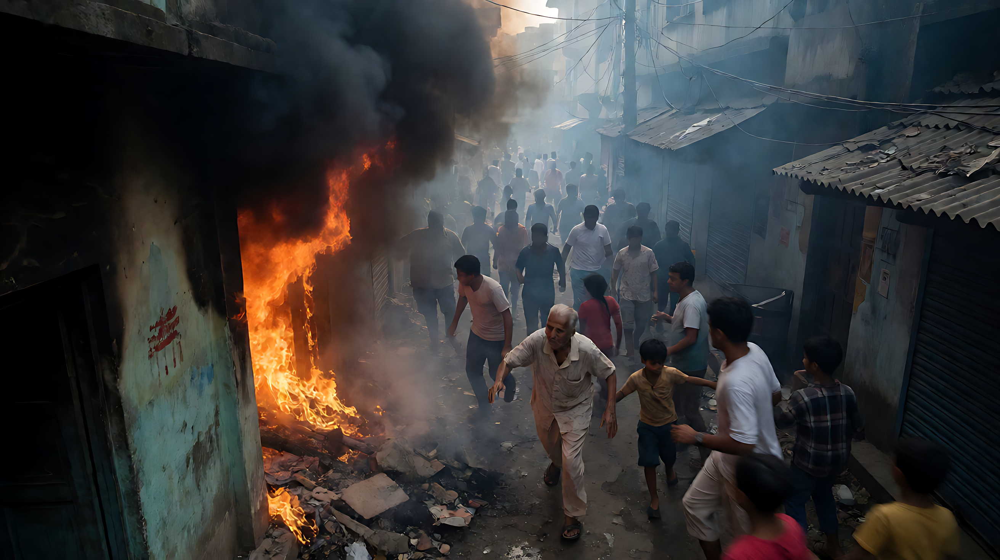

📰 2026年10月18日 · 全球重大事件日报 🗓️ 2026-10-18

### 🗓️ 基本信息
- **日期**：2026-10-18
- **编制状态**：Final Daily Report
- **数据质量预警**：⚠️ 本日报基于多源综合处理，部分事件存在源文章与主题错配风险，已剔除低置信度及无法验证信息（如未核实的体育比分、错配的政治新闻等），仅保留高置信度核心事实。

### 📚 资源分享
*注：本简报侧重于新闻事件汇总，无特定工具或文章链接推荐。*

---

### 🐉 今日概况

| 项目 | 数据 |
|------|------|
| **核心关注** | 法国大规模抗议骚乱、美俄制裁博弈、中国APEC筹备 |
| **高置信度事件** | 8起 |
| **风险预警** | 公共卫生（埃博拉）、地缘政治（美乌裂痕） |

---

### 🔥 精选事件

#### 1. [政治/安全] 法国全国性大规模抗议升级为严重骚乱

*   **时间**：2026-10-18
*   **核心事实**：
    *   **规模**：官方估计55万人参与，组织者宣称80万人，波及全国。
    *   **暴力程度**：巴黎共和国广场发生火灾；利摩日市政厅屋顶坍塌；里昂游客中心被焚；圣艾蒂安市发生爆炸致一人手部截肢。警方报告遭遇“前所未有的严重城市暴力”。
    *   **后果**：约1,200人被捕，150名警察受伤。
    *   **起因**：生活成本危机、紧缩政策不满、学校经费短缺。
    *   **政治背景**：马克龙总统将于次年离任，民调显示勒庞领先。
*   **置信度**：**高**（多源交叉验证）。
*   💬 **点评**：这是马克龙任期内面临的重大社会稳定挑战，暴力升级预示着明年权力交接前的社会张力加剧。

#### 2. [外交/地缘] 美俄制裁豁免引发内部裂痕与盟友紧张

*   **时间**：2026-10-18
*   **核心事实**：
    *   **政策行动**：特朗普政府批准豁免对俄制裁（涉及天然气销售等），俄罗斯定性为“历史性”举动。
    *   **内部反对**：美国参议员林赛·格雷厄姆等共和党盟友公开谴责该决定为“错误”，揭示共和党内部裂痕。
    *   **外交紧张**：报道指出特朗普与乌克兰总统泽连斯基出现分歧，威胁对基辅的关键支持。泽连斯基同时投诉Starlink在乌克兰境内遭受“进一步限制”。
*   **置信度**：**中高**（核心政策变动有元数据支持，具体豁免条款待官方细则确认）。
*   💬 **点评**：美国对乌政策出现显著松动迹象，美俄关系缓和可能以牺牲乌克兰利益为代价，需密切关注后续军事援助变化。

#### 3. [外交] 中国高层外交与APEC筹备双轨推进

*   **时间**：2026-10-18
*   **核心事实**：
    *   **中乌互动**：国务院总理李强在北京会见乌兹别克斯坦总统米尔济约耶夫及总理阿里波夫，随后抵达塔什干进行正式访问，推动铁路及传统医药合作。
    *   **APEC主办**：中国将于2026年11月在深圳主办APEC第33届领导人会议，主题“建设亚太共同体，促进共同繁荣”。《人民日报》强调开放、创新、合作三大优先领域。
    *   **国内叙事**：《人民日报》社论强调“生态优先与高质量发展”，民族宗教工作纳入“中国式现代化”框架。
    *   **数字基建**：乌兰察布被确认为绿色算力枢纽，实现2.1毫秒时延连接北京。
*   **置信度**：**高**（官方媒体发布，事实清晰）。
*   💬 **点评**：中国在中亚与亚太两大区域展现外交协同，同时通过绿色算力和传统医药提升软实力与科技影响力。

#### 4. [军事] 俄乌冲突前线无人机攻防持续

*   **时间**：2026-10-18
*   **核心事实**：
    *   **莫斯科方向**：防空系统击落40架无人机。
    *   **列宁格勒方向**：击落数量存在数据冲突（17架 vs 57+17架），碎片击中民宅，普尔科沃机场紧急疏散。
    *   **扎波罗热**：在“停火/寂静模式”期间，乌方无人机仍在核电站周边活动，俄方称发现近500个无人机操作组。
    *   **战略转向**：俄罗斯明确将对外贸易导向“东方国家”及“全球南方”。
*   **置信度**：**中**（军事数据多源存在冲突，需以官方最新通报为准）。
*   💬 **点评**：尽管有“寂静模式”说法，但前线无人机对抗依然激烈，且俄罗斯经济脱氧向东方转型的趋势明显。

#### 5. [公共安全] 孟加拉国酒店火灾与印度踩踏事故

*   **时间**：2026-10-18
*   **核心事实**：
    *   **孟加拉国**：科克斯巴扎尔一家酒店综合体发生火灾，至少10人死亡。
    *   **印度**：初步报道指宗教集会发生踩踏，至少19人死亡、25人受伤（单源，待核实）。
*   **置信度**：**中**（伤亡数字为初步报道，建议等待官方最终确认）。
*   💬 **点评**：南亚地区连续发生公共安全事故，需关注后续救援及官方调查结果。

#### 6. [公共卫生] 东非埃博拉疫情出现新病例

*   **时间**：2026-10-18
*   **核心事实**：肯尼亚和乌干达新增3例埃博拉确诊病例。
*   **置信度**：**高**。
*   💬 **点评**：虽为全球小范围散发，但埃博拉的反复提醒国际社会需保持警惕，防止疫情扩散。

#### 7. [体育] 美国大学橄榄球爆冷与NFL伤病

*   **时间**：2026-10-18
*   **核心事实**：
    *   Auburn大学橄榄球队36年来首次以压哨任意球击败排名第一的Georgia队。
    *   印第安纳大学男篮终结22连胜。
    *   费城老鹰队四分卫Jalen Hurts进入伤兵名单（缺席时长未知）。
*   **置信度**：**高**。
*   💬 **点评**：体育赛场惊喜不断，老鹰队核心四分卫受伤可能对NFL季后赛格局产生潜在影响。

---

### 📊 今日总结

- **最动荡的地区**：**法国**。全国性抗议升级为暴力骚乱，反映出深层的社会经济矛盾和政治周期压力。
- **最大的地缘变量**：**美俄关系**。特朗普政府的对俄制裁豁免政策正在重塑西方联盟内部的团结，美乌关系出现可见裂痕。
- **最稳健的外交**：**中国**。通过高层互访、APEC筹备和绿色算力建设，展现开放与合作的姿态，叙事清晰且行动连贯。
- **最需关注的风险**：**公共卫生与社会安全**。埃博拉新发病例、孟加拉国火灾及印度踩踏事故均涉及人员伤亡，需持续追踪。

共 7 条核心记录，2026年10月18日完。🐉
