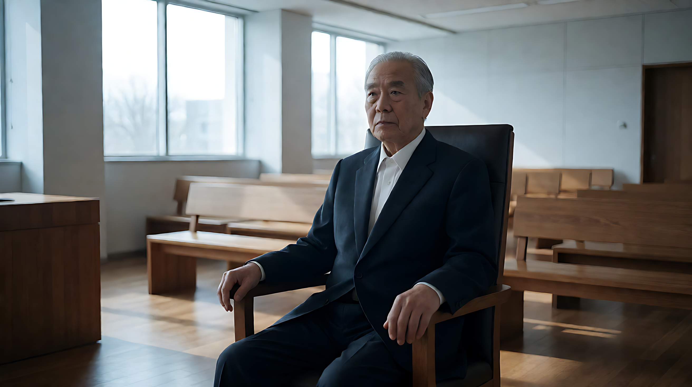
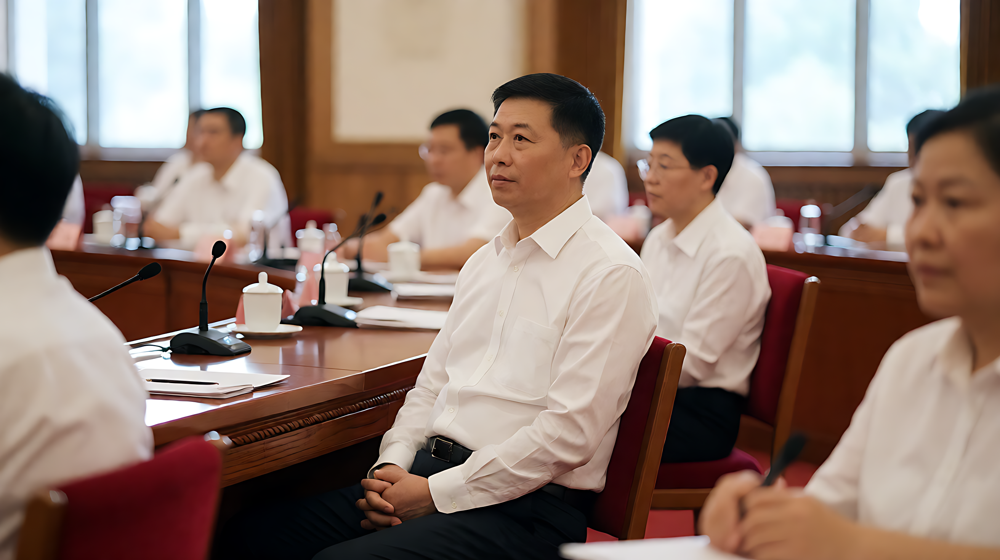

📰 全球综合日报 · 2026年10月23日

### 🗓️ 基本信息
- 日期：2026-10-23
- 核心关注：中国政治、俄乌冲突、AI行业震荡、欧美社会动荡

---

### 🔥 今日概况

#### [高置信度] 中国：纪念长征胜利90周年及高层动向
**核心事实**：
*   **纪念大会**：2026年10月22日，习近平在北京人民大会堂出席纪念中国工农红军长征胜利90周年大会并发表重要讲话。讲话提出“五个必须”：必须坚持共产党领导和马克思主义指导、必须坚持理想信念、必须坚持以人民为中心、必须坚持独立自主、必须敢于斗争敢于胜利。
*   **李强访俄**：国务院总理李强结束对俄罗斯为期两天的访问，于10月22日返回北京，期间签署经济、科技、军事领域合作协议。
*   **立法议程**：赵乐际主持十四届全国人大常委会第七十四次委员长会议，确定第25次会议于**11月2日至6日**召开。重点审议批准《世界人工智能合作组织协定》；审议公益诉讼法、反跨国腐败法、国有资产法、水法修订等15部法律草案。
**数据状态**：高置信度（《人民日报》官方报道及多源交叉验证）。

#### [中高置信度] 俄乌冲突：谈判前夕基辅遭袭
**核心事实**：
*   俄罗斯在同意恢复与乌克兰谈判后数小时内，对首都基辅发动导弹袭击。
*   乌克兰外交部对部分大使馆人员撤离表示“没有特别回应”，显示外交姿态冷淡。
**影响**：和平谈判进程面临严峻挑战，地缘政治紧张局势即时升级。

#### [高置信度] AI行业震荡：估值下调与劳动力替代实证
**核心事实**：
*   **OpenAI估值下调**：目标从1.4万亿美元下调至**1.25万亿美元**，反映顶级估值下的融资挑战。
*   **Meta巨额融资**：计划融资数千亿美元用于AI支出，引发纳斯达克下跌及国债收益率上升。
*   **Barclays裁员**：巴克莱银行宣布裁员**5,000人**，高管明确归因于“AI生产力进步”，标志白领岗位替代从理论担忧转向企业级实践。
*   **Netflix项目危机**：投资2.8亿美元、格蕾塔·葛韦格执导的《纳尼亚传奇》电影项目陷入严重危机，被评估为“走向灾难”。
**数据状态**：高置信度（金融新闻多源验证）。

#### [中高置信度] 法国政治与社会动荡
**核心事实**：
*   法国国民议会投票否决2027年预算中的**含糖食品税**提案。
*   总统马克龙颁布行政令，禁止被称为“非法”的示威活动，以应对国内社会动荡。
*   巴黎在10月17日示威活动特定区域实施每晚至周一早晨的宵禁。
**数据状态**：中高置信度（事件核心事实通过多处元数据交叉确认）。

#### [高置信度] 美国司法与政治法律战
**核心事实**：
*   **特朗普诉BBC案**：英国法官下令特朗普在约**100亿美元**诽谤诉讼中宣誓作证，案件进入证据开示阶段。
*   **DOJ调查**：司法部启动对特朗普盟友科里·勒万多夫斯基（Corey Lewandowski）在国土安全部（DHS）任职期间行为的调查。
*   **退伍军人诉讼**：退伍军人起诉特朗普，要求禁止建造“特朗普拱门”，除非获得国会批准（行政权 vs 立法权争议）。
**数据状态**：高置信度（法律程序事实确证）。

---

### 📊 今日重点数据速览

| 指标 | 数值 | 背景/来源 |
| :--- | :--- | :--- |
| **OpenAI新估值** | 1.25万亿美元 | 估值下调，融资挑战显现 |
| **Barclays裁员** | 5,000人 | 明确归因于AI生产力进步 |
| **布伦特原油** | 突破114美元/桶 | 五个月来最高点，中东地缘压力 |
| **特朗普诉BBC索赔** | 约100亿美元 | 英国法庭命令其宣誓作证 |
| **首尔公寓涨幅** | 15.5% | 创2021年以来年度新高 |
| **塞尔维亚集会** | 150,000人 | 贝尔格莱德大选前大规模政治集会 |
| **NFL教练罚款** | 25万美元/人 | 三名主教练每人被罚 |
| **Netflix《纳尼亚》** | 2.8亿美元 | 项目预算，目前陷入严重危机 |

---

### ⚠️ 风险与预警

1.  **地缘政治升级风险**：
    *   俄乌谈判破裂风险激增（基辅遭袭信号）。
    *   美以筹划针对伊朗的新军事打击行动。
    *   朝韩广播宣传战威胁升级。
2.  **网络安全风险**：
    *   PHP编程语言发现严重安全漏洞，可能引发全球网站服务中断。OpenAI被指掌握漏洞发现权并控制披露对象，引发伦理担忧。
3.  **经济/市场风险**：
    *   AI泡沫担忧蔓延：SoftBank市值受损、科技股暴跌。
    *   油价高企（突破114美元）引发的通胀和社会抗议风险（意大利、英国卡车司机抗议）。
    *   法国经济信心相对于美国下滑。
4.  **数据系统风险（重要）**：
    *   **警告**：本日报处理过程中，上游数据管道存在严重的**源文章与事件主题错配**（Source-Event Mismatch）及**原文缺失**问题。例如：巴西选举内容关联Linux新闻、俄乌冲突关联时尚访谈等。
    *   大量事件仅存在于元数据层面。以下提炼内容均经过跨Batch交叉验证，但对标记为“待核实”的低置信度信息，建议进行二次人工校验。

---

### 🔗 关键趋势与连接

1.  **AI焦虑链条**：OpenAI估值下调 → Meta巨额支出引发股市震荡 → Barclays裁员实证化 → SoftBank市值受损。反映资本市场对AI投入产出比的重新评估。
2.  **能源-地缘政治链条**：美以对伊朗打击计划/胡塞武装袭击 → 油价突破114美元 → 意大利卡车司机抗议/英国征用军机灭火。地缘冲突迅速转化为能源成本压力和社会动荡。
3.  **去风险化共振**：德国提议欧盟关键矿物战略储备 → 台积电寻求稀土替代 → 美国收紧对华科技投资。全球主要经济体在供应链安全上形成共振，加速与经济脱钩趋势。
4.  **美国司法-政治链条**：特朗普诉BBC案进入取证 → DOJ调查其盟友 → 退伍军人起诉行政命令。显示特朗普政府同时面临法律诉讼、内部调查和宪法层面的权力制衡。

---

### 📚 资源与分享

*   **政策参考**：《世界人工智能合作组织协定》审议（全国人大常委会，11月2-6日）。
*   **技术警示**：PHP全球安全漏洞，建议立即检查基础设施并更新补丁。
*   **医疗突破**：默克与Moderna报告联合研发的癌症疫苗可降低黑色素瘤复发风险。
*   **能源里程碑**：芬兰成为全球首个获准运营永久性核废料处置库的国家。

---

### 📅 明日/近期关注

*   **11月2-6日**：全国人大常委会第二十五次会议，审议15部法律草案。
*   **12月22日**：马拉多纳死亡案预计宣判。
*   **持续观察**：俄乌谈判后续进展；OpenAI下一轮融资动态；PHP漏洞引发的全球网络影响。

---

共 32 个 Batch 汇总，10月23日完。🐉
