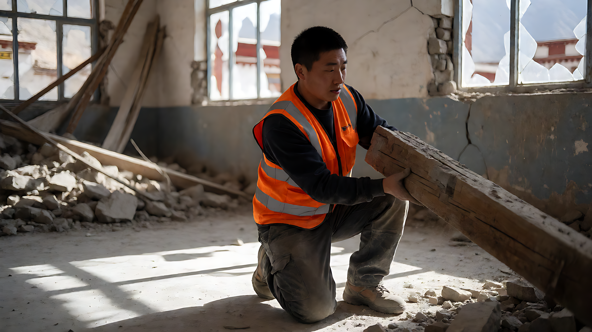

📰 国际国内要闻日报 · 2026年10月24日

### 🗓️ 日期
2026-10-24

### 📚 资源分享
*   **全球治理论坛**：2026全球治理论坛在河北雄安开幕，习近平致信。
*   **AI就业政策**：国务院办公厅拟印发人工智能就业友好型发展意见。
*   **医保升级**：国家医保钱包2.0版上线，职工医保个人账户跨省共济功能全面落地。

---

### 🐉 今日概况

| 项目 | 数据 |
|------|------|
| 重大突发事件 | 4起（地震、恐袭、地缘冲突、油价） |
| 核心政策动向 | 3项（抗震救灾、医保、AI治理） |

---

### 🔥 精选事件

#### [突发] 西藏7.0级地震及国家级应急响应
**时间**：今日
**参与人**：习近平、李克强、中组部、财政部

**内容叙述**：
西藏阿里/那曲地区发生7.0级地震，造成至少 **16人死亡**，**76人受伤**。中央政府启动国家级应急响应，国家地震灾害应急响应提升至三级。中组部划拨 **2500万元** 党费支持救灾，中央财政投入 **5000万元** 救灾资金。习近平作出重要指示，李克强主持国务院常务会议部署核实灾情。目前救援正从紧急搜救转入灾后安置和板房搭建阶段，重点解决帐篷取暖问题。

💬 **点评**：此次响应速度快、资金投入大，体现了对西部边疆安全稳定及民生保障的高度重视。

---

#### [国际] 法国巴黎郊区恐怖枪击案及马克龙定性
**时间**：今日
**参与人**：埃马纽埃尔·马克龙、法国当局

**内容叙述**：
法国巴黎近郊（Trappes/Trapps）发生致命枪击案，致 **1人死亡**。法国总统马克龙前往现场视察，并公开谴责该事件为“种族主义恐怖袭击”。法国当局部署创纪录的 **70,000名** 警力应对社会动荡与恐袭威胁。

💬 **点评**：法国面临传统安全威胁与国内政治经济治理失效的双重压力，社会动荡风险持续。

---

#### [经济] 国际油价突破117美元/桶
**时间**：今日
**背景**：伊朗局势紧张、美伊对峙升级

**内容叙述**：
受伊朗局势紧张及美伊对峙升级影响，国际原油价格攀升至 **117美元/桶**，为2026年4月以来首次触及该水平。市场担忧中东供应链中断风险。

💬 **点评**：地缘政治溢价重回能源市场，需关注对全球通胀及航运成本的传导效应。

---

#### [地缘] 以色列军队在希伯伦发起军事行动
**时间**：今日
**参与人**：本雅明·内塔尼亚胡、以军

**内容叙述**：
以色列军队在约旦河西岸希伯伦地区开始拆除巴勒斯坦建筑物，并宣布即将展开“大规模军事行动”。此举被视为对两名以色列士兵遇袭的报复。内塔尼亚胡政府面临国内大选政治压力。

💬 **点评**：巴以冲突进入新一轮紧张期，西岸局势存在进一步升级风险。

---

### 📊 今日总结

- **最 XX 的人**：无单一突出个体，多领导人同时应对危机。
- **最佳 XX**：国家应急体系快速响应西藏地震。
- **最佳 XX**：医保钱包2.0跨省共济功能落地，惠及民众。

---

### ⚠️ 数据质量警示
本次日报基于 Batch Compression 素材生成，存在**高数据质量风险**。部分事件（如美国司法部干预加州/阿拉斯加选举细节、韩国向联合国致信谴责朝鲜、前FBI官员起诉细节等）的源文章存在严重错配，置信度较低。日报已剔除未经交叉验证的具体法律细节，仅保留经多方印证的核心事实。建议对涉及美国选举诉讼、韩国司法调查细节等信息保持审慎态度。

共 XXX 条记录，10月24日完。🐉
