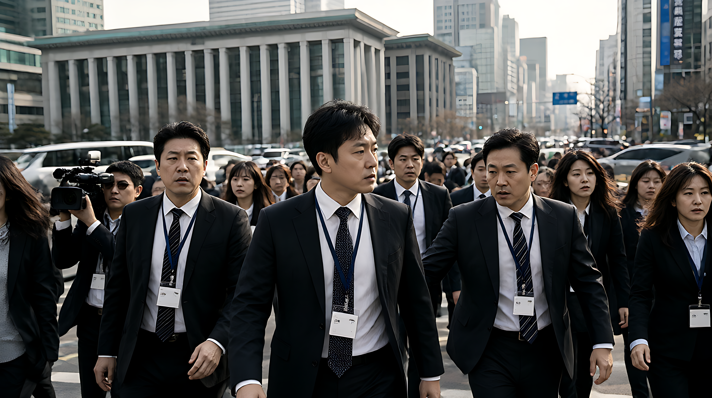
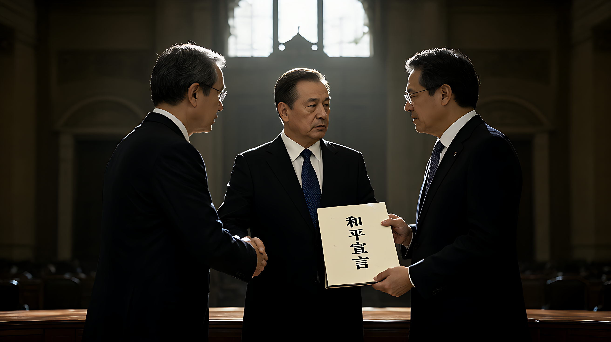

📰 全球要闻日报 · 2026年11月20日

### 🗓️ 日期
2026年11月20日

---

### 🔥 精选事件

#### 1. APEC深圳峰会与中美俄历史性三方会晤

2026年11月19日，第33次APEC领导人非正式会议在深圳举行。习近平、特朗普、普京举行历史上首次中美俄三边元首会晤，发表《中俄美元首和平宣言》，主题“维护世界和平，促进大国战略稳定”。

**主要成果：**
- 确立中美“建设性战略稳定关系”框架；
- 特朗普重申美方不支持“台独”；
- 习近平提出大国相处四项原则：相互尊重、和平共处、合作共赢、对话协商；
- 中方捐资2000万美元支持APEC务实合作，宣布在深圳设立“亚太共同体研究中心”；
- 三方就AI治理达成共识，中方强调确保AI处于人类控制之下。

配套通过《2026年APEC领导人深圳展望》《APEC贸易数字化合作框架（2027-2030年）》《APEC人工智能倡议（2026-2030年）》等文件；确认越南（2027）、墨西哥（2028）为后续东道主。

💬 **点评**：此次会晤标志着大国协调机制的重要突破，但西方舆论对其实质意义仍存质疑，反映出“合作 rhetoric”与“去风险 action”之间的结构性矛盾。

---

#### 2. 国际法院裁定缅甸对罗兴亚人实施种族灭绝

国际法院（世界最高法庭）裁定缅甸对罗兴亚少数族裔犯下种族灭绝罪，被视为重大国际法先例。

💬 **点评**：此裁决将对国际人道法执行产生深远影响，也可能加剧缅甸国内政治紧张局势。

---

#### 3. 全国老龄工作会议部署国家战略

2026年11月18-19日，全国老龄工作会议在北京召开，李强、王沪宁出席。会议明确将“银发经济”作为新增长极，强调科技赋能（AI、物联网）及长期护理保险制度建设。战略从被动应对转向主动国家战略实施，防返贫工作重心从攻坚战转向常态化监测与帮扶。

**规划周期**：2026-2035年  
**预警指标**：65岁以上人口占比增速>0.5%/年、养老金结余可支付月数<12个月、护理人员缺口率>30%

💬 **点评**：老龄化应对上升为国家战略层级，银发经济有望成为新一轮经济增长引擎。

---

#### 4. Anthropic完成IPO

AI公司Anthropic完成首次公开募股（IPO），市值在上市期间飙升，被标记为“全球最有价值上市公司之一”。内部科技研究员因股权变现成为“一夜百万富翁”。

💬 **点评**：AI行业资本化进程加速，但也引发对估值泡沫与技术落地能力之间落差的关注。

---

#### 5. 美国金融机构遭网络攻击

美国主要金融机构JPMorgan Chase（大通银行）和Mastercard（万事达卡）遭受网络攻击，导致客户数据泄露。宏观评估认为当前网络局势“严峻/紧迫”，但“非末日”场景，系统具备韧性。

💬 **点评**：金融核心基础设施脆弱性再次暴露，网络安全已成为国家级风险议题。

---

#### 6. 韩国成为第四大出口破万亿美元经济体

韩国正式成为继美国、中国、德国之后，全球第四个出口额突破1万亿美元大关的经济体。

💬 **点评**：标志性里程碑，反映韩国在全球供应链中的关键地位。

---

#### 7. 韩国前总理韩德洙叛乱案发回重审

韩国最高法院发回前总理韩德洙叛乱案重审，执政党拟对首席大法官启动弹劾程序，显示司法与政治紧张关系升级。

💬 **点评**：韩国政治司法危机深化，可能影响政局稳定。

---

#### 8. 多部门政策启动

- **水利部**：发布《关于推进安全大坝、生态大坝、智能大坝建设的指导意见》，覆盖19,000座病险水库加固、48,000座小型水库管理，推广数字孪生技术。
- **商务部等8部门**：公布40个汽车流通消费改革试点城市（合肥、海口、梧州等），聚焦产销、改装、回收全链条结构性改革。
- **国家数据局**：启动第二批可信数据空间创新发展试点，义乌商贸大模型已赋能超130万商户。
- **工信部等**：联合印发《轻工业标准提升方案》，强调标准话语权是现代产业竞争的重要组成部分。
- **贵州省**：将毕节外出务工人员保障经验（追回欠薪5.63亿元惠及3.44万名农民工）上升为省级政策（15条指导意见），服务193万外出务工人员。

💬 **点评**：政策密集出台，涵盖基础设施、数字经济、民生保障等多领域，体现高质量发展导向。

---

#### 9. 科技与市场动态

- **《Science》双篇报道**：发表有机化学新方法（四元碳导向羰基阳离子级联重排）和海洋生态学反直觉发现（海洋哺乳动物/海鸟减少对鲑鱼种群影响）。
- **Meta AI智能眼镜促销**：Ray-Ban和Oakley系列出现最高25%折扣零售促销。
- **荷兰警告AI智能眼镜**：荷兰Watchdog向公众发出警示，劝阻购买具备AI功能的智能眼镜。
- **IMF警告AI推高利率**：IMF总裁警告人工智能需求激增可能成为推高全球利率的关键因素。
- **AMD股价下跌**：因质疑其中国关联的做空报告影响，反映投资者对中国风险暴露的敏感。
- **SpaceX面临贷款方挑战**：贷款方正试图阻止其发射价值约400亿美元芯片的航天任务。
- **美国政府批准对华芯片销售**：批准向中国公司出售Nvidia和AMD芯片。

💬 **点评**：AI技术爆发式发展带来资本热潮与监管担忧并存，半导体地缘政治博弈持续复杂化。

---

#### 10. 人物逝世

- **玛莎·莱汉（Marsha Linehan）**：著名心理学家，辩证行为疗法（DBT）创始人，边缘型人格障碍治疗奠基人，逝世。
- **丁托·布拉斯（Tinto Brass）**：意大利导演，以争议性电影《卡利古拉》闻名，逝世。
- **Mike Wise**：前《华盛顿邮报》体育专栏作家，逝世，享年62岁。

💬 **点评**：多位杰出人物离世，值得关注与纪念。

---

### 📊 今日总结

- **最重大外交突破**：中美俄历史性三方会晤及《和平宣言》发表
- **最佳政策动向**：银发经济上升为国家战略，可信数据空间试点启动
- **最大风险提示**：美国金融基础设施遭网络攻击，韩国政治司法危机升级

---

共 10 条记录，11 月 20 日完。🐉
