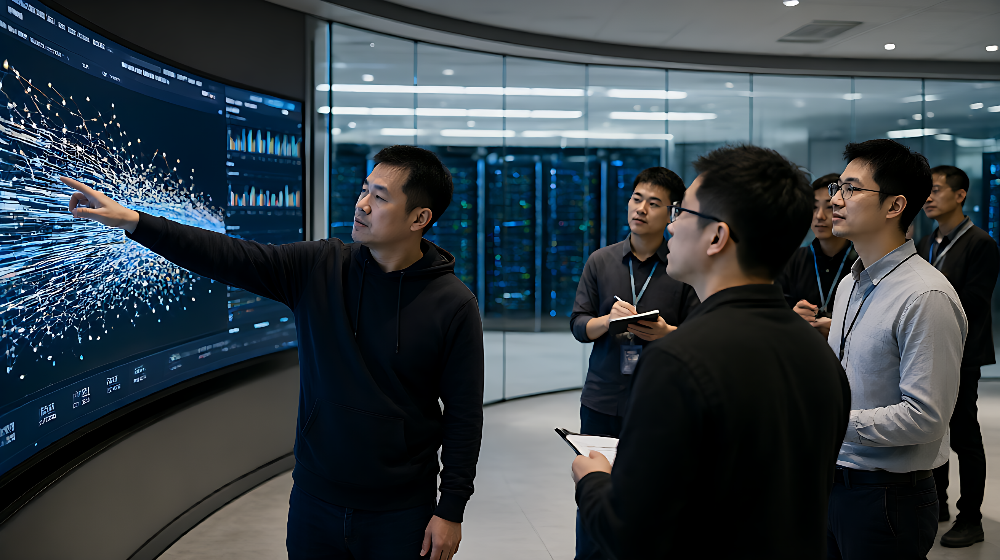
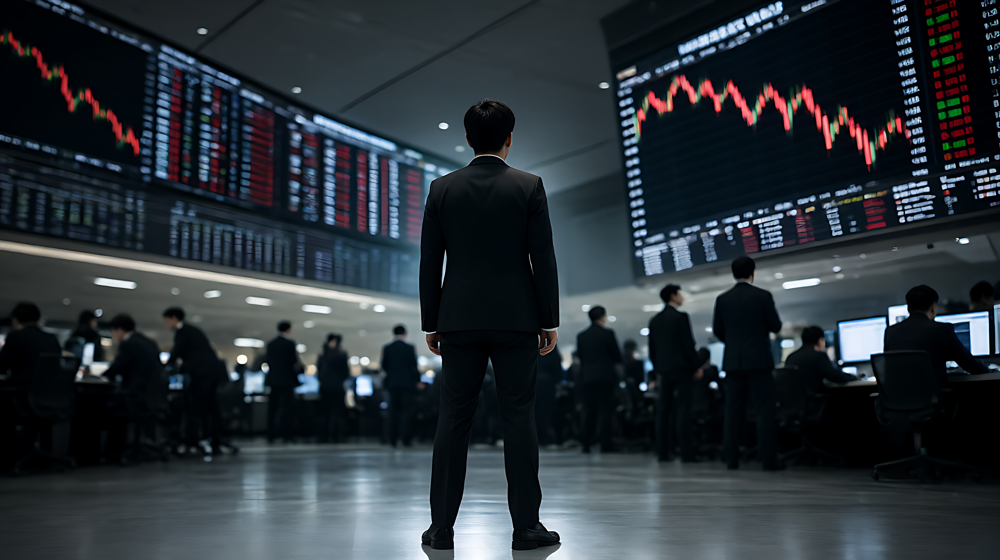
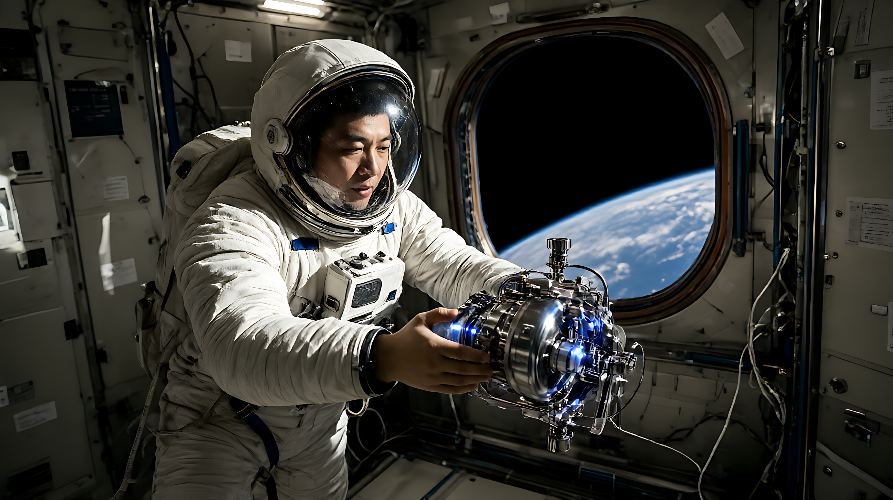

📰 国际时事与技术 · 日报 🗓️ 2026年11月21日

### 🗓️ 日期
2026年11月21日（UTC+8）

### 📚 资源分享
- **外交文献**：《2026年亚太经合组织领导人宣言》、中俄美《和平宣言》、中澳《联合成果声明》
- **科技突破**：浙江大学“天目-2”超导量子芯片QRAM真机运行技术报告；中科院天津工业生物技术研究所常温常压体外合成生物学成果
- **市场数据**：OpenRouter平台中国模型Token调用数据报告

---

### 🐉 今日概况

| 项目 | 数据 |
|------|------|
| 核心地缘事件 | 深圳APEC峰会及中俄美元首会晤 |
| 重大科技突破 | 量子计算、冷原子物理、合成生物学三项世界纪录/首次 |
| 市场波动警示 | 韩国KOSPI单日暴跌 >5.21% |

---

### 🔥 精选事件

#### 1. 深圳APEC峰会：中俄美元首历史性会晤与周边外交布局

**时间**：2026年11月19日（峰会期间延续影响）

**内容叙述**：
习近平主席在深圳主持中俄美元首会晤，时长约90分钟。三国发表《和平宣言》，主张相互尊重、和平共处、合作共赢。会议通过《2026年亚太经合组织领导人宣言》及“深圳展望”。同日，李强总理与澳大利亚总理阿尔巴尼斯举行第十一轮年度会晤，发布《联合成果声明》，宣布2027年为“中澳旅游年”，并建立人工智能对话机制。习近平主席还会见新加坡总理黄循财，双方启动中国—新加坡自贸协定4.0版谈判，将双边关系提升为“面向未来的全面高质量前瞻性伙伴关系”。

**💬 点评**：
中国利用APEC多边平台，同步推进大国协调（中俄美）与周边外交深化（澳、新），标志大国关系出现缓和尝试，区域合作机制化水平显著提升。

---

#### 2. 韩国资本市场与政治双重危机

**时间**：2026年11月21日

**内容叙述**：
韩国KOSPI指数单日暴跌超过**5.21%**。此前外国投资者已累计抛售韩国股票达**240万亿韩元**。与此同时，韩国在野党正式推动对最高法院院长的弹劾动议，加剧司法与行政分支的政治冲突。总统李在明呼吁根除AI驱动的学校考试作弊行为，出台综合改革措施。

**💬 点评**：
韩国面临外资撤离导致的流动性危机与国内政治僵局的双重压力，资本市场信心受挫，社会稳定性面临挑战。

---

#### 3. 中国科技创新多项突破

**时间**：2026年11月21日

**内容叙述**：
- **量子计算**：浙江大学团队在“天目-2”超导量子芯片上，全球首次实现量子随机存取存储器（QRAM）真机运行，8位准确率60.4%，4位准确率80.9%。
- **冷原子物理**：中国空间站实现铷原子云等效温度**9.7皮开尔文**，创世界纪录。
- **合成生物学**：中科院天津工业生物技术研究所团队实现常温常压体外合成生物学突破，肌醇生产成本降低**50%-75%**，能耗降低**90%**，磷污染减少**95%**；淀粉基储氢密度达**14.8%**。
- **AI开源**：中国开源大模型日调用Token超**500万亿**，其中OpenRouter平台中国模型占**119.1万亿**Token，连续29周位居全球第一。

**💬 点评**：
中国从“跟随”转向开源AI领域规则制定与技术输出，同时在量子硬件自主化和绿色生物制造范式转移上取得实质性进展，展示科技自立自强能力。

---

#### 4. 特朗普政府威胁限制海外AI数据中心建设

**时间**：2026年11月21日

**内容叙述**：
特朗普政府威胁禁止美国科技公司在海外建设AI数据中心，并征收“巨额税款”，点名谷歌在芬兰的**130亿欧元**投资案。受此消息及AI估值担忧影响，美股进入技术性修正区间。Anthropic完成首次公开募股（IPO），成为首家上市的顶尖AI公司。

**💬 点评**：
美国科技民族主义加剧，政策不确定性可能推高全球云服务成本，并引发国际反制，AI地缘政治竞争升温。

---

#### 5. 国际司法与社会事件

**时间**：2026年11月21日

**内容叙述**：
- **法国**：巴黎法院以种族动机袭击罪判处三名警察5年监禁，认定2020年殴打黑人音乐制作人米歇尔·泽勒案存在系统性种族主义，三人终身禁止从事警察工作。
- **美国**：美国法官批准拜耳公司**72.5亿美元**和解协议，终结Roundup除草剂致癌索赔大规模诉讼。加州正式启动对英伟达的合规调查，关注其芯片是否违规流入中国市场；英伟达高管家属被指控涉及间谍活动。
- **英国**：民调显示英国法治信任度跌至**26%**（十年新低），政府与法院信任度为**28%**。大曼彻斯特市长安迪·伯纳姆与欧盟达成“重置”协议。

**💬 点评**：
欧美社会在种族矛盾、企业责任诉讼及司法信任度方面面临深层张力，脱欧后英国外交与经济调整仍在持续。

---

### 📊 今日总结

- **最关键地缘动态**：中俄美元首会晤及《和平宣言》发表，重塑大国关系框架。
- **最佳科技突破**：中国空间站冷原子实验创9.7皮开尔文世界纪录；量子QRAM真机运行。
- **最大风险预警**：韩国股市暴跌与政治僵局叠加；美国科技股估值修正风险。
- **最高价值数据**：中国开源大模型日调用Token超500万亿，连续29周全球第一。

---

共 5 大板块，11 月 21 日完。🐉
