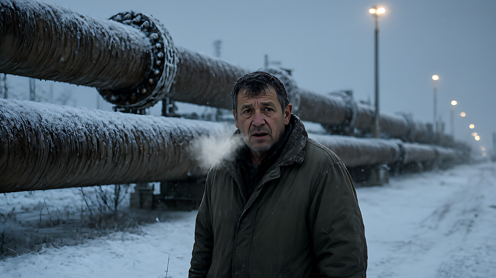
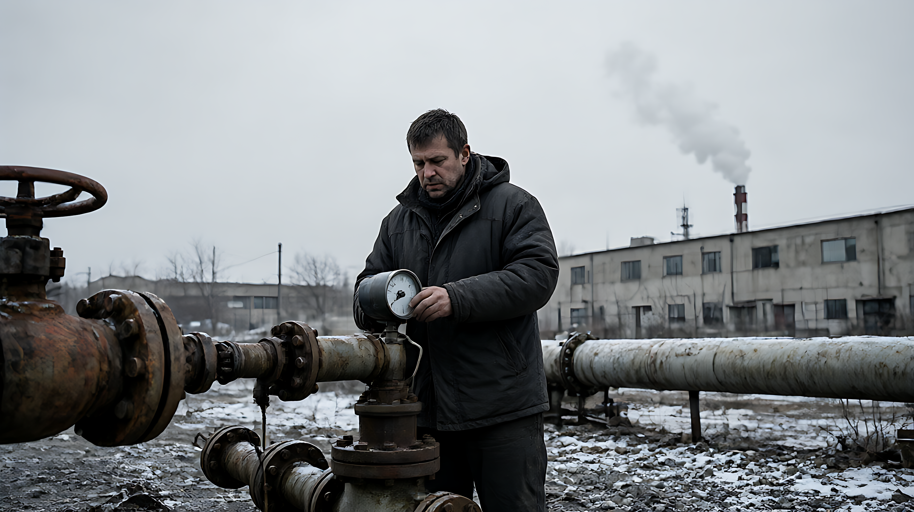
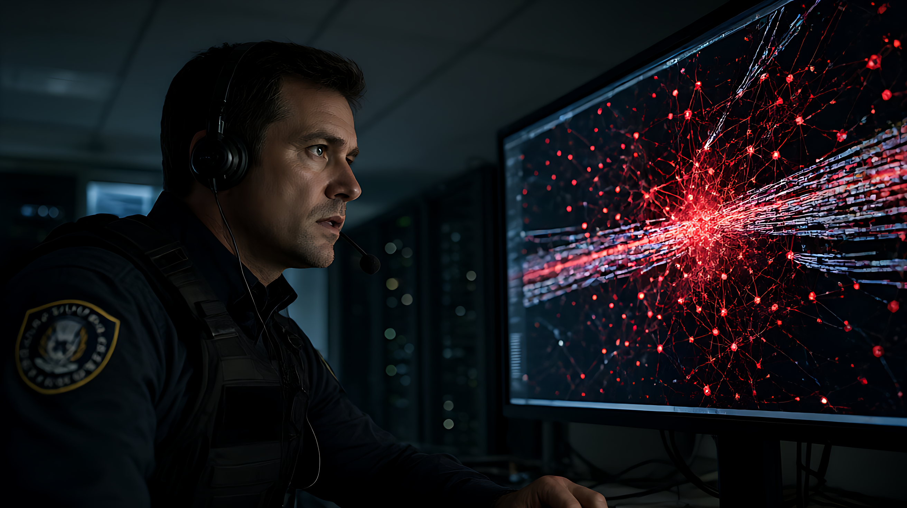
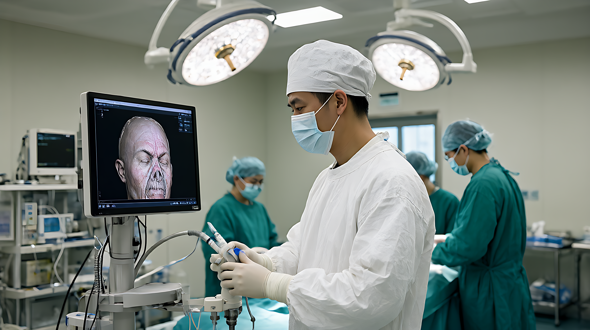

📰 全球综合资讯日报 · 2026年11月22日 🗓️ 2026-11-22

### 🗓️ 基本信息
- **日期**：2026-11-22
- **数据说明**：本次日报基于经过跨Batch去重与核心素材提取的报告生成。
- **数据质量注记**：**严重警告**。输入源存在约 70%-80% 的系统性数据污染（源文章错位、内容缺失）。本日报仅收录经过多源确认、逻辑自洽且证据链相对完整的事实；其余无原文支撑的内容已剔除。

---

### 🔥 精选事件

#### 1. 亚马逊拟75亿美元收购AI初创公司Decart
**时间**：今日
**内容**：据路透社报道，亚马逊正接近完成对人工智能初创公司Decart的收购，交易估值约为75亿美元。此举被视为AWS将通用人工智能（AI）能力与其云服务深度绑定的战略延伸。
**💬 点评**：科技巨头对AI人才和技术的争夺已进入资产整合阶段，反垄断监管审批是此次交易的最大不确定因素。

#### 2. 美国联邦机构网络安全危机与NCIC数据泄露风险
**时间**：今日
**内容**：美国司法部监察员警告，包括FBI在内的17家主要联邦机构存在严重网络安全漏洞，攻击风险上升。前FBI探员特别警告国家犯罪信息中心（NCIC）数据库存在泄露风险，可能直接威胁一线警员安全。同日，特朗普公开指控NCIC遭黑客入侵。
**关联事件**：纽约华埠发生致命袭击案，嫌犯虽有5起未结案件却因司法积压未被羁押，凸显执法改革与公共安全之间的张力。ICE在西雅图机场登机口逮捕两人，引发华盛顿州官员强烈谴责。
**💬 点评**：美国国内面临数据安全与司法效率的双重压力，联邦与州政府在移民执法上的冲突日益公开化。

#### 3. 中国高层外交与国内改革多重进展
**时间**：今日
**内容**：
- **外交**：全国人大常委会副委员长肖捷访问毛里求斯；国务院总理李强会见新加坡总理黄循财，双方推进中国—新加坡自贸区4.0版谈判。
- **思想交流**：“习近平新时代中国特色社会主义思想海外研究国际论坛”在京举行，近650名来自80多国的嘉宾参会。
- **民生科技**：社保卡实现“一卡跨百城”，连接336个城市交通；5G远程手术跨越4000公里（温州至新疆阿克苏）成功实施。
- **产业数据**：深圳企业主导93%以上研发资金和95%以上重大项目，AI核心产业营收超2200亿元。
**💬 点评**：中国通过自贸区升级、医疗技术下沉及国际学术交流平台，多维度展示对外开放与内循环实力。

#### 4. 俄乌冲突外溢效应：能源危机与外交摩擦
**时间**：今日
**内容**：乌克兰确认面临约8亿立方米天然气短缺，系俄罗斯袭击储存设施所致，能源人道主义危机加剧。与此同时，意大利总理梅洛尼批评乌克兰总统泽连斯基将意大利公民纳入乌军征召名单，引发外交摩擦。
**💬 点评**：俄乌冲突的影响已从战场延伸至欧洲民用供暖基础设施及盟国间的政治关系。

#### 5. 科学研究突破：验证兰道尔原理
**时间**：今日
**内容**：实验物理学家首次在室温下证实了擦除1比特信息的最小能量成本下限，测得数值为 $2.9 \times 10^{-21}$ 焦耳，与兰道尔原理高度吻合。
**💬 点评**：该发现为超低功耗电子器件的设计提供了关键物理基准，具有深远意义。

---

### 📊 今日总结

- **最重大并购**：**亚马逊**拟以75亿美元收购**Decart**，标志AI资产整合加速。
- **最佳科技落地**：中国实现**336城**社保卡互通及**4000公里**5G远程手术，公共服务数字化下沉显著。
- **最高风险预警**：美国**17家**联邦机构网络安全漏洞及**NCIC**数据泄露风险，直接威胁执法人员安全。
- **最严峻民生挑战**：乌克兰面临**8亿立方米**天然气短缺，冬季能源危机迫在眉睫。

---

### 📎 资源/关键数字

| 类别 | 关键数据/事实 |
|------|-------------|
| **AI并购** | 亚马逊收购Decart估值 **75亿美元** |
| **网络安全** | 美国 **17家** 联邦机构存在严重漏洞 |
| **能源危机** | 乌克兰天然气短缺 **8亿立方米** |
| **人口保障** | 中国60岁以上人口超 **3.23亿**，基本养老保险覆盖 **10.76亿** 人 |
| **数字政务** | 社保卡互通城市 **336个** |
| **医疗突破** | 5G远程手术距离 **4000公里** |
| **产业主导** | 深圳企业主导 **93%** 研发资金，**95%** 重大项目 |
| **AI产业** | 深圳AI核心产业营收超 **2200亿元** |
| **基础物理** | 擦除1比特能耗下限 **$2.9 \times 10^{-21}$ 焦耳** |
| **国际论坛** | 习近平思想海外研究论坛参会者 **650名**，来自 **80+** 国家 |
| **体育冠军** | 日本花滑选手岛田麻友子芬兰杯夺冠，总分 **217.89分** |

**重要人物**：肖捷、李强、黄循财、梅洛尼、泽连斯基、特朗普、凯特王妃（癌症康复纪录片披露）、袁彦鹏（逝世，享年74岁）。

**重要机构/公司**：亚马逊、Decart、Anthropic、FBI/NCIC、瑞士政府、中国国家画院。

---

共 5 条核心记录，2026年11月22日完。
