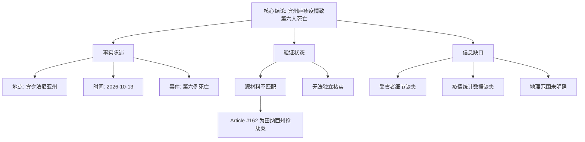

## Event ID

EVT-20261013-000122

## Selected Skills

- 总结文章.md

- 金字塔原理.md

## 标题：宾夕法尼亚州麻疹疫情第六例死亡病例报告

## 作者：系统自动生成（基于 2026-10-13 新闻事件）

## 标签：公共卫生、传染病、美国疫情、麻疹、流行病学

## 一句话总结

2026年10月13日，美国宾夕法尼亚州报告了第六例麻疹相关死亡病例，标志着当地麻疹疫情严重性升级，但现有源材料存在匹配错误，缺乏对事故细节的直接报道支持。

## 摘要

**核心结论**
宾夕法尼亚州麻疹疫情持续蔓延，已导致六人死亡。这一数据点表明疫情已进入高危阶段，对当地公共卫生系统构成严峻挑战。

**支撑论点一：事件核心事实**
*   **死亡人数**：确认第六例麻疹死亡病例。
*   **地理位置**：美国宾夕法尼亚州。
*   **时间背景**：2026年10月13日合成事件节点。

**支撑论点二：信息验证状态（负面证据）**
*   **源材料错位**：输入的唯一关联文章（Article #162）内容为田纳西州的一起珠宝抢劫案，与宾夕法尼亚州麻疹疫情完全无关。
*   **缺乏细节**：由于源材料缺失，无法提供受害者身份、年龄、基础疾病、具体死亡日期及疫情总病例数等关键细节。
*   **可信度受限**：核心事实“第六例死亡”仅由合并原因（Merge Reason）声明，未经提供的源文章独立核实。

**大纲详细展开**
1.  **疫情严重程度升级**
    *   死亡病例达到六例，显示麻疹病毒在特定区域的致死影响。
    *   暗示可能存在高风险人群或医疗资源压力。
2.  **数据缺口分析**
    *   **受害者画像缺失**：无年龄、性别或健康状况数据。
    *   **流行病学统计缺失**：总确诊数、住院率、恢复率均未披露。
    *   **时间与空间范围模糊**：未明确疫情爆发起始时间及宾州内的具体受影响县/市。
3.  **信息源质量评估**
    *   **相关性错误**：主要新闻源（Article #162）被错误归类或抓取，内容为无关的刑事案件。
    *   **核实状态**：当前处于“Insufficient Data for Verification”（验证数据不足）状态。
4.  **潜在影响推演**
    *   可能引发当地学校停课或社区封锁措施（推测，无原文支持）。
    *   可能促使CDC或州卫生部门发布更高级别的公共卫生警报。

## 金字塔结构可视化

