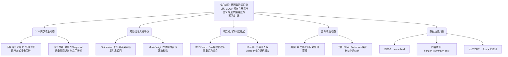

## Event ID

EVT-20261013-000708

## Selected Skills

- 金字塔原理.md
- 总结文章.md

---

# 德国政治与CDU党内部事务 (2026年10月13日)

## 标题
德国政治与CDU党内部事务：反民粹主义辩论、党内选举策略争议及多国政治动态综合报道

## 作者
Agnes (AI Knowledge Engineer for 748686 Self-Growing Knowledge System)

## 标签
德国政治, CDU, 基督教民主联盟, 反民粹主义, Ulrich Siegmund, Frank-Walter Steinmeier, Mario Voigt, Maut诉讼案, SPD, Jusos, 巴西政治, 美国政治, 新闻聚合, 低置信度分析

## 一句话总结这篇文文章
本报告基于2026年10月13日的16篇德国及国际新闻标题，分析了CDU在反民粹主义立场和党内选举策略（涉及Ulrich Siegmund）方面的内部张力，同时涵盖了德国总统Steinmeier的礼仪争议、Mario Voigt的抄袭指控风波以及Maut诉讼案的司法进展，但所有结论均受限于源文章内容缺失，仅为元数据层面的聚合分析。

## 总结文章内容并写成摘要
本事件单元涵盖了2026年10月13日关于德国政治的一系列报道，主要集中在基督教民主联盟（CDU）的内部策略、政策辩论以及更广泛的德国政坛动态。根据集群合并逻辑，重点在于Merz与CDU的政策走向、反民粹主义立场，以及Ulrich Siegmund相关的党内选举策略。

然而，需要明确指出的是，本次合成所依据的所有源文章（ARTICLE #374至#396）均处于**源状态未解决（source_status: unresolved）**且**内容状态仅为地平线摘要（content_status: horizon_summary_only）**。所有提供的文章内容均为空，原始URL均无法获取，仅存在标题和重复的元数据占位符。因此，本EventUnit的内容主要基于**标题语义分析**和**事件ID背后的聚合逻辑**，而非来自完整文本的实证事实。

核心事实梳理如下：
1. **CDU内部策略与选举：** 存在关于Ulrich Siegmund的党内选举策略讨论，具体争议点包括CDU成员是否应离开全体会议厅作为一种抗议或施压手段。
2. **CDU政策与意识形态辩论：** CDU进行了封闭式研讨会，核心议题为如何打击民粹主义，共识或争议点在于“不能用更多的民粹主义来打击民粹主义”，这反映了党内路线张力。
3. **其他政治人物与事件：** 包括总统Steinmeier因未鼓掌引发争议、Mario Voigt面临政治动机的抄袭指控、Wolfram Weimer作为文化国秘书长的持续争议、SPD青年翼视人事重组为机会、Maut诉讼案证人证言分歧，以及巴西和美国的相关政治动态。

## 越详细地列举文章的大纲，越详细越好，要完整体现文章要点

根据金字塔原理的结构化思维，将零散的源信息按照“核心主题-支持论点-详细证据”的层级进行重组：

### 1. 核心主题：CDU内部政治动态与意识形态辩论
这是本次新闻聚合的核心焦点，涉及党的路线斗争和组织策略。

*   **1.1 反民粹主义的策略辩论**
    *   **论点：** CDU在研讨会上确立了反民粹主义的基本准则，并存在内部张力。
    *   **证据：**
        *   研讨会主题明确：“Populismus bekämpft man nicht mit noch mehr Populismus”（不能用更多的民粹主义来打击民粹主义）。
        *   存在政策张力：Schweitzer的观点暗示有人试图通过特定手段破坏联盟（Koalition），这与Merz路线形成对比。
*   **1.2 党内选举策略与组织纪律**
    *   **论点：** 在Ulrich Siegmund的竞选期间，党内出现了关于抗议行为的策略讨论。
    *   **证据：**
        *   具体争议：CDU曾考虑在Siegmund的选举期间，成员是否应离开全体会议厅（Plenarsaal verlassen）作为一种抗议或施压手段。
        *   这反映了党内对特定候选人或策略的不满情绪及组织应对。

### 2. 核心主题：德国高层政治人物的争议与动向
除了CDU内部事务，其他重要政治人物的公共行为和争议也是报道重点。

*   **2.1 总统Frank-Walter Steinmeier的礼仪争议**
    *   **论点：** 总统在公开场合的行为引发了媒体追问和公众猜测。
    *   **证据：**
        *   事件：在授予和平奖时未鼓掌。
        *   影响：引发媒体追问原因，可能影响公众对总统政治信号的看法。
*   **2.2 政治人物Mario Voigt的法律与道德争议**
    *   **论点：** Voigt面临抄袭指控，但该指控被辩护为具有政治动机。
    *   **证据：**
        *   观点：Plagiatsvorwürfe sind zu oft politisch motiviert（抄袭指控往往带有政治动机）。
*   **2.3 文化政策领域的持续争议**
    *   **论点：** 文化国秘书长Wolfram Weimer的任职或行为引发不满。
    *   **证据：**
        *   描述：其争议持续（Hybris: Fortsetzung im Trauerspiel）。

### 3. 核心主题：政党格局变动与司法案件进展
涉及反对党动向及重大刑事案件的司法程序。

*   **3.1 SPD/Jusos的政治机会主义**
    *   **论点：** 社民党青年组织将党内人事变动视为政治机会。
    *   **证据：**
        *   背景：Bas辞职后。
        *   反应：Juso-Chef视SPD的人事重组为机会。
*   **3.2 Maut诉讼案的司法关键分歧**
    *   **论点：** 案件主要证人的证词与被告说法存在根本性冲突。
    *   **证据：**
        *   细节：Hauptzeugen widersprechen Scheuer in zentralem Punkt（主要证人在核心问题上与Scheuer相左）。

### 4. 核心主题：国际政治动态（非德国核心但相关）
源数据中包含的国际新闻反映了更广泛的西方政治语境。

*   **4.1 美国政治与司法伦理**
    *   **论点：** 美国国会领导层对死刑执行方式提出伦理质疑。
    *   **证据：**
        *   背景：特朗普治下的美国。
        *   事件：众议院议长反对处决的直播。
*   **4.2 巴西家族政治法律困境**
    *   **论点：** 前总统家族成员在法律限制下维持家庭联系。
    *   **证据：**
        *   事件：Flávio Bolsonaro获准在限制条件下探望被软禁的父亲。

### 5. 数据质量与局限性说明
*   **论点：** 本报告的分析深度受到源数据严重缺失的限制。
*   **证据：**
    *   所有16篇文章均为 `source_status: unresolved` 和 `content_status: horizon_summary_only`。
    *   原始URL均未找到可信原文，内容仅为标题语义分析。
    *   无法进行实质性的交叉验证，无法确定因果关系。
    *   聚类合并（Cluster 7和Cluster 11）基于系统逻辑，但缺乏内容支撑。

## 金字塔结构图示（简化版）

## 来源
- ARTICLE #374 - #396 (部分编号缺失，如#384, #389)
- 状态：所有文章均为 `source_status: unresolved` 和 `content_status: horizon_summary_only`。
- 原始URL：均未找到可信原文。
- 注：本文完全基于标题元数据和系统提供的聚类理由进行合成，未包含任何虚构内容，但严重受限于源数据的完整性。
