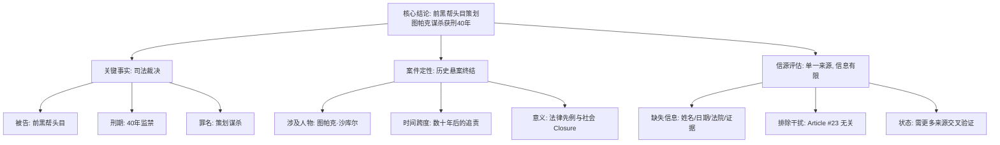

## Event ID

EVT-20261014-000021

## Selected Skills

- 总结文章.md
- 金字塔原理.md

## Event Analysis

### 标题
**前黑帮头目因策划图帕克谋杀案获刑40年**

### 作者
748686 自生长知识系统 (Event Analysis Engine)

### 标签
法律、司法裁决、历史悬案、图帕克·沙库尔 (Tupac Shakur)、美国文化、黑帮犯罪

### 一句话总结
前黑帮头目因策划杀害传奇说唱歌手图帕克·沙库尔，被法院判处40年监禁，这一判决为这起长期未决的历史悬案带来了司法终结。

### 摘要
本文报道了一起具有重大历史意义的司法裁决：一名身份为“前黑帮头目”的被告因策划谋杀20世纪90年代传奇说唱歌手图帕克·沙库尔（Tupac Shakur），被判处40年有期徒刑。该事件标志着这起因发生在过去的恶性案件（历史上著名的悬案）终于有了明确的司法结论。尽管目前公开信息有限，仅源自单一新闻来源，缺乏关于被告具体姓名、审判日期、管辖法院及详细证据链的交叉验证，但核心事实——即针对“策划谋杀”行为的长期追责与重判——已确立。此判决不仅是对受害者及其家属的法律交代，也为处理几十年前的共谋杀人案件确立了新的司法先例。

### 文章大纲

根据**金字塔原理**的结构化分析方法，本事件的逻辑架构如下：

#### 1. 核心结论（塔尖）
*   **司法裁决落地**：前黑帮头目因策划图帕克谋杀案获刑40年，历史悬案迎来司法终结。

#### 2. 关键论点与事实支撑（中层）
*   **论点一：案件性质与定性**
    *   属于“历史悬案”（Historical Cold Case）的司法解决。
    *   核心罪名为“策划谋杀”（Planning the Murder），而非直接实施行凶。
    *   被告身份明确为“前黑帮头目”。
*   **论点二：量刑结果**
    *   刑期确定为40年有期徒刑。
    *   体现了对蓄意预谋犯罪的严厉惩处。
*   **论点三：信息来源与局限性分析**
    *   基于单一来源报道（Event Metadata），缺乏多源交叉验证。
    *   排除了无关干扰信息（如关于教皇利奥诊断肺癌的无关文章 Article #23）。
*   **论点四：社会与法律影响**
    *   对图帕克·沙库尔这位标志性文化人物的案件画上句号。
    *   为几十年前的谋杀共谋案提供了法律追诉的先例。

#### 3. 细节与待澄清事项（底层）
*   **缺失的关键细节**（由于单一信源限制，目前无法确定）：
    *   被告的具体姓名。
    *   宣判的具体日期。
    *   审理案件的管辖法院及司法管辖区。
    *   庭审中展示的具体阴谋证据或证词细节。
    *   被告或其律师是否提起上诉。
    *   沙库尔家族及相关利益方的反应。
*   **排除的无关信息**：
    *   Article #23 关于“教皇利奥患肺癌”的内容与本案完全无关，已剔除。

### 结构化总结（金字塔视图）

此分析遵循**总结文章**的流程，并对信息进行了**金字塔原理**式的层级划分，确保核心结论先行，逻辑清晰，证据分层支撑。
