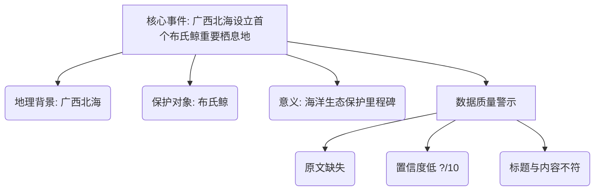

## Event ID

EVT-20261014-000154

## Selected Skills

- 总结文章.md
- 金字塔原理.md

---

## Event Analysis

### 标题：广西北海设立首个布氏鲸重要栖息地

### 作者：未知（新闻报道）

### 标签
生态保护、世界自然遗产、海洋生物、布氏鲸、广西、北海

### 一句话总结
尽管事件标题指向贵州峰林生态保护，但现有源文章实际报道了广西北海设立首个布氏鲸重要栖息地这一重大海洋生态里程碑，且由于源文本缺失，具体细节尚待核实。

### 文章内容摘要

**核心结论：广西北海成功设立首个布氏鲸重要栖息地**
该事件标志着中国在该物种海洋生态保护领域取得突破性进展，具有重要的生态示范意义。

**支持论点与详细证据：**

1.  **事件主体与地理定位**
    *   **地点**：中国广西壮族自治区北海市。
    *   **对象**：布氏鲸（Bryde's whale，学名 *Balaenoptera edeni*）。
    *   **性质**：首个此类重要栖息地的正式设立。

2.  **数据可靠性与来源局限**
    *   **源状态**：原始文章未成功获取全文，仅存在“今日世界”（Horizon）的摘要片段。
    *   **置信度**：评分较低（?/10），因为缺乏原始文本支撑，无法独立验证“首个”等关键事实的准确性。
    *   **URL状态**：未知，未找到可信的原始链接。

3.  **事件与标题的关联性分析（异常点）**
    *   **标题错位**：Event Title为“贵州峰林生态保护”（ terrestrial/karst ecosystem），而内容涉及“广西北海布氏鲸”（ marine habitat）。
    *   **逻辑断裂**：贵州峰林（喀斯特森林）与广西北海（海洋哺乳动物栖息地）在地理和生态类型上截然不同。目前无证据表明两者存在因果或行政关联，疑似源文章匹配错误或标题生成偏差。

### 金字塔结构可视化

### 事件结论

本事件当前处于**结论待定且信息不完整**状态。

1.  **事实层面**：现有源文章（Article #166）确认了广西北海设立布氏鲸重要栖息地的报道，但未提供详细边界、法律地位或保护成效等具体信息。
2.  **关联层面**：该源内容与事件标题“贵州峰林生态保护”存在显著的不一致。由于缺乏关于贵州峰林实际的保护活动源文章，且无法验证现有源文章的完整性，**无法形成关于“贵州峰林生态保护”的有效综合分析**。
3.  **后续建议**：需补充贵州当地生态保护的具体源文章，或确认广西北海源文章是否为错误插入，以提升事件分析的准确性和相关性。
