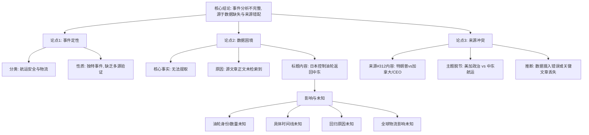

## Event ID

EVT-20261014-000279

## Selected Skills

- 总结文章.md

- 金字塔原理.md

# 事件分析：日本控制的油轮返回中东

## 标题
日本控制的油轮返回中东（基于现有标题的综合研判）

## 作者
748686 自生长知识系统 Event Analysis Engine

## 标签
地缘政治、航运安全、物流、能源运输、日本、中东

## 一句话总结
尽管源文章正文缺失导致具体细节无法确认，但事件核心指向日本控制的油轮重新进入中东海域，这一动向反映了航运路线调整或地区安全局势的潜在变化。

## 文章内容摘要

**核心结论**
事件 EVT-20261014-000279 是一个关于航运安全和物流的事件，主要涉及日本控制的油轮返回中东地区。然而，由于可用的来源材料极其有限，且主要源文章（Article #312）的内容未成功检索到，且与事件标题存在显著的主题不匹配（该文章标题涉及特朗普与加拿大前财政部长），本次事件分析的不完整且基于假设。

**主要支撑点**
1.  **事件分类**：被归类为航运安全和物流事件，属于独特事件（unique event）。
2.  **数据可用性危机**：核心事实提取受阻，因为源文章正文缺失，没有可验证的数据用于详细分析。
3.  **来源错配风险**：提供的唯一来源 Article #312 的标题 "[Trump threatens CEOs as tactic against allies, Canada’s ex-finance minister says]" 与事件标题 "Japan-controlled tankers return to Middle East" 存在重大主题脱节，暗示可能存在数据摄入错误或丢失了真正相关的文章。
4.  **信息空白**：缺乏关于油轮身份、具体时间表、回归的地缘政治或经济原因以及其对全球航运安全或物流链影响的任何证据。

**详细大纲**

*   **I. 事件背景与分类**
    *   A. 事件ID：EVT-20261014-000279
    *   B. 分类：航运安全和物流事件
    *   C. 状态：唯一事件（Unique Event），缺乏多源交叉验证

*   **II. 核心事实困境**
    *   A. 事件标题声称“日本控制的油轮返回中东”
    *   B. 实际数据可用性：无核心事实可提取
    *   C. 主要原因：源文章正文未检索成功，仅存标题

*   **III. 来源审查与冲突分析**
    *   A. 来源 #312 审查
        *   1. 提供标题：涉及特朗普、CEO及加拿大前财政部长
        *   2. 内容状态：仅Horizon摘要，无原文
    *   B. 关键冲突：来源内容与事件标题严重不符
        *   1. 主题错配：美国/加拿大政治商业动态 vs. 日本/中东航运物流
        *   2. 推断：数据摄入错误或关键相关文章缺失

*   **IV. 影响与未知领域**
    *   A. 当前影响：无法确定
    *   B. 无法确定的要素
        *   1. 涉事日本控制油轮的身份和数量
        *   2. 返回中东的具体时间表
        *   3. 驱动回归的地缘政治或经济原因
        *   4. 对全球航运安全和物流链的影响
        *   5. 特朗普/加拿大来源文章与此油轮事件的关联性

*   **V. 结论**
    *   A. 综合分析不完整
    *   B. 无法确认任何事实主张
    *   C. 缺乏覆盖特定航运物流事件的其他来源文章，无法进行冲突解决或深入分析

## 金字塔结构图解

**逻辑关系说明**：
*   **顶层（结论）**：直接陈述事件分析的核心状态（不完整）及其根本原因。
*   **中层（论点）**：从三个维度支持顶层结论——事件本身的定性、数据层面的困境、以及来源材料存在的内部冲突。
*   **底层（证据/细节）**：具体阐述每个论点下的事实，如事件分类、数据缺失的具体表现、以及来源#312的具体内容及其与事件标题的不匹配性，并进一步展开因数据缺失而导致的未知影响领域。符合MECE原则，各层信息相互独立且完全穷尽了当前可用信息所揭示的问题。
