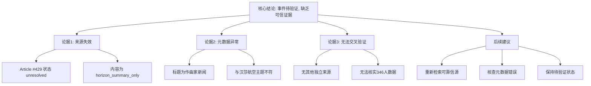

## Event ID

EVT-20261014-000801

## Selected Skills

- 总结文章.md
- 金字塔原理.md
- 四维价值模型.md

---

# 汉莎航空大规模退休事件分析

## 文章/事件信息

- **标题**：汉莎航空员工大规模退休事件
- **事件ID**：EVT-20261014-000801
- **日期**：2026年10月14日
- **标签**：#航空业 #人力资源 #德国新闻 #企业人事变动 #数据验证

## 一句话总结

该事件声称346名汉莎航空员工退休，但因唯一源文章未获取且元数据异常，当前缺乏可信证据，处于待验证状态。

## 内容摘要

本事件关于汉莎航空（Lufthansa）发生的大规模人员退休情况。根据第一层全球合并引擎的判断，涉事员工人数为346人。然而，深度分析显示该事件存在严重的**信息完整性缺陷**：

1.  **数据来源缺失**：唯一对应的源文章（Article #429）状态为 `unresolved`，内容为 `horizon_summary_only`，即没有获取到实际正文。
2.  **元数据异常**：源文章标题为德语“Geniale Komponisten: Genie beweist sich im kühnen Stilwandel”（天才作曲家：天才在大胆的风格转变中证明自身），与“汉莎航空退休”主题完全不匹配，疑似抓取错误或数据混淆。
3.  **缺乏交叉验证**：由于缺乏原始报道，无法确认346人这一数字的真实性、退休的具体原因（自然退休潮还是提前退休计划）以及对汉莎航空运营的实际影响。

因此，目前无法构建一个事实完整、可验证的事件单元，需标记为待验证。

## 详细大纲

### 一、 核心事实认定（结论先行）
- **事件性质**：疑似大规模退休/离职事件
- **涉事主体**：汉莎航空（Lufthansa）
- **涉及人数**：346人
- **当前状态**：**待验证（Pending Verification）**
- **关键问题**：缺乏可信原始文章支持，数据真实性存疑

### 二、 信息可靠性评估（自上而下逻辑）

#### 1. 来源有效性分析
- **源文章编号**：Article #429
- **获取状态**：失败（`source_status: unresolved`）
- **内容状态**：仅封面/摘要层（`content_status: horizon_summary_only`）
- **原文URL**：未找到可信原文

#### 2. 元数据一致性检查
- **预期主题**：汉莎航空人事变动
- **实际标题**：Geniale Komponisten: Genie beweist sich im kühnen Stilwandel（关于作曲家）
- **结论**：存在严重的不匹配，推测为数据抓取错误或源映射错误

#### 3. 交叉验证可行性
- **独立来源数量**：0个有效来源
- **冲突检测**：无冲突（因无其他来源可对比）
- **验证结果**：无法进行交叉验证

### 三、 缺失的关键信息（底层证据）

#### 1. 事实细节缺失
- “346人”数据的原始出处
- 退休的具体时间范围
- 涉及的岗位类型（飞行员、空乘、地勤等）

#### 2. 背景与原因缺失
- 是计划内的自然退休潮还是突发性集体离职？
- 是否有工会介入或公司官方公告？
- 是否伴随裁员重组等战略调整？

#### 3. 影响评估缺失
- 对汉莎航空航班运营的具体影响
- 对员工士气及劳动力市场的影响
- 对德国航空业就业数据的潜在影响

### 四、 后续行动建议（逻辑归纳）

- **立即行动**：重新检索可靠的德语/英语新闻源，验证“Lufthansa 346 employees retirement”相关报道
- **数据清洗**：核查Article #429的元数据，确认是否为系统抓取错误
- **状态标记**：在获得有效原文前，维持“待验证”状态，不作事实性传播

---

## 金字塔结构图解

## 四维价值模型分析

### 1. 信息价值 (Information Value)
- **评价**：**低（当前阶段）**
- **分析**：
    - 目前提供的信息仅为事件标题和状态描述，缺乏实质性的事实细节（如具体时间、岗位、原因）。
    - 对于关注航空业动态或人力资源研究的读者，当前信息无法提供有效的决策支持或知识增量。
    - 若后续能获取真实可靠的原始报道，信息价值将显著提升，因为“大型航司机队/人员结构调整”通常是重要的行业信号。

### 2. 情绪价值 (Emotional Value)
- **评价**：**中性偏负面**
- **分析**：
    - 事件本身涉及“大规模退休”，可能引发读者对汉莎航空运营稳定性、德国就业市场健康状况的担忧或焦虑。
    - 然而，由于事件真实性存疑，这种情绪更多源于不确定性带来的困惑，而非明确的情感冲击。
    - 对于内部员工或投资者，若此事属实，可能引发焦虑；但基于当前信息，主要情绪是“怀疑”和“等待澄清”。

### 3. 趣味价值 (Interest Value)
- **评价**：**低**
- **分析**：
    - 事件报道缺乏生动的叙事、独特的视角或有趣的转折。
    - 源文章标题与内容的荒谬不匹配（作曲家 vs. 航空退休）具有一定的数据异常趣味性，但这属于系统错误而非内容创意，不具备正面的娱乐价值。
    - 整体呈现为枯燥的状态报告式文本。

### 4. 独特价值 (Unique Value)
- **评价**：**低**
- **分析**：
    - 事件本身并未提供汉莎航空独有的、不可替代的视角或独家内幕。
    - 当前文档的独特性仅体现在其对“数据缺失”和“元数据错误”的明确标识上，这为后续数据质量审计提供了案例，但就新闻内容本身而言，缺乏独家深度。
    - 若未来有内部消息披露具体退休细节和原因，则可能具备独特价值。

---

**最终结论**：本事件单元目前处于**数据不可靠状态**。所有分析均基于对现有缺陷的识别，而非对事件本身的确认。建议在实际应用此事件前，优先完成源文章的重新获取与验证工作。
