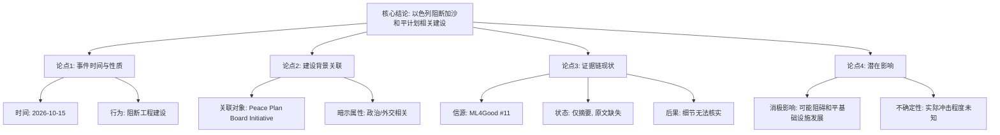

## Event ID

EVT-20261015-000010

## Selected Skills

- 总结文章.md

- 金字塔原理.md

---

## 最终事件分析报告

### 标题
以色列阻断加沙地带和平计划相关基地建设

### 作者
748686 自生长知识系统 Event Analysis Engine

### 标签
#国际新闻 #中东局势 #以巴冲突 #和平进程 #信息完整性预警

### 一句话总结
2026年10月15日，以色列阻断加沙地带与“和平计划委员会”倡议相关的建设工作，但因原始报道缺失，具体细节、动机及影响尚无法确认。

### 内容摘要

**核心结论（顶层）**
以色列在2026年10月15日阻断了位于加沙地带的某项工程建设，该工程与一个名为“和平计划委员会”（peace plan board）的倡议有关。由于关键信源缺失，该事件目前处于“初步综合”状态，需进一步验证。

**关键论点（中层）**

1.  **事件性质与时间**：事件发生时间为2026年10月15日，性质为以色列对加沙地带特定建设活动的阻断行为。
2.  **建设背景关联**：被阻断的工程并非普通民用设施，而是明确关联于“和平计划委员会”的倡议项目，暗示其可能具有政治或外交属性。
3.  **证据链断裂**：现有分析仅基于摘要级信息（Horizon Summary），缺乏原始报道全文，导致无法核实具体地点、建设性质（如行政办公楼、军事设施伪装等）及以方官方理由。
4.  **潜在影响方向**：该阻断行为可能构成对和平进程基础设施发展的摩擦或阻碍，但其对当前和平谈判进程的具体冲击程度未知。

**事实细节（底层）**

*   **信源状态**：主要来源为"ML4Good Impact Assessment"文章#11，状态标记为`unresolved`（未解决）且`content_status: horizon_summary_only`（仅含摘要）。
*   **信息缺口**：
    *   **建设具体形态**：未知是行政建筑、居住区还是其他设施。
    *   **确切地理位置**：加沙地带内的具体区域未明确。
    *   **委员会详情**："和平计划委员会"的身份、授权范围及构成不明。
    *   **以方立场**：以色列官方的具体解释或法律依据未在现有材料中呈现。
    *   **后续反应**：是否引发外交抗议或和平进程延迟尚无数据。
*   **交叉验证**：由于仅有一个信源且该信源内容不完整，无法进行独立的多源交叉验证。

### 金字塔结构图示

### 事件结论

本事件记录基于有限信息源。以色列阻断加沙地带与“和平计划委员会”相关的建设活动是已确认的核心事实，但鉴于原始报道文本的缺失，所有关于建设具体内容、地理位置、以方动机及外交后果的细节均属于“待确定”范畴。建议持续关注后续信源的解析与补充，以便完善对该事件及其对以巴和平进程潜在影响的评估。
