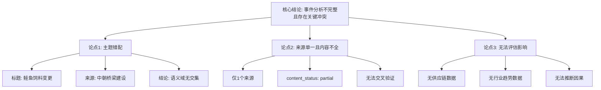

## Event ID

EVT-20261015-000039

## Selected Skills

- 总结文章.md
- 金字塔原理.md
- 四维价值模型.md

## 事件分析报告：养殖鲑鱼饲料变更与信息完整性评估

### 1. 标题
**养殖鲑鱼改用鸡肉饲料：事件信息矛盾评估与数据来源核查报告**

### 2. 作者
Event Analysis Engine (AI Agent)

### 3. 标签
#水产养殖 #鲑鱼 #饲料配方 #数据一致性 #新闻分析 #供应链

### 4. 一句话总结
尽管事件标题声称报道“养殖鲑鱼改用鸡肉饲料”，但唯一提供的来源文章（Article #49）实际内容关于“中韩朝新建桥梁”，存在严重的数据错位；本报告基于现有可用材料，指出事实确认的缺失并建议重新核查数据源。

### 5. 详细内容摘要

#### 一、 核心结论（金字塔顶端）
**事件 EVT-20261015-000039 的分析结论为：信息不完整且存在关键冲突。**
由于唯一来源文章（Article #49）的主题（中国-朝鲜基础设施桥梁）与事件标题（养殖鲑鱼改用鸡肉饲料）完全不符，且该来源内容仅为部分摘要（`content_status: partial`），导致无法验证标题所声称的事件事实。目前该事件记录缺乏可信的原始数据支持，需重新评估来源相关性或补充数据。

#### 二、 核心论点与支持证据（金字塔中层）

**论点 1：事件元数据与来源内容存在根本性主题错配**
*   **事实 A**：事件标题明确界定为“养殖鲑鱼改用鸡肉饲料”，涉及水产养殖业的技术变革。
*   **事实 B**：来源 Article #49 的标题为 “New bridge between China and North Korea opens”（中韩朝之间新桥梁开通）。
*   **事实 C**：Article #49 的内容描述完全聚焦于基础设施项目，未包含任何关于鲑鱼、饲料成分或农业行业动态的信息。
*   **推论**：来源文章无法支持事件标题的主题，存在明显的分类或数据关联错误。

**论点 2：单一且内容不完整的来源导致无法进行交叉验证**
*   **事实 D**：本次分析仅依据 1 个来源（source_count: 1），缺乏独立的多源佐证。
*   **事实 E**：该来源的状态标记为 `source_status: fetched` 但 `content_status: partial`。这意味着仅检索到了 Google News 的标题和摘要片段，未获取到文章正文。
*   **推论**：在缺乏全文且仅有单一来源的情况下，即使来源主题匹配，也无法深入验证细节；如今主题完全不匹配，更是无从验证。

**论点 3：无法确定事件的实际影响与因果链条**
*   **事实 F**：由于源材料中未提及水产养殖、食品供应链或饲料替代技术，因此无法评估该事件对市场价格、环境可持续性（如减少鱼类捕捞需求）或行业成本的影响。
*   **事实 G**：源材料中提及的“中国”和“朝鲜”仅出现在桥梁基础设施的语境中，与事件标题中的农业变量无逻辑关联。
*   **推论**：无法建立“桥梁建设”与“鲑鱼饲料变更”之间的任何因果关系或潜在联系。

#### 三、 详细分析与数据局限（金字塔底层）

**1. 来源数据质量分析 (Article #49)**
*   **原始数据**：来自 Google News 聚合的 RSS 链接。
*   **内容局限性**：仅提取了标题 "New bridge between China and North Korea opens" 和少量描述性文本，缺失报道主体、日期细节、地点信息及官方声明。
*   **状态标记**：`content_status: partial` 表明系统未能成功抓取完整文章，导致信息熵极低，不足以支撑任何实质性新闻分析。

**2. 逻辑冲突的具体表现**
*   **语义域断裂**：事件标题属于“农业科技/食品科学”领域，而源文本属于“国际政治/基础设施”领域。两者在语义空间上无交集。
*   **实体缺失**：标题中的核心实体“Salmon（鲑鱼）”、“Chicken feed（鸡肉饲料）”在源文本中完全不存在；源文本中的核心实体“Bridge（桥梁）”、“China-North Korea（中朝）”在标题中完全不存在。

**3. 四维价值模型评估**

*   **信息价值**：**缺失**。
    *   未能提供关于鲑鱼养殖饲料变更的任何新知识、新数据或行业洞察。
    *   用户无法从当前分析中获得“学到了什么”，因为核心事实未被证实。

*   **情绪价值**：**中性/困惑**。
    *   分析过程揭示了数据系统的潜在错误，可能引发读者对数据可靠性的担忧或困惑，而非激励或共鸣。
    *   未提供情感上的安慰或愤怒，仅呈现了逻辑上的不通。

*   **趣味价值**：**低**。
    *   缺乏生动的叙事、比喻或有趣的转折。内容主要为技术性排查和逻辑陈述，阅读体验较为枯燥。
    *   “鲑鱼吃鸡肉”这一话题本身可能具有趣味潜力，但因数据错位而未能展开。

*   **独特价值**：**低**。
    *   当前分析主要是对数据错误的诊断，缺乏独特的个人观点或独家故事。
    *   如果未来能获取到真正的来源并深入分析饲料变更的经济或环境意义，则可构建独特价值。

#### 四、 待解决与未决事项

1.  **事件标题有效性存疑**：无法确认“养殖鲑鱼改用鸡肉饲料”这一事件是否真实发生，或是否仅为误标。
2.  **桥梁细节不明**：由于 Article #49 内容不完整，关于该桥梁的具体位置、开通日期及地缘政治意义均无法确定。
3.  **数据管道错误排查**：需要调查为何将 Article #49 关联至 EVT-20261015-000039。这可能存在自动聚类错误、ID 映射错误或数据采集时的错位。

#### 五、 行动建议

1.  **数据修正**：立即检查 EventUnit 的生成逻辑，确认是否有关联错误。
2.  **来源补充**：若事件标题属实，需重新搜索并获取关于“鲑鱼饲料中鸡肉成分使用趋势”的真实新闻源，替换当前的无关来源。
3.  **重新合成**：在获得正确且完整的来源后，重新执行事件分析流程，以提供有价值的行业洞察。

---

### 6. 金字塔结构图解

---

### 7. 最终结论

**事件 EVT-20261015-000039 当前无法进行实质性分析。**

依据**金字塔原理**，顶层结论为“数据冲突导致事实无法确认”；中层论据为“来源与标题主题不符”及“来源内容不完整”；底层证据为具体的标题文本对比和来源状态标记。

依据**总结文章.md**的工作流，已提取元数据、标签及大纲，但核心摘要部分受限于错误的数据输入，仅能做异常报告而非新闻总结。

依据**四维价值模型**，当前分析在信息价值和独特价值上均为零，因为基础事实未被验证。

**建议操作**：标记此事件为“数据异常”，并要求重新采集与标题相符的可靠来源，以便进行下一次有效分析。
