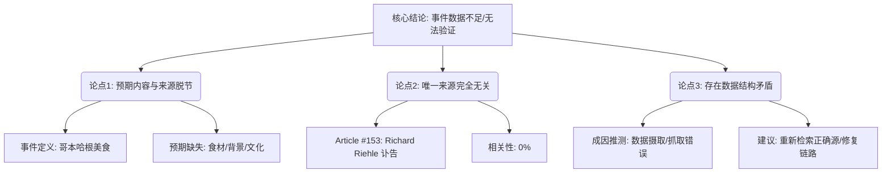

## Event ID

EVT-20261020-000090

## Selected Skills

- 总结文章.md

- 金字塔原理.md

---

## Event Analysis

### 标题
哥本哈根切片奶酪面包美食现象：数据与事实源严重失配的事件分析

### 作者
748686 自生长知识系统 - Event Analysis Engine

### 标签
#数据分析 #数据治理 #哥本哈根美食 #事实核查 #事件分析 #数据缺失

### 一句话总结这篇文文章
事件 EVT-20261020-000090 虽标记为“哥本哈根切片奶酪面包现象”，但其唯一关联来源（Article #153）内容为演员 Richard Riehle 的讣告，导致该事件因核心事实源缺失而处于无法验证的“数据不足”状态。

### 总结文章内容并写成摘要

本次事件分析针对 Event ID 为 **EVT-20261020-000090** 的单元进行综合评估。该事件在初步路由中被定义为关于丹麦哥本哈根流行的“切片奶酪夹面包美食文化现象”。然而，经过对现有证据源的深度审查，发现存在严重的**主题不匹配（Topical Mismatch）**问题。

具体分析如下：
1.  **事件定义与内容断裂**：事件标题明确指向“食品文化/哥本哈根”，但关联的唯一信息来源 Article #153 完全无关，其内容是关于美国演员 Richard Riehle（电影《上班一条龙》主演）去世的消息。
2.  **验证失败**：由于来源文章未包含任何关于哥本哈根、奶酪、面包或当地饮食趋势的信息，跨来源交叉验证无法进行，事件的核心事实无法确立。
3.  **根本原因推断**：这极有可能是一次数据摄取错误，即错误的文章被分配给了该事件，或者来源文章抓取失败导致使用了错误的默认/残留内容。

鉴于上述情况，本分析报告无法提供关于该美食现象的具体细节（如原料、起源、社会影响等），而是聚焦于揭示数据链路中的这一结构性缺陷。

### 文章大纲

为了清晰呈现分析逻辑，本部分严格遵循**金字塔原理**进行结构化表达，并运用**MECE原则**（相互独立，完全穷尽）对问题进行分层拆解。

#### I. 核心结论（顶层）
*   **结论**：事件 EVT-20261020-000090 当前**状态为“数据不足/结论待定”**。
*   **理由**：唯一支撑源与事件主题完全无关，缺乏实质性的证据基础。

#### II. 关键论点分析（中层）

**1. 现象定义与预期内容**
*   **预期主题**：丹麦哥本哈根的切片奶酪夹面包（Sliced Cheese Bread/Sandwich）美食文化。
*   **预期要素**：具体食材、制作工艺、流行背景、文化意义。
*   **现状**：预期内容在现有数据中完全空白。

**2. 实际来源内容审查**
*   **来源标识**：Article #153。
*   **实际主题**：名人讣告/娱乐新闻（Richard Riehle, age 78）。
*   **关联性评分**：0/10（零相关）。
*   **来源状态**：未解决（Unresolved），内容仅停留在地平线摘要层面，无原文支持。

**3. 数据结构矛盾分析**
*   **冲突类型**：结构性冲突（Structural Conflict）。
*   **冲突表现**：Event Definition (食品) vs. Source Material (影视讣告)。
*   **可能成因**：
    *   数据摄取错误（Wrong article assigned）。
    *   来源抓取失败（Incorrect fetch）。
    *   索引映射错误（Indexing error）。

#### III. 影响与限制（底层证据）

**1. 对知识系统的影响**
*   系统内存在一个无法被验证的事件记录，占用了事件 ID 空间但无知识增量。
*   降低了事件数据库的整体可信度（Data Integrity Issue）。

**2. 无法确定的信息点**
*   哥本哈根该美食现象的具体性质（是否存在、细节如何）。
*   原始报道的来源媒体（因源文章错误，无法追溯）。
*   第一层合并（Global Merge）决策的正确性（因源错误，无法验证合并依据）。

**3. 待办事项**
*   需重新检索或修正与“Copenhagen Sliced Cheese Bread”相关的正确新闻源。
*   检查 Article #153 的分配链路，修复数据摄取 bug。

---

### 附录：结构化图表示（金字塔结构可视化）

*(注：由于原始输入数据存在严重缺失，本报告侧重于揭示数据质量问题，而非描述美食现象本身。)*
