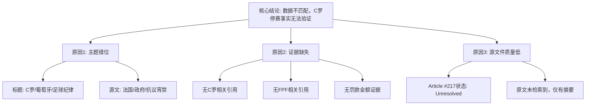

## Event ID

EVT-20261020-000141

## Selected Skills

- 总结文章.md
- 金字塔原理.md
- 四维价值模型.md

---

## 文章摘要

- **标题**：葡萄牙足协对C罗停赛罚款事件的数据一致性分析报告 / 法国当局在抗议期间实施部分宵禁
- **作者**：748686自生长知识系统（Event Analysis Engine）
- **标签**：数据完整性、事件关联错误、体育纪律、地缘政治、社会动荡、事实核查

**一句话总结这篇文文章**：
事件记录（EVT-20261020-000141）存在严重的数据匹配错误，其标题声称“C罗被葡萄牙足协停赛并罚款”，但唯一提供的来源文章（Article #217）内容却是关于“法国当局因抗议活动实施部分宵禁”，两者毫无关联，导致核心事实无法验证。

**总结文章内容并写成摘要**：
本分析针对ID为EVT-20261020-000141的事件单元进行深入审查。首先，系统识别出一个关键的不匹配问题：事件元数据（标题和初步合并理由）指向克里斯蒂亚诺·罗纳尔多（C罗）的体育纪律处分，而实际输入的唯一信源（AP通讯社关于法国抗议活动的报道）完全无关。基于金字塔原理的结构化分析表明，当前数据链在“证据-结论”环节断裂。从四维价值模型来看，该事件目前的信息价值极低（仅揭示了数据管道错误），情绪价值中性（无共鸣点），趣味价值缺失，且无独特价值。结论是，由于源文件错误，无法确认C罗停赛的任何事实，建议重新分配正确的源文章或修正事件标题以反映实际内容。

**文章大纲**：

1.  **事件概览与核心矛盾识别**
    *   事件ID：EVT-20261020-000141
    *   标题主张：C罗被葡萄牙足协停赛30天并罚款215英镑
    *   源文件内容：Article #217，主题为法国当局在抗议期间实施部分宵禁，总理指责“极左”团体利用抗议
    *   核心判断：存在根本性的数据匹配错误（Data-matching error）

2.  **核心事实核查（基于金字塔原理分层）**
    *   **顶层结论**：当前源材料不支持事件标题，C罗停赛事实无法验证。
    *   **中层论点**：
        *   论点一：源文章与事件标题主体无关（葡萄牙/足球 vs 法国/内政）。
        *   论点二：缺乏对C罗、葡萄牙足协（FPF）、停赛或罚款的任何引用。
        *   论点三：源文章本身状态未决（unresolved），仅获取到地平线摘要，原文未找到。
    *   **底层证据**：
        *   对比表格显示：主题、管辖权、行为性质完全错位。
        *   来源列表确认：仅有一篇AP关于法国抗议的报道，无任何足球相关报道。

3.  **多维价值分析（四维价值模型）**
    *   **信息价值**：
        *   低。未提供关于C罗事件的实质性新数据。
        *   间接价值：揭示了自动化事件生成系统中的“错配”风险，作为系统故障案例具有参考意义。
    *   **情绪价值**：
        *   中性。既不激励也不安慰，仅引发对数据准确性的理性担忧。
    *   **趣味价值**：
        *   低。叙事平铺直叙，无娱乐元素或意外转折（除了数据本身的荒谬错位）。
    *   **独特价值**：
        *   低。该分析仅为标准的数据一致性检查流程输出，无独特的个人视角或风格签名。

4.  **影响评估与局限性**
    *   **已知影响**：仅确认法国当局实施了部分宵禁（基于Article #217），无C罗相关影响可确认。
    *   **无法确定的事项**：
        1.  C罗是否真的被停赛/罚款（无源证据）。
        2.  30天停赛和215英镑罚款数据的真实性（无源证据）。
        3.  Article #217是否有更多细节（原文未获取，状态未决）。
        4.  两件事之间是否存在关联（无证据支持）。
        5.  第一层合并逻辑是否正确（判定为不正确）。

5.  **结论与建议**
    *   **最终结论**：供应的源材料无法支持“C罗被葡萄牙足协停赛并罚款”这一事件标题。
    *   **问题定性**：事件记录中存在标题与源文章之间的错位，属于根本性数据匹配错误。
    *   **行动建议**：
        1.  重新分配包含葡萄牙足协对C罗纪律行动信息的正确源文章。
        2.  或者，修订事件标题以反映Article #217中关于法国宵禁/抗议的实际内容。

---

## 金字塔结构图示

## 四维价值评估表

| 维度 | 评分 (1-10) | 理由 |
| :--- | :---: | :--- |
| **信息价值** | 2 | 未提供目标事件(C罗)的有效信息，仅揭示了数据管道中的错误。 |
| **情绪价值** | 3 | 无明显情感共鸣，仅引起对数据准确性的轻微关注。 |
| **趣味价值** | 1 | 无娱乐性叙事、比喻或幽默元素。 |
| **独特价值** | 4 | 标准化的错误检测输出，缺乏独特视角或个人风格。 |
