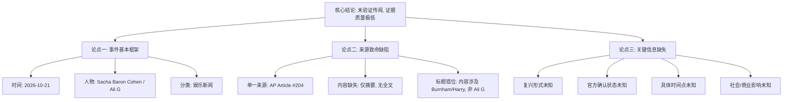

## Event ID

EVT-20261021-000137

## Selected Skills

- 总结文章.md
- 金字塔原理.md

---

## 标题
Ali G 角色复兴传闻（待验证）

## 作者
748686 自生长知识系统（Event Analysis Engine）

## 标签
娱乐新闻、Sacha Baron Cohen、Ali G、事实核查、来源存疑、AP新闻

## 一句话总结这篇文文章
2026年10月21日记录了一起关于Sacha Baron Cohen旗下角色“Ali G”可能复出的事件，但因唯一来源文章正文缺失且标题内容不匹配，该信息目前仅为未经证实的传闻。

## 总结文章内容并写成摘要
本事件记录于2026年10月21日，核心主题是英国喜剧演员Sacha Baron Cohen旗下的经典角色“Ali G”可能迎来复兴。然而，经过对现有证据的深入分析，发现该事件存在严重的证据缺陷。虽然初步元数据将事件归类为娱乐/文化新闻并指向Ali G角色的复兴，但提供信息的唯一来源（Article #204，美联社AP）实际上仅提供了一份摘要，且其标题涉及的是另一组完全不同的主题（Burnham面临的气候反抗及Harry试图修复关系）。由于无法获取原始文章的完整正文，无法确认Ali G复兴的消息是否真实存在于文章中，还是由外部知识错误关联所致。此外，缺乏多方来源验证，使得该事件的影响力、具体形式（电影、电视特辑或公开露面）及时间安排均无法确定。因此，该事件目前被定性为“低质量证据的未验证声明”。

## 大纲（基于金字塔原理结构化展开）

**一、 核心结论（塔尖）**
*   **事件状态**：未验证的传闻（Unverified Claim）。
*   **主要风险**：证据质量极低，存在来源与主题不匹配的重大疑点。
*   **最终建议**：暂不予采信，需等待完整原文 retrieval 或独立来源交叉验证。

**二、 关键论点支撑（塔身）**

1.  **论点一：事件基本信息与初步定性**
    *   **时间**：2026年10月21日。
    *   **主体**：Ali G 角色，关联人物 Sacha Baron Cohen。
    *   **分类**：娱乐/文化新闻。
    *   **初步评估**：尽管主题明确，但可信度初始评分较低。

2.  **论点二：单一来源的严重缺陷**
    *   **来源限制**：仅依赖 Article #204（美联社 AP），无其他独立媒体佐证。
    *   **内容缺失**：仅提供 "Horizon Summary"（摘要），无全文。
    *   **标题冲突**：文章标题为《[The Papers: 'Burnham faces climate revolt' and 'Harry wants to fix feud']》，与 Ali G 复兴无关。
    *   **逻辑推断**：若原文确实包含 Ali G 内容，则属于次要信息；若原文不包含，则事件元数据关联错误。由于全文缺失，这一矛盾无法解开。

3.  **论点三：关键事实无法确定**
    *   **复兴形式**：是电影、剧集、访谈还是现场表演？未知。
    *   **官方确认**：是否有正式公告？未知。
    *   **时间线**：何时发生？未知。
    *   **公众影响**：媒体反应和商业后果如何？因证据不足，无法评估。

**三、 底层证据与分析细节（塔基）**

*   **证据 A：来源核查结果**
    *   原始 URL 未被 Horizon digest 系统找到。
    *   未检索到可信的原始文本。
    *   文件状态标记为 "Unresolved / Horizon Summary Only"。
*   **证据 B：交叉来源验证状态**
    *   状态：Insufficient Evidence（证据不足）。
    *   原因：无法进行独立来源比对。
*   **证据 C：冲突识别**
    *   **元数据 vs. 内容冲突**：事件标题指向 Ali G，但可用文章标题指向政治/皇室新闻。这是导致怀疑的核心技术原因。
*   **证据 D：已知影响**
    *   当前无已知公众反应或媒体报道，因为核心信息本身未得到证实。

---

**附录：金字塔结构可视化简述**

