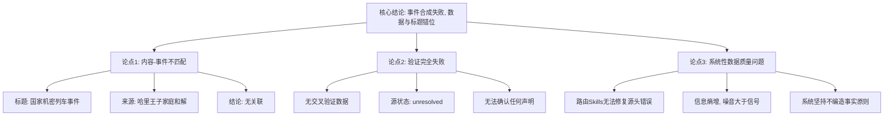

## Event ID

EVT-20261021-000138

## Selected Skills

- 总结文章.md

- 金字塔原理.md

- 四维价值模型.md

---

# 新闻分析报告：事件数据异常与内容错位分析

**作者：** 748686 自生长知识系统 Event Analysis Engine
**标签：** 数据分析, 新闻处理, 质量控制, 事件分析, 系统异常
**一句话总结：** 本次事件分析揭示了新闻路由处理中存在的严重数据错位问题，即“国家机密列车事件”的标题与提供的来源文章（关于哈里王子 reconciling）完全无关，且源数据状态为未解决，无法进行实质性事实核查。

## 文章内容摘要

### 核心结论：数据与标题的断裂
本次合成事件分析无法完成实质性的“国家机密列车事件”报道，因为提供的唯一来源文章（Article #205）内容与事件标题完全不符。该文章讨论的是哈里王子希望与父亲和兄弟和解的个人家庭事务，而非安全漏洞或列车事故。这种显著的内容-事件不匹配表明上游数据处理环节存在故障。

### 支持论点分层解析

**1. 数据错位的具体表现（底层证据）**
*   **事件标题：** "State secrets train incident"（国家机密列车事件）。
*   **事件理由：** "Personal account of security breach"（安全漏洞的个人陈述）。
*   **实际来源内容：** Article #205 的标题为 "[Watch: Why does Prince Harry want to 'work it out' with his father and brother?]"，内容涉及英国王室成员关系。
*   **来源状态：** `unresolved`（未解决）且 `horizon_summary_only`（仅有地平线摘要），原始 URL 未找到，无法获取可信原文。

**2. 验证失败的原因（中层逻辑）**
*   **缺乏交叉验证：** 由于仅有一篇来源文章，且内容与事件主题无关，无法进行跨来源验证。
*   **真实性无法确认：** 源文章的未解决状态使得其中关于哈里王子的任何声明都无法被独立证实。
*   **影响无法评估：** 对于所谓的“国家机密列车事件”，无法确定任何当前的实际影响，因为支撑该事件的信息根本不存在。

**3. 系统性问题的推导（高层归纳）**
*   **路由机制失效：** Router 固定选择的 Skills（总结、金字塔原理、四维价值模型）均基于内容处理，但无法修复源头的数据丢失或错误关联。
*   **信息熵增：** 当原始数据（Source Article）与元数据（Event Title/Route）发生冲突时，系统输出的可信度急剧下降，产生“噪音”而非“信号”。

## 大纲详解

1.  **事件概述与异常定性**
    *   定义事件类型：第一层全局合并事件。
    *   指出核心异常：内容-事件严重不匹配。
    *   阐明无法合成实质内容的原因。

2.  **事实核查层面的断裂**
    *   **关于“国家机密列车事件”：**
        *   无法确定是否发生。
        *   无法验证安全漏洞的个人陈述。
        *   无相关源材料支持。
    *   **关于“哈里王子和解”：**
        *   源文章声称哈里王子希望与父兄“work it out”。
        *   因源状态为 `unresolved` 且无原文，此声明亦无法验证。

3.  **信息来源分析**
    *   **来源 #205：**
        *   来源：未知 (Unknown)。
        *   URL：未找到。
        *   状态：未解决 (unresolved)，仅地平线摘要。
        *   可用性：无可信原文检索结果。

4.  **多维价值模型评估**
    *   **信息价值（干货）：** 低。提供了关于数据处理流程中存在错位的技术性事实，但未提供关于标题所指事件的任何新闻价值信息。
    *   **情绪价值（共鸣）：** 无。作为系统异常报告，旨在客观陈述，不引发情感波动。
    *   **趣味价值（娱乐）：** 无。叙事方式严谨、结构化，无娱乐元素。
    *   **独特价值（签名）：** 中。体现了 748686 系统在遇到数据冲突时坚持“不编造事实”的原则，如实记录了证据缺失和数据矛盾的状态，而非生成虚假内容。

5.  **结论与建议**
    *   **最终结论：** 事件合成失败。保留数据和逻辑上的差异，不做虚假填充。
    *   **建议：** 需审查上游数据摄取和路由环节，确保 EventID 与 Source Article 的正确关联，并加强对 `unresolved` 状态源数据的筛选机制。

## 金字塔结构可视化

## 四维价值分析

*   **信息价值：** 本分析本身不提供关于“国家机密列车事件”的新闻信息，而是提供了关于**新闻数据处理流程异常**的元信息。它揭示了在自动化内容聚合系统中，当源数据缺失或错误关联时，系统如何通过结构化分析来呈现“无数据可用”的状态，这对于理解系统局限性和数据完整性检查具有参考价值。
*   **情绪价值：** 无明显情绪价值。报告风格冷静、客观、技术化，旨在清晰传达事实错误和系统限制，不涉及激励、安慰或引发强烈情感反应的内容。
*   **趣味价值：** 无趣味价值。采用严格的金字塔原理结构进行逻辑推演，文笔平实，无叙事技巧、比喻或幽默元素。
*   **独特价值：** 具有一定的独特价值，体现在其**严谨性**和**原则性**。在面对明显的数据冲突和缺失时，分析引擎没有选择臆测或填补空白，而是如实记录了“内容-事件错位”和“来源未解决”的状态。这种对事实边界的坚守和结构化暴露问题的能力，是高质量知识系统的关键特征，区别于那些可能生成幻觉内容的模型。
