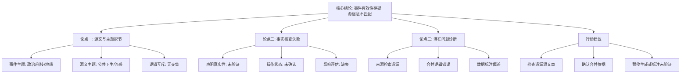

## Event ID

EVT-20261023-000509

## Selected Skills

- 总结文章.md

- 金字塔原理.md

---

### 事件摘要

**标题**：特朗普称马斯克恢复乌克兰星链（源信息不匹配）
**标签**：地缘政治、科技外交、源数据校验、事实核查
**一句话总结**：系统合并的事件（特朗普声称马斯克恢复乌克兰Starlink接入）与唯一提供的源文章（美国西海岸流感疫情）完全无关，导致核心事实无法确认，事件有效性存疑。
**大纲详情**：

1. **核心结论（Top Level）**
   - 当前EventUnit无法构建有效知识文档，因为源文章与事件主题存在根本性不匹配。

2. **关键论点一：源文章与事件主题完全脱节**
   - **论据A：事件主题界定**
     - 事件涉及政治人物（特朗普）、科技企业家（马斯克）、基础设施（Starlink）及地缘冲突（乌克兰）。
   - **论据B：源文章内容界定**
     - 唯一源文章（ARTICLE #248）主题为公共卫生，涉及美国西海岸流感病例早期上升及疫苗接种建议。
   - **论据C：逻辑互斥**
     - 两主题无任何交集，导致无法提取支持事件声明的有效信息。

3. **关键论点二：事实核查失败**
   - **论据A：声明真实性未验证**
     - 提供的材料中未包含任何关于“特朗普发表该声明”的记录。
   - **论据B：操作状态未确认**
     - 没有源信息证实或反驳“马斯克恢复乌克兰Starlink接入”这一操作变化。
   - **论据C：影响评估缺失**
     - 缺乏相关报道，无法分析该声明的政治、军事或社会影响。

4. **关键论点三：潜在问题诊断**
   - **可能性A：来源检索遗漏**
     - 可能存在与事件主题相关的关键源文章未被当前输入包含。
   - **可能性B：合并逻辑错误**
     - 事件合并理由可能基于未提供的源数据，导致错误的关联。
   - **可能性C：数据标注偏差**
     - 源文章ID（#248）可能与事件ID匹配错误。

5. **行动建议（Bottom Level）**
   - **短期措施**：检查是否存在被遗漏的源文章；确认事件合并理由的数据来源。
   - **长期处理**：若暂无其他源文章，应暂停此EventUnit生成，或明确标注为“源信息不足，事件真实性未验证”。

---

**金字塔结构图示**：

