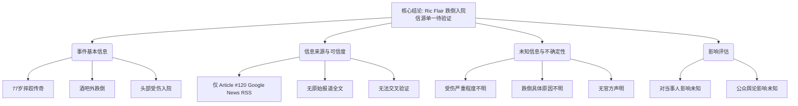

## Event ID

EVT-20261024-000431

## Selected Skills

- 总结文章.md
- 金字塔原理.md

## Event Analysis

### 标题
摔跤传奇 Ric Flair 跌倒受伤入院事件

### 作者
748686 自生长知识系统 Event Analysis Engine

### 标签
#摔跤 #Ric_Flair #医疗事件 #名人新闻 #健康 #单一信源验证

### 一句话总结
2026年10月24日，77岁摔跤传奇人物 Ric Flair 在酒吧外跌倒导致头部受伤被送医，但该消息目前仅基于单一 Google News 聚合标题，缺乏原文及多源交叉验证，详细信息待进一步确认。

### 文章内容摘要

**核心结论（结论先行）**
77岁摔跤传奇 Ric Flair 因在酒吧外跌倒导致头部受伤入院。由于目前仅有一条来自 Google News 聚合页面的标题性报道，且未获取原始新闻全文，该事件的细节（如受伤严重程度、跌倒原因、治疗进展）均处于不确定状态，需持续监测以获取更多独立来源的证实。

**支持论点与详细大纲**

**1. 事件基本信息（顶层核心事实）**
   - **当事人**：Ric Flair，77岁，著名摔跤传奇人物。
   - **事件性质**：意外跌倒导致的头部受伤。
   - **地点**：酒吧外。
   - **后果**：被送医入院治疗。
   - **时间**：报道日期为 2026年10月24日，具体跌倒时间未披露。

**2. 信息来源与可信度分析（归纳逻辑：单一来源局限性）**
   - **来源构成**：
     - 主要依赖 Article #120（news.google.com RSS 聚合）。
     - 无其他独立新闻机构或官方渠道的报道。
   - **内容完整性**：
     - 原始报道全文未获取，内容仅停留在 Google News 的标题摘要层面。
     - 标题摘要称：“77岁摔跤传奇Ric Flair在酒吧外跌倒导致头部受伤被送医”。
   - **验证状态**：
     - 无法进行有效的交叉验证（Cross-Source Verification）。
     - 不存在不同国家或地区视角的差异化报道。
     - 无事实冲突，但也无多方佐证。

**3. 未知与不确定信息（底层证据缺失）**
   - **医疗细节未知**：
     - 头部受伤的具体诊断结果不明。
     - 是否需要手术、住院时长、预后情况均未披露。
   - **事件经过未知**：
     - 跌倒的具体原因不明（是意外滑倒、突发健康状况还是其他原因）。
     - 事发时的具体情境细节缺失。
   - **官方回应未知**：
     - Ric Flair 本人、其团队或相关机构是否发布过正式声明？
     - 目前无相关信息。

**4. 影响评估（演绎逻辑：信源有限则影响不明）**
   - **对当事人影响**：无法判断其健康状况的长期影响或职业生涯后续安排。
   - **对公众舆论影响**：由于缺乏权威媒体深入报道，目前尚未形成广泛的公众讨论或舆论反响。
   - **当前影响范围**：未知。

### 金字塔结构图示

### 后续行动建议
鉴于当前信息的局限性，建议持续关注主流体育新闻（如 ESPN、WWE 官方渠道）及权威综合新闻源，等待多源报道出现后再更新本事件单元，以获取更准确的受伤细节和官方回应。
