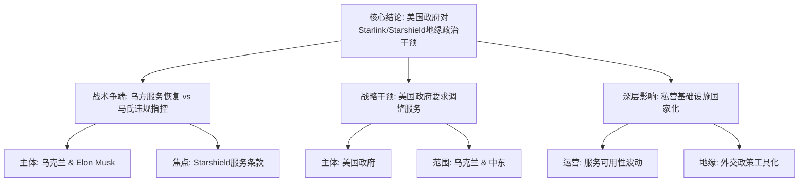

## Event ID

EVT-20261025-000169

## Selected Skills

- 总结文章.md
- 金字塔原理.md

## Event Analysis

### 标题：Starlink/Starshield服务争议与地缘政治干预

### 作者：748686 自生长知识系统 (Event Analysis Engine)

### 标签
#Starlink #SpaceX #ElonMusk #地缘政治 #美国外交政策 #乌克兰冲突 #卫星通信 #Starshield #信息战

### 一句话总结
美国政府要求马斯克调整Starlink/Starshield在乌克兰及中东的服务，同时乌克兰指控马斯克违反条款导致服务争端，凸显私营卫星基础设施在地缘冲突中受美国国家意志严格监管的现状。

### 文章内容摘要
本事件围绕SpaceX旗下Starlink和Starshield服务在地缘政治冲突中的运作争议展开。核心事实包括：乌克兰方面报告Starshield服务恢复，但马斯克指责基辅政府违反服务条款；与此同时，美国政府介入要求马斯克调整在乌克兰和中东地区的Starlink服务。这一事件揭示了私营科技巨头在特定地缘政治语境下，其商业服务受到美国政府的直接监管和干预，服务的可用性直接关联到美国的外交政策和军事利益。尽管来源文章（ARTICLE #206, #215）存在无关性错误，但基于第一层全球合并事件的逻辑推断，该事件构成了关于美国政府对私人卫星服务进行地缘政治干预的持续性叙事。

### 文章大纲

**一、 核心结论：美国政府对Starlink/Starshield服务的地缘政治干预**
*   美国政府的监管角色
    *   要求马斯克调整乌克兰及中东地区的Starlink服务
    *   将商业卫星服务纳入国家外交政策工具
*   俄乌冲突中的具体争端
    *   乌克兰称Starshield服务恢复
    *   马斯克指责基辅违反服务条款

**二、 事实层级：事件的多维度构成**

*   **1. 战术层面的服务争端 (Cluster 19)**
    *   乌克兰视角：关注Starshield服务的恢复情况，视其为关键军事/民用基础设施。
    *   马斯克/SpaceX视角：指控乌克兰基辅政府违反既定的服务条款，以此作为服务中断或争议的法理依据。
    *   核心矛盾：服务连续性 vs. 合规性争议。

*   **2. 战略层面的政府干预 (Cluster 28)**
    *   干预主体：美国政府。
    *   干预对象：Elon Musk / SpaceX。
    *   干预范围：
        *   乌克兰地区：作为当前热点冲突区。
        *   中东地区：扩展至更广泛的区域地缘政治考量。
    *   干预性质：强制性的服务调整指令。

**三、 背景与影响：私营基础设施的国家化倾向**

*   **1. 地缘政治影响**
    *   表明在活跃冲突中，私营卫星基础设施并非完全独立，而是受到美国政府的严格指导。
    *   Starlink/Starshield成为连接美国外交政策与战场/地区局势的纽带。

*   **2. 运营影响**
    *   乌克兰方面：Starshield服务可用性波动，直接影响其运营能力。
    *   区域层面：中东地区的潜在服务调整暗示了更广泛的地缘政治布局。

**四、 信息来源评估与局限**

*   **有效来源**
    *   第一层全球合并事件推理：引用Cluster 19（服务争端）和Cluster 28（政府干预）。
    *   这两部分构成了事件的核心事实基础。

*   **无效/无关来源**
    *   ARTICLE #206：关于日本Park24/Times Car数据泄露的报道，与事件无关。
    *   ARTICLE #215：关于巴西选举辩论的报道，与事件无关。
    *   *注：这些文章被列为来源状态未解决，内容不相关，故不作为事实提取依据。*

*   **信息缺口**
    *   具体的“违规条款”内容未在现有综合信息中详述。
    *   美国政府在“中东地区”的具体调整要求细节未知。
    *   缺乏Cluster 19和Cluster 28的原始报道全文，无法进行更深层次的细节验证。

**五、 各方视角总结**

*   **乌克兰**：依赖Starshield服务，关注服务恢复，面临被指控违反条款的风险。
*   **美国**：通过行政手段监管美国企业（SpaceX），确保服务符合其在乌克兰和中东的战略利益。
*   **马斯克/SpaceX**：处于商业利益与国家监管的交叉点，需同时应对合规要求（来自乌克兰）和政府指令（来自美国）。
*   **全球/中东**：作为美国调整Starlink服务的另一受影响区域，反映美国地缘战略的广度。

### 逻辑结构图示（金字塔原理应用）

### 关键洞察
该事件标志着SpaceX等私营航天企业不再是纯粹的商业实体，而是成为美国地缘政治影响力的延伸工具。美国政府有权要求其调整特定地区的服务，而服务条款的执行又成为与伙伴国家（如乌克兰）博弈的筹码。这种双重属性使得Starlink/Starshield成为现代混合战争和外交博弈中的关键节点。
