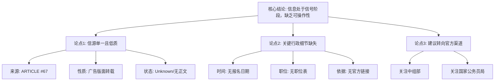

## Event ID

EVT-20261026-000046

## Selected Skills

- 总结文章.md
- 金字塔原理.md

---

## Event Analysis

### 标题：2027年中央机关公务员遴选报名信号分析

### 作者：748686 自生长知识系统 Event Analysis Engine

### 标签
公务员遴选、中央机关、招录政策、事件追踪、低质量信源

### 一句话总结
本事件为“2027年公务员遴选报名”相关的新闻信号，但现有数据来源单一且内容缺失（仅为广告版面标题），无法提取具体报名时间、职位或官方文件细节，仅能作为话题存在的标记，不具备实际指导意义。

### 文章内容摘要

**核心结论（顶层）**
当前关于“2027年公务员遴选报名”的信息处于**信号阶段**，而非**执行阶段**。由于缺乏实质性来源，公众和系统无法从中获取 actionable（可操作）的报名指南。建议关注官方渠道以获取后续确切信息。

**支持性论点（中层）**

1.  **事件定性：转载与广告性质的单一信源**
    *   数据源（ARTICLE #67）被标记为“[06 版 - 广告]”，且来源状态为“Unknown（未知）”。
    *   首层 Global Merge 将其归因为“转载中央机关公开遴选和选调公务员报名通知”，但原始正文内容并未包含该通知的具体条款。

2.  **信息缺失的具体维度（底层证据）**
    *   **时间维度**：无具体的报名起止日期、公告发布日期。
    *   **内容维度**：无遴选职位类别、职位数量、报考条件等关键行政指令内容。
    *   **来源维度**：未找到可信的原始URL，官方发布渠道（如中共中央组织部、国家公务员局）未在本事件中直接验证。

3.  **交叉验证的局限性**
    *   仅有一个来源（Source Count: 1），无法进行多源交叉验证。
    *   存在“归因提到的详细信息”与“源文章实际可提取信息”之间的落差，导致可信度存疑。

**详细大纲与要点列举**

*   **一、 事件背景与归因**
    *   **时间戳**：2026年10月26日
    *   **事件主题**：2027年公务员遴选报名相关工作
    *   **归因来源**：首层合并事件判断，指向“中央机关公开遴选和选调公务员报名通知”的转载。

*   **二、 核心事实核查（基于现有材料）**
    *   **事实1：来源质量低**
        *   源文章标题为“[06 版 - 广告]”，评分缺失（?/10）。
        *   内容状态为 `horizon_summary_only`，即仅有摘要占位符，无正文。
    *   **事实2：关键信息缺失**
        *   报名时间：无法确定。
        *   遴选职位：无相关信息。
        *   官方依据：虽有背景提及，但无具体链接或文件编号。

*   **三、 信息差异与冲突分析**
    *   **差异点**：首层归因暗示存在正式的“中央机关通知”，但实际提供的源文章并未包含任何通知文本。
    *   **冲突点**：无直接冲突，但存在“期望信息”与“实际获得信息”之间的巨大落差。

*   **四、 影响评估与后续建议**
    *   **当前影响**：无法评估具体社会或行政影响，因缺乏执行细节。
    *   **系统结论**：本事件单元仅作为“2027年公务员遴选报名”相关话题存在的**信号标记**。
    *   **行动建议**：
        *   不作为获取报名操作指南的依据。
        *   建议后续关注中共中央组织部或国家公务员局等官方渠道发布的正式公告。

### 金字塔结构可视化示意

### 结论
基于金字塔原理的结构化分析，本事件的核心在于**信息的不完整性**。虽然“2027年公务员遴选报名”是一个高关注度的公共事务话题，但当前数据源（ARTICLE #67）仅提供了一个空洞的标题和归因，缺乏支撑具体行动的实质内容。因此，该事件的最终分析结论是：**保留信号，等待验证，暂缓传播具体操作细节**。
