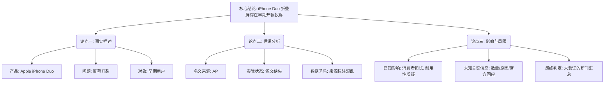

## Event ID

EVT-20261027-000003

## Selected Skills

- 总结文章.md

- 金字塔原理.md

---

## 标题

Apple iPhone Duo 早期用户反馈屏幕开裂问题报道分析

## 作者

KBS World News Digest (综合报道) / 原始归属：Associated Press (AP)

## 标签

#科技新闻 #苹果公司 #iPhoneDuo #折叠屏手机 #产品质量 #屏幕开裂 #消费者投诉 #新闻聚合

## 一句话总结这篇文章

KBS World News 聚合了美联社关于苹果折叠屏手机“iPhone Duo”早期出现屏幕开裂投诉的技术新闻报道，但由于源文件缺失，事件详情尚待进一步验证。

## 总结文章内容

**摘要**

2026年10月27日，KBS World News Digest 推送了一条来自美联社（AP）的科技新闻，指出苹果公司推出的折叠屏智能手机“iPhone Duo”在早期用户群体中引发了关于屏幕开裂的硬件耐久性投诉。然而，由于原始新闻正文未能成功获取，且元数据中同时存在“来源未知”与“原文链接未找到”的矛盾信息，该事件目前仅停留在标题层面的初步报告阶段。分析显示，该报道反映了消费者对新型折叠屏设备耐用性的初步担忧，但缺乏具体投诉数量、故障条件、苹果官方回应及召回政策等关键细节，属于未经验证的信息状态。

## 文章大纲

### 一、 核心结论（事件定调）
*   **事件性质**：关于苹果新品硬件质量缺陷的初步新闻报道。
*   **核心冲突**：创新技术（折叠屏）与产品耐久性（屏幕易碎）之间的矛盾。
*   **数据状态**：不可靠/未验证（因源文缺失）。

### 二、 主要论点与支持证据

#### 1. 产品与问题描述（What）
*   **涉及产品**：Apple iPhone Duo（苹果折叠屏智能手机）。
*   **具体问题**：早期 adopters（先行使用者）报告出现屏幕开裂现象。
*   **问题归类**：硬件耐久性问题（Hardware durability issues）。

#### 2. 信源与透明度分析（Source Verification）
*   **名义来源**：美联社（Associated Press, AP）。
*   **实际可得性**：
    *   原始正文未获取成功（`horizon_summary_only`）。
    *   元数据显示“Original URL: Not found”。
    *   部分数据标记为“Source: Unknown”。
*   **内部矛盾**：标题归属 AP，但内容追踪指向未知来源，存在数据完整性缺口。

#### 3. 当前已知影响（Impact）
*   **消费者情绪**：早期用户对折叠屏结构的可靠性产生疑虑。
*   **品牌声誉**：iPhone Duo 作为折叠形态产品，面临初期耐用性挑战的舆论压力。

### 三、 缺失信息与待验证内容（Gap Analysis）
*   **数量维度**：投诉的具体数量及比例不明。
*   **因果维度**：开裂的具体场景（正常折叠、跌落、制造缺陷）不明。
*   **应对维度**：苹果官方是否有回应、是否启动召回或维修计划不明。
*   **范围维度**：是系统性故障还是孤立个案不明。

### 四、 建议与后续行动（Actionable Insights）
*   **短期**：关注苹果官方对此类报道的回应或声明。
*   **长期**：需等待完整源文（AP原文）恢复后，才能评估该事件的严重性及对市场竞争格局的影响。

---

## 金字塔结构图

**逻辑说明**：
1.  **结论先行**：首先明确事件的核心——即“有报道指出 iPhone Duo 存在屏幕开裂问题”，并直接点明当前信息的局限性。
2.  **自上而下**：将分析分为三个关键支柱：事实本身（是什么）、来源可信度（哪里来）、影响与缺失（意味着什么）。
3.  **分组归类**：
    *   **论点一**聚焦于产品物理层面的问题描述。
    *   **论点二**聚焦于信息传播链路的可靠性评估（这是本事件的关键风险点）。
    *   **论点三**聚焦于后果分析与未来验证方向。
4.  **MECE原则**：三个论点相互独立，涵盖了从客观事实、主观信源到综合影响的完整闭环，无内容重叠。
