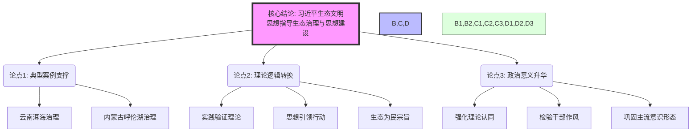

## Event ID

EVT-20261027-000375

## Selected Skills

- 总结文章.md
- 金字塔原理.md

## Event Analysis

### 标题：人民日报评论员观察《一江碧水悟思想》发布，以洱海、呼伦湖治理阐释生态文明思想与党建关联

### 作者：系统自动提取（来源：人民日报 2026-10-27）

### 标签
#习近平生态文明思想 #人民日报 #评论员观察 #洱海治理 #呼伦湖治理 #党的建设 #意识形态建设 #生态治理

### 一句话总结
2026年10月27日《人民日报》第五版刊发评论员观察文章《一江碧水悟思想》，以洱海和呼伦湖的生态治理实践为案例，阐述习近平生态文明思想对党的思想建设的指导意义。

### 文章摘要
本文基于2026年10月27日《人民日报》第五版（评论版）的目录索引及事件元数据进行分析。当日刊发的评论员观察文章题为《一江碧水悟思想》，该文章选取了中国两个典型的湖泊生态修复案例——云南洱海和内蒙古呼伦湖，通过“碧水”这一具象成果来体悟和阐释“思想”的理论内涵。文章的核心逻辑在于建立生态治理成效与党的思想建设之间的内在联系，即通过将习近平生态文明思想贯彻于具体的湖泊治理实践中，体现党的理论武装和思想建设的深度与实效。该报道发布于《人民日报》评论版面，属于党媒官方叙事的一部分，旨在强化生态文明思想在党建和意识形态工作中的地位。需要注意的是，本次分析所依据的原始来源文档（ARTICLE #533）仅为当版面的目录索引页，未包含文章正文全文，因此具体分析论点、引用的数据细节及论证过程均基于事件元数据中的描述性信息，而非直接摘录自原文。

### 文章大纲

**一、 核心结论（顶层）**
*   习近平生态文明思想是指导生态治理和党的思想建设的重要理论武器。
*   洱海和呼伦湖的治理成功是践行该思想的生动体现，也是检验思想建设成效的试金石。

**二、 主要支撑论点（中层）**

1.  **案例呈现：典型湖泊的生态治理实践**
    *   **云南洱海治理**：作为高原湖泊保护的代表，其治理过程体现了对生态优先、绿色发展的坚持。
    *   **内蒙古呼伦湖治理**：作为北方重要湿地和湖泊，其恢复与保护反映了生态文明建设在边防和草原地区的重要性。
    *   *注：具体治理措施、数据及面临的挑战因原文缺失无法详述，但二者共同构成了“一江碧水”的实证基础。*

2.  **理论阐释：从“碧水”到“悟思想”的逻辑转换**
    *   **实践出真知**：通过治理成效验证理论的科学性和真理性。
    *   **思想引领行动**：强调习近平生态文明思想在具体工作中的指导地位。
    *   **生态为民**：治理成果最终服务于人民群众对美好生态环境的需求，体现党的宗旨。

3.  **政治升华：生态治理与党的思想建设相结合**
    *   **意识形态维度**：将生态治理成效上升到思想建设高度，强化理论认同。
    *   **党建融合**：暗示生态环境治理是检验党员干部作风和执政能力的重要领域。
    *   **政治宣示**：通过主流媒体（人民日报）发声，巩固主流意识形态话语权。

**三、 背景与细节（底层）**

*   **发布时间**：2026年10月27日
*   **发布媒体**：《人民日报》（中国共产党中央委员会机关报）
*   **版面位置**：第五版（评论版）
*   **文章体裁**：评论员观察（Commentator Observation），通常代表官方立场或深入的政策解读。
*   **同版相关文章**：
    *   《草原“守护者”负重前行》（现场评论）
    *   《共同守护保护，共同守护文化灵魂》（人民时评）
    *   《读懂课本里的长征（微观）》
*   **编辑人员**：李浩然、张帆、李铁林
*   **数据来源限制说明**：当前分析基于事件元数据描述，原始来源文档（ARTICLE #533）仅包含目录索引信息，未提供文章正文全文，故无法引用原文具体语句或详细数据。

### 金字塔结构图示（逻辑关系）

### 关键洞察

1.  **数据局限性警示**：本次分析存在显著的信息缺口。原始新闻源（ARTICLE #533）仅为目录页，未包含《一江碧水悟思想》的正文内容。所有关于“洱海”、“呼伦湖”、“思想建设”的具体关联细节均源自事件元数据的描述性文字，而非原文直接引用。这可能导致对文章具体论证逻辑的推断存在偏差。
2.  **官方叙事特征**：文章发表于《人民日报》评论版，且与《草原“守护者”负重前行》等同类主题文章同版，显示出当前宣传口径对“生态文明”与“基层/边疆治理”双重议题的关注，旨在构建从具体实践到宏观思想的完整叙事链条。
3.  **概念关联性**：标题“一江碧水悟思想”采用了具象（碧水）与抽象（思想）结合的手法，符合中国共产党宣传工作中常见的“以小见大”、“知行合一”的表达策略，强调通过可见的治理成果来深化对指导思想的理解和信仰。
