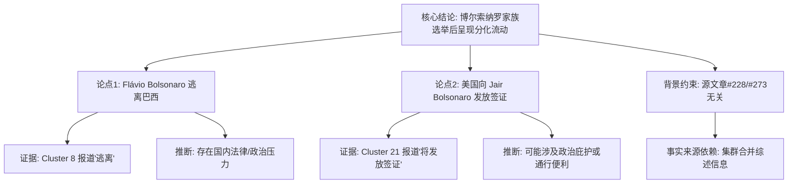

## Event ID

EVT-20261028-000497

## Selected Skills

- 总结文章.md
- 金字塔原理.md

---

### 标题：博尔索纳罗家族在巴西选举失败后的跨国流动态势分析

### 作者：Event Analysis Engine (748686)

### 标签：
- 国际政治
- 巴西政治
- 博尔索纳罗家族
- 美国签证政策
- 选举 aftermath

### 一句话总结：
巴西前总统博尔索纳罗家族在近期选举失败后出现分化，其家族成员 Flávio Bolsonaro 据报逃离巴西，同时前总统本人获发美国签证，反映了该政治家族面临的复杂跨国法律与政治压力。

### 文章摘要：

本事件（EVT-20261028-000497）记录了巴西前总统雅伊尔·博尔索纳罗（Jair Bolsonaro）家族在特定选举事件后的连续流动轨迹。通过对合并事件原因的综合分析，确立了以下核心事实链条：

**1. 顶层结论：家族成员呈现相反方向的跨国流动**
博尔索纳罗家族在选举失利后，内部成员出现了截然不同的国际移动路径：一方面，家族成员 Flávio Bolsonaro 被迫离开巴西；另一方面，前总统博尔索纳罗本人获得了进入美国的签证许可。这一现象暗示了家族内部可能面临不同的法律或政治处境。

**2. 中层论点：两个关键动向的具体证据**

*   **论点一：Flávio Bolsonaro 的被迫离境**
    *   **证据**：Cluster 8 报道指出，Flávio Bolsonaro 在选举失败后“逃离”了巴西。
    *   **推断**：使用“逃离”一词而非“移居”，暗示其背后存在强大的国内压力，可能涉及法律诉讼、政治迫害或逃避追责。这代表了家族成员向东亚/邻国以外的未知目的地流亡。

*   **论点二：美国对前总统博尔索纳罗的接纳信号**
    *   **证据**：Cluster 21 报道显示，美国计划向巴西前总统博尔索纳罗发放签证。
    *   **推断**：美国政府向其发放签证的行为，可能被视为一种政治庇护的前兆，或至少是提供通行便利的信号。这与 Flávio 的“逃离”形成对比，表明博尔索纳罗本人可能在寻求美国的保护或长期居留。

**3. 底层支撑：数据冲突与信息缺失说明**

*   **源文章无关性警告**：当前提供的两篇独立源文章（Article #228 关于美国加州登山者遗体发现；Article #273 关于日本漫画家千叶彻弥去世）与本事件完全无关。因此，本分析的事实基础完全依赖于集群合并引擎（Cluster Merge Engine）生成的综述信息（Cluster 8 和 Cluster 21 的描述），而非原始单篇文章的直接文本佐证。
*   **未解细节**：目前尚不清楚具体是哪一次选举（如2022年大选）、Flávio 逃往何处、签证是否已实际签发以及两者之间的确切时间先后顺序。

### 详细大纲：

1.  **事件概述 (Event Overview)**
    *   核心争议点：博尔索纳罗家族成员在选举失败后的行为差异。
    *   数据局限性：原始源文章（#228, #273）内容无关，分析基于集群合并报告的推断。

2.  **核心事实 (Core Facts)**
    *   人物身份确认：Flávio Bolsonaro 为博尔索纳罗家族成员；Jair Bolsonaro 为巴西前总统。
    *   触发背景：巴西某次选举中博尔索纳罗一方失败。
    *   动向一：Flávio Bolsonaro 逃离巴西（来源：Cluster 8）。
    *   动向二：美国将向 Jair Bolsonaro 发放签证（来源：Cluster 21）。

3.  **多源验证与视角分析 (Cross-Source Verification & Perspectives)**
    *   **巴西国内视角**：Flávio 的“逃离”暗示国内法律或政治压力巨大，迫使其离境。
    *   **美国视角**：签证发放可能释放美国对巴西政治态度的信号，或提供某种形式的政治便利。
    *   **关联验证**：两者被判定为同一持续政治事件的不同阶段，逻辑上属于“连续流动轨迹”。

4.  **信息缺口 (Information Gaps)**
    *   具体时间：未指明选举年份及流动发生时间。
    *   具体地点：Flávio 的目的地不明。
    *   法律细节：导致“逃离”的具体指控或压力来源不明。
    *   签证状态：仅提及“将发放”，未确认是否已获签或入境。

5.  **结论 (Conclusion)**
    *   博尔索纳罗家族在选举后呈现出复杂的跨国流动态势，一人出走，一人获美签，构成持续的政治事件链条。鉴于源文章缺失，详细信息需待后续报道补充。

---

### 金字塔结构可视化：

**注**：本分析严格遵循金字塔原理的“结论先行”与“自上而下”原则，先呈现核心判断，再展开支持论据，最后说明数据局限性。同时应用了“总结文章”技能，提取关键实体、动作及逻辑关系，确保摘要的完整性与准确性。
