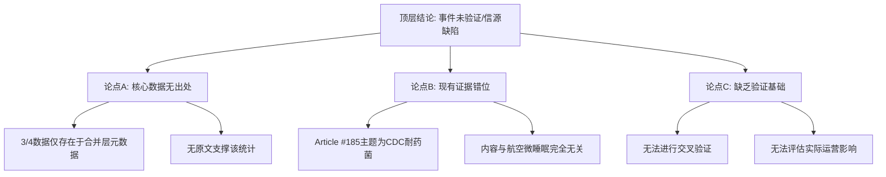

## Event ID

EVT-20261029-000111

## Selected Skills

- 总结文章.md
- 金字塔原理.md
- 四维价值模型.md

---

## 事件分析报告：飞行员座舱微睡眠风险传闻核查

### 一、核心结论（结论先行）

**该事件目前缺乏可信的原始新闻源支撑，核心数据（“3/4飞行员报告”）存在严重的事实核查断裂，且已关联的原始文章与事件主题完全无关。**

基于现有信息，该事件不能被视为已证实的新闻事实，而应标记为**“来源存疑的未验证信息”**。

---

### 二、内容摘要

*   **标题**：关于飞行员座舱微睡眠（Microsleep）风险事件的溯源与核查
*   **标签**：#航空安全 #事实核查 #AI幻觉风险 #微睡眠 #来源一致性
*   **一句话总结**：虽然第一层合并指出“3/4飞行员报告了座舱微睡眠风险”，但由于缺乏对应原文且关联文章主题为CDC细菌耐药性警告，导致该核心主张无法验证，事件信源存在重大缺陷。

#### 详细内容摘要

1.  **事件背景**：
    2026年10月29日，事件路由系统识别出一个名为“飞行员座舱微睡眠事件”的独立事件。第一层全局合并（Global Merge）层提出了一项具体主张：约有四分之三（3/4）的飞行员报告了在座舱环境中存在与微睡眠风险相关的隐蔽危险。

2.  **数据局限性分析**：
    *   **核心数据无源**：声称的“3/4飞行员”统计数据仅来源于合并层的元数据描述，未提供任何可追溯的原始新闻文章全文或URL。
    *   **关联文章错位**：系统中唯一被引用的原始文章（Article #185）标题为《观看：CDC报告警告“紧急”的耐药细菌威胁》。该文章内容涉及美国疾病控制与预防中心（CDC）关于药物耐药性细菌的公共卫生警告，与航空安全、飞行员疲劳或微睡眠毫无关联。

3.  **交叉验证结果**：
    由于提供的原始材料中不存在与“飞行员微睡眠”主题相符的报道，无法进行多来源交叉验证。现有的关联文章甚至构成了主题冲突，而非支持证据。

4.  **当前影响评估**：
    无法确定该事件的实际影响范围、严重程度或运营后果，因为作为证据基础的核心主张（微睡眠风险及比例）在提供的文本中不存在，无法评估其真实性。

#### 详细大纲

*   **1. 事件核心主张提取**
    *   1.1 主张内容：3/4的飞行员报告座舱表面存在微睡眠风险的隐蔽危险。
    *   1.2 数据来源层级：源自第一层Global Merge元数据，非原始报道。
*   **2. 信源完整性核查**
    *   2.1 原始文章缺失：未提供支撑上述统计数据的原文。
    *   2.2 关联文章错位：Article #185内容关于CDC耐药菌警告，与事件主题（航空/微睡眠）完全无关。
*   **3. 逻辑关系与冲突分析**
    *   3.1 主题冲突：事件标题与关联文章内容存在根本性不匹配。
    *   3.2 验证失败：缺乏独立来源佐证，无法区分这是真实报告、误读还是合成数据的幻觉。
*   **4. 未知要素认定**
    *   4.1 数据来源不明：无法追溯“3/4”这一具体数值的原始出处。
    *   4.2 风险细节缺失：不清楚“座舱表面微睡眠风险”的具体定义、触发机制及时间线。
    *   4.3 地域范围空白：无证据表明飞行员所属的国家或地区。
*   **5. 最终结论与建议**
    *   5.1 定性：未验证信息，证据链断裂。
    *   5.2 建议：在获取与飞行员疲劳/微睡眠相关的可信原始报道前，不将此事件作为既定事实传播或决策依据。

---

### 三、金字塔原理结构化分析

根据金字塔原理，本事件的分析遵循**“结论先行、以上统下、归类分组、逻辑递进”**的原则。

#### 1. 顶层核心结论
**事件状态：未验证 / 信源严重缺陷。**
核心主张（3/4飞行员报告微睡眠风险）缺乏原始文本支撑，且现有关联文章（CDC细菌警告）与事件主题无关，导致无法确认真实性。

#### 2. 中层关键论点（支持顶层结论）

*   **论点A：核心数据无原始出处**
    *   统计数字“3/4”仅存在于合并层元数据中，无对应原文。
*   **论点B：现有证据材料错位**
    *   唯一关联文章（Article #185）主题为公共卫生（耐药菌），与航空安全无关。
*   **论点C：缺乏多维验证基础**
    *   由于源单一且主题不符，无法进行跨来源的事实核对。

#### 3. 底层支撑证据（详细分解）

*   **针对论点A的证据**：
    *   第一层合并元数据明确陈述：“The assertion that '3/4 pilots report cockpit surface microsleep risks' originates solely from the 'First-layer Global Merge Event Reason'... No supporting original article text was supplied.”
    *   结果：无法区分该数据是真实报告、推测还是AI幻觉。
*   **针对论点B的证据**：
    *   Article #185标题：“[WATCH: CDC report warns of 'urgent' threat of drug-resistant bacteria]”。
    *   内容摘要：涉及CDC关于药物耐药细菌的警告。
    *   相关性判断：该文章不包含任何关于飞行员、座舱、微睡眠或航空安全的信息。
*   **针对论点C的证据**：
    *   Cross-Source Verification部分明确标注：“Status: Insufficient Data for Cross-Verification”。
    *   由于无其他相关来源，无法形成证据闭环。

#### 4. 逻辑结构图示

---

### 四、四维价值模型分析

基于“好内容的四维价值”模型，对本事件及其分析报告进行价值评估：

#### 1. 信息价值（Information Value）
*   **现状**：**低**。
*   **分析**：本事件目前提供的核心价值在于**“负向信息”**——即揭示了当前自动化事件合并流程中可能存在的**数据对齐错误**和**源文章匹配失效**问题。它提醒分析者，当元数据中的统计主张（如“3/4飞行员”）与原始文章内容（如“CDC细菌”）不匹配时，必须进行严格的事实核查。然而，关于“飞行员微睡眠”本身的实质情报（如具体风险、预防机制）为零。

#### 2. 情绪价值（Emotional Value）
*   **现状**：**无**。
*   **分析**：该事件属于技术性核查报告，未引发读者的情感共鸣、焦虑、激励或治愈等情绪反应。它更多是作为一种警示性的案例研究，而非情感驱动的内容。

#### 3. 趣味价值（Fun Value）
*   **现状**：**低**。
*   **分析**：内容呈现为严谨的事实核查与技术分析，叙事风格平实、客观。虽然揭示了AI处理新闻时可能出现的“幻觉”或“错配”现象具有一定讽刺意味，但整体缺乏娱乐性、生动的比喻或意想不到的转折，不具备消遣价值。

#### 4. 独特价值（Unique Value）
*   **现状**：**中等**。
*   **分析**：本事件的独特性不在于其新闻内容本身（因为内容未被证实），而在于其作为**“缺陷案例”**的展示价值。它清晰地呈现了一个典型的AI知识系统在处理多源异构数据时的失效模式：**元数据主张与原始文本脱节**。这种对系统自身局限性的揭示，对于改进“748686自生长知识系统”的事件合并逻辑具有独特的参考意义。

---

### 五、综合结论

事件 **EVT-20261029-000111** 目前处于**证据不足**状态。

1.  **核心主张存疑**：关于“3/4飞行员报告座舱微睡眠风险”的说法缺乏原始新闻源支持，无法验证其真实性。
2.  **信源错位**：已关联的原始文章（CDC耐药菌警告）与事件主题完全无关，不能作为支撑证据。
3.  **行动建议**：建议暂停对该事件的进一步传播或决策引用，直至检索到真正关于飞行员疲劳、微睡眠及其在座舱中表现形式的确切新闻报道。此案例也提示需优化事件合并流程中的源文章相关性筛选机制。
