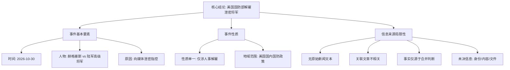

## Event ID

EVT-20261030-000107

## Selected Skills

- 总结文章.md
- 金字塔原理.md

---

## Event Analysis

### 标题
美国国防部长因泄密指控解雇陆军高级将军

### 作者
748686自生长知识系统 Event Analysis Engine

### 标签
#美国国防部 #军事人事 #泄密事件 #皮特·赫格塞斯 #陆军将领 #国防政策

### 一句话总结
2026年10月30日，美国国防部长皮特·赫格塞斯解雇了一名被指控向媒体泄露信息的高级陆军将军，该事件目前仅基于初步合并判断，缺乏原始新闻文本支撑。

### 文章内容摘要

本次事件记录了一起美国国防高层的人事变动。2026年10月30日，美国国防部长皮特·赫格塞斯（Pete Hegseth）作出解雇决定，针对对象为一名美国陆军高级将军。解雇的直接原因是该将军被指控向媒体泄露了信息。

在信息来源验证层面，当前数据集存在显著缺陷。唯一关联的文章（Article #138）主题为“大型科技公司数据中心热潮正在耗尽资金并吓坏华尔街”，与国防部人事事件完全无关，且该文章状态为仅具摘要、无原文及URL。因此，关于此事件的所有核心事实（时间、人物、动作、原因）均仅源自事件元数据中的第一层全局合并判断描述，缺乏独立的新闻报道或官方文件佐证。

### 详细大纲

基于金字塔原理，将事件信息按逻辑层级结构如下：

#### 一、 核心结论（顶层）
**美国国防部解雇泄密将军事件**
- 2026年10月30日，美国国防部长赫格塞斯解雇一名涉嫌向媒体泄密的高级陆军将军。

#### 二、 关键支持论点（中层）

**1. 事件基本要素明确**
- **时间**：2026年10月30日
- **执行者**：皮特·赫格塞斯（美国国防部长）
- **对象**：一名美国陆军高级将军
- **行为**：解雇/降职
- **动因**：被指控向媒体泄露信息

**2. 事件性质单一**
- 第一层全局合并判断显示，该事件仅涉及上述解雇行动，未关联其他并发事件。
- 事件被判定为美国国内国防政策行动，暂无国际反应或区域视角的记录。

**3. 信息来源存在严重局限性**
- **缺乏原始文本**：无可供核实的新闻原文或官方备忘录。
- **来源不相关**：关联的Article #138涉及科技财经领域，与国防人事无关。
- **依赖元数据**：核心事实完全来源于事件合并理由的描述性语句。

#### 三、 细节证据与分析（底层）

**1. 未决信息（无法确定）**
- **身份不明**：被解雇将军的具体姓名、军衔（如中将、少将）未提及。
- **泄密内容不明**：泄露信息的具体性质（机密级、敏感级）及内容未知。
- **官方文件缺失**：无国防部确认解雇的正式声明或备忘录文本。
- **关联逻辑存疑**：Article #138被错误关联至本事件ID，需澄清数据管道问题。

**2. 已知影响**
- 导致美军陆军领导层出现人事变动。
- 反映出国防部对媒体泄密行为的零容忍态度及内部安全协议的执行。

**3. 可靠性评估**
- 当前可信度受限，因缺乏独立信源交叉验证。
- 事件真实性依赖于第一层合并判断的准确性，但无外部新闻文本支撑。

---

### 金字塔结构图示

