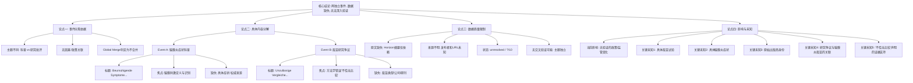

## Event ID

EVT-20261030-000381

## Selected Skills

- 总结文章.md
- 金字塔原理.md

---

# Event Analysis: Meningitis Symptom Awareness and Vaccine Research Controversy (Unmerged)

## 标题
脑膜炎症状科普与疫苗研究争议（未合并分析）

## 作者
Horizon News Feed Analysis (748686 Self-Growing Knowledge System)

## 标签
医疗健康、脑膜炎、疫苗研究、科学争议、数据缺失、非合并事件、Horizon摘要

## 一句话总结这篇文章
本事件单元综合了两篇独立且无法合并的德语新闻：一篇关于脑膜炎警告症状的医学科普，另一篇关于存在方法学缺陷（不恰当比较）的疫苗研究争议，但因缺乏原文，两者均无法进行深度事实核查。

## 总结文章内容并写成摘要

基于2026年10月30日的新闻数据，本分析报告针对两个相互独立但同属医疗健康领域的主题进行了综合审视。尽管两者常被归拢讨论，但经过第一层Global Merge判断，确认它们并非同一具体现实事件，也缺乏明确的因果或政策关联，因此保持独立分析。

**核心内容概述：**

1.  **事件A（疾病科普）：** 涉及一篇题为《Beunruhigende Symptome: Was ist eine Hirnhautreizung?》（令人担忧的症状：什么是脑膜刺激？）的报道。该文章旨在进行患者面向的健康教育，定义并识别脑膜刺激（脑膜炎）的症状。然而，由于原文不可用，具体的“令人担忧的症状”细节及医学权威来源无法确认。
2.  **事件B（研究争议）：** 涉及一篇题为《Unzulässige Vergleiche: Impfstudie mit Fehlern》（不恰当的比较：有错误的疫苗研究）的报道。该文章聚焦于学术或监管层面对疫苗试验方法学的批评，特别指出了“不恰当比较”这一方法学错误。同样，由于缺乏原文，无法确定具体被批评的疫苗类型、制药公司或期刊。
3.  **数据局限性：** 两篇文章（Article #462 和 #463）均仅依赖Horizon摘要，原始全文未获取，源URL未知。这导致所有声明均处于`source_status: unresolved`状态，可信度评级为`⭐️ ?/10`。
4.  **结论与展望：** 目前无法验证疫苗研究争议的真实性或脑膜炎科普的具体建议。未来处理需检索原始可信出版物的文章，以解决未决状态并进行实质性事实核查。

## 详细大纲

根据金字塔原理，将信息按层级组织如下：

### 顶层结论
本EventUnit汇总了两篇独立、无法合并的德语医疗健康新闻（脑膜炎科普与疫苗研究争议），因缺乏原始来源文件，目前无法进行深度验证或评估其实际影响，两事件在主题上无因果关联。

### 中层支持论点

#### 1. 事件分离与独立性论证
*   **主题差异：** 一个是疾病症状科普（临床意识），另一个是研究方法论批评（研究诚信）。
*   **缺乏关联：** 无明确因果或政策联系，符合“宁可分开”的处理原则。
*   **合并判断：** Global Merge阶段已明确标注无法合并。

#### 2. 具体内容分析
*   **脑膜炎症状科普 (Article #462):**
    *   **目的：** 患者健康教育。
    *   **焦点：** 定义和识别脑膜刺激症状。
    *   **缺失信息：** 具体症状列表、区域背景、引用的医学权威。
*   **疫苗研究争议 (Article #463):**
    *   **目的：** 学术/监管批评。
    *   **焦点：** 指出“不恰当比较”的方法学错误。
    *   **缺失信息：** 具体疫苗名称、制药公司、发表期刊。

#### 3. 数据质量与来源限制
*   **原文缺失：** 两篇文章的原始全文均未从Horizon每日摘要中获取。
*   **来源不明：** 原始发布者身份未知，URL未找到。
*   **状态标记：** `source_status: unresolved`，`content_status: horizon_summary_only`。
*   **可信度：** 无法评定，标记为`⭐️ ?/10`。

#### 4. 影响评估与未知项
*   **当前影响：** 无已验证的公共卫生政策变化或监管行动证据。
*   **关键未知：**
    1.  被批评的具体疫苗试验对象。
    2.  报道中列出的具体脑膜炎症状。
    3.  原始出版商的真实性。
    4.  疫苗研究争议是否与脑膜炎疫苗有关（数据中未呈现此类链接）。
    5.  “不恰当比较”声明是否有证据支持。

### 底层证据与细节
*   **来源语言：** 德语标题暗示来源可能位于德国、奥地利或瑞士。
*   **交叉验证：** 无独立支持的事实，两篇文章主题完全独立，无重叠信息可供交叉验证。
*   **共享局限性：** 均仅依赖Horizon摘要，无法独立验证任何声明。

## 越详细地列举文章的大纲（结构化呈现）

