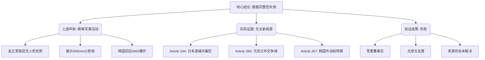

## Event ID

EVT-20261031-000171

## Selected Skills

- 总结文章.md
- 金字塔原理.md

---

# 新闻摘要：朝鲜军事活动与火箭展示（数据完整性警告）

**标题**：朝鲜军事活动与火箭展示（事件 ID：EVT-20261031-000171）

**作者**：系统生成（基于上游元数据合成）

**标签**：国际新闻, 朝鲜军事, 地缘政治, 数据安全, 事件分析

**一句话总结这篇文章**: 该事件记录显示上游声称发生了“朝鲜敦促无人机优势及展示600毫米火箭炮、韩国回应非军事区爆炸”的军事事件，但经过严格的多源交叉验证，发现所关联的三篇原始新闻文章均与主题无关且缺乏实质内容，确认此次事件分析存在严重的**数据源错位与完整性失效**。

## 文章内容摘要

本事件单元（EventUnit）表面上旨在报道2026年10月31日朝鲜的军事动态，包括最高领导人的战略指令、武器公开展示以及韩国的相关回应。然而，通过对所摄入的三篇文章（Article #244, #266, #267）进行深度解析，揭示了一个关键问题：**事件标题与支撑证据之间完全脱节**。

文章的核心事实主张（如金正恩敦促无人机主导权、600毫米火箭炮展示、非军事区爆炸）仅源自“第一层全球合并事件理由”这一元数据标签，并未在任何原始文本中得到证实。相反，被分配到此事件ID的三篇文章分别涉及日本逮捕诈骗犯、乌克兰外交争端以及韩国作战权转移时间线，三者之间无任何逻辑重叠，且均未提供全文或实质性摘要。因此，本分析报告的重点在于揭示这一数据治理失败，而非报道真实的军事新闻。

## 文章大纲

### 一、 核心结论：数据完整性严重失效
1. **主要发现**：事件ID EVT-20261031-000171 的上游合成标题与下游实际获取的新闻源完全错位。
2. **影响评估**：无法验证任何关于朝鲜军事活动的具体事实；该事件在缺乏原始证据支持的情况下仅为“未经验证的声称”。

### 二、 事实陈述与证据缺失分析
1. **上游声称的事实**：
   - 金正恩在导弹/火箭火力中敦促“无人机优势”。
   - 朝鲜公开展示了600毫米火箭炮。
   - 韩国回应了非军事区（DMZ）附近的爆炸声。
2. **实际获取的证据**：
   - **Article #244**：日本警方逮捕6名涉嫌从越南进行的诈骗男子（来源：AP）。与朝鲜军事无关。
   - **Article #266**：国家安全顾问表示与乌克兰的双边争端不会影响国际支持（来源：未知）。与朝鲜军事无关。
   - **Article #267**：高层办公室预计明年早些时候在作战权（OPCON）转移方面取得实质性进展（来源：未知）。虽涉及韩国，但话题为指挥权转移时间表，非DMZ爆炸事件。
3. **数据质量缺陷**：所有三篇文章均处于“仅 Horizon 摘要”状态，无全文，无有效URL，来源状态为“未解决”。

### 三、 跨源验证结果
1. **验证状态**：失败 / 证据不足。
2. **相关性检查**：0%。三篇文章内容与事件标题描述的主题（朝鲜武器展示、DMZ军事紧张）无交集。
3. **冲突识别**：存在结构性冲突，即“元数据标签”与“实体内容”的根本性不匹配。

### 四、 无法确定的事项
1. **事件真实性**：无法确定金正恩是否真的发表了相关讲话或展示了该武器。
2. **DMZ爆炸性质**：无法确定引发韩国回应的“爆炸”的具体原因和时间。
3. **数据流向**：无法确定是上游合并过程错误标签了文章，还是文章抓取系统错误分配了事件ID。

### 五、 结论与建议
1. **当前结论**：本事件单元包含无效的支撑数据，不能用于构建可信的新闻知识图谱。
2. **建议行动**：
   - 标记此 EventUnit 为“低可信度/需人工审核”。
   - 回溯上游数据流，检查 Global Merge 阶段的来源过滤逻辑。
   - 重新检索与“North Korea military activities”和“rocket showcase”相关的真实新闻源。

---

**金字塔结构视图**：

