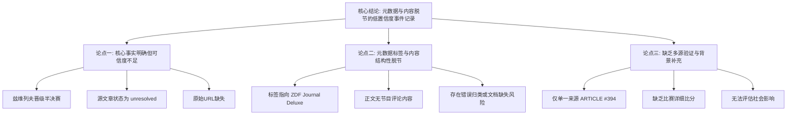

## Event ID

EVT-20261031-000617

## Selected Skills

- 总结文章.md

- 金字塔原理.md

---

# 事件分析报告

## 一、总结文章（基于 总结文章.md）

**标题：** ZDF《Journal Deluxe》节目评论与亚历山大·兹维列夫维也纳ATP赛表现关联分析

**作者：** 748686自生长知识系统 Event Analysis Engine

**标签：** #体育新闻 #网球 #ATP巡回赛 #ZDF #亚历山大·兹维列夫 #事件分析 #数据缺口

**一句话总结：**
本事件核心事实为德国网球名将亚历山大·兹维列夫作为新晋世界第一轻松晋级维也纳ATP赛半决赛，但事件元数据中关联的“ZDF《Journal Deluxe》节目评论”在现有源文章中完全缺失，且源文章本身处于未验证的摘要状态，导致无法核实媒体评论内容及原始事实依据。

**文章内容总结：**
本事件源于单篇编号为 ARTICLE #394 的源文章，标题涉及ATP维也纳站赛事。文章指出亚历山大·兹维列夫（Alexander Zverev）以“新世界第一”的身份，在比赛中表现强势（原文描述为“spaziert ins Halbfinale”，意为轻松步入半决赛）。然而，该事件的元数据标签将其归类为“ZDF《Journal Deluxe》节目评论”，这在逻辑上存在显著的信息断层。现有的源文章内容仅为体育比分速报性质，并未包含任何来自该电视节目的评论文本、观点或视频链接。此外，源文章的 `source_status` 标记为 "unresolved"（未解决），`content_status` 为 "horizon_summary_only"（仅地平线摘要），且原始URL未被找到。这意味着该信息目前停留在二次加工的摘要层，缺乏经过全面审核的完整报道支持，也无法进行多源交叉验证。

**详细大纲：**

1.  **事件背景与核心事实**
    1.  **赛事信息**：维也纳举行的ATP网球巡回赛。
    2.  **关键人物**：亚历山大·兹维列夫（Alexander Zverev）。
    3.  **比赛结果**：兹维列夫成功晋级半决赛。
    4.  **排名状态**：兹维列夫在报道中被标识为“新晋世界第一”。

2.  **信息缺口与异常点**
    1.  **标题与内容脱节**：事件标签指向“ZDF《Journal Deluxe》节目评论”，但正文无相关评论内容。
    2.  **来源状态可疑**：源文章标记为“未解决”和“仅摘要”，原始链接缺失。
    3.  **缺乏交叉验证**：仅有单一来源，无法确认兹维列夫“新世界第一”身份的具体变动时间及背景细节。

3.  **无法确定的事项**
    1.  ZDF《Journal Deluxe》是否对此事发表了评论及其具体立场。
    2.  ARTICLE #394 所引用的“Horizon日报”或其他原始信源的具体细节。
    3.  比赛的具体比分、对手信息及详细数据。
    4.  该事件对社会或体育界的实际影响力评估。

4.  **结论与建议**
    1.  当前信息完整性低，核心为体育赛果简报。
    2.  建议等待源文章完成深度分析并获取可信原文后，再行核实媒体评论内容。

---

## 二、结构化分析（基于 金字塔原理）

根据金字塔原理，将上述事件信息按照**结论先行、以上统下、分组归类、逻辑递进**的原则进行重组：

### 【顶层：核心结论】

**事件本质判定：这是一起“元数据标签与源内容严重不匹配”的低置信度事件记录。**

虽然表面新闻价值在于“兹维列夫晋级维也纳半决赛”，但从知识工程角度审视，该事件的主要特征并非体育报道本身，而是**信息来源的不可靠性**与**上下文关联的断裂**。具体而言，“ZDF《Journal Deluxe》节目评论”这一关键标签在源文本中毫无踪迹，且源文章本身缺乏原始出处验证。

### 【中层：支持核心结论的三个关键论点】

#### 论点一：核心事实明确，但独立可信度不足
*   **论据1.1（事实层面）**：兹维列夫确实在维也纳ATP赛中晋级半决赛，且被标记为新世界第一。这是文章唯一明确传递的硬性信息。
*   **论据1.2（缺陷层面）**：源文章 `source_status` 为 "unresolved"，`content_status` 为 "horizon_summary_only"，且原始URL未找到。这表明该信息可能来源于未经全面审核的聚合平台或二次加工层，而非权威一手信源。
*   **逻辑关系**：因为源文章处于未验证的摘要状态，所以其承载的核心事实（兹维列夫晋级）虽具参考价值，但独立可信度较低，需待后续核实。

#### 论点二：元数据标签与内容存在结构性脱节
*   **论据2.1（标签指向）**：事件路由和元数据明确将此事关联至“ZDF《Journal Deluxe》节目评论”。
*   **论据2.2（内容缺失）**：通读ARTICLE #394全文，未发现任何提及ZDF、Journal Deluxe、主持人、评论观点或节目片段的内容。
*   **论据2.3（关联断裂）**：这种“标签-内容”的不匹配表明，该事件可能被错误归类，或者缺失了关键的补充文档（如节目转录文本）。
*   **逻辑关系**：由于内容中缺失标签所承诺的关键信息（节目评论），导致无法完成用户预期的“评论分析”任务，只能退回至基础体育新闻分析。

#### 论点三：缺乏多源验证与背景补充
*   **论据3.1（单源限制）**：本次分析仅基于ARTICLE #394一篇来源，缺乏第二篇独立报道进行交叉验证。
*   **论据3.2（细节空白）**：关于兹维列夫“新世界第一”的身份确认细节、比赛具体比分、半决赛对手等关键背景信息，在当前材料中均为空白。
*   **论据3.3（影响不明）**：由于信息来源受限，无法评估该事件在体育界或公众舆论中的实际传播范围和影响。
*   **逻辑关系**：因为没有足够的佐证材料和背景细节，我们无法构建一个完整、立体的事件图景，只能呈现当前的碎片化信息。

### 【底层：具体证据与数据】

*   **源文章ID**：ARTICLE #394
*   **源文章标题**：[ATP-Turnier in Wien: Zverev spaziert als neue Nummer eins ins Halbfinale](#item-tech-news-390)
*   **源文章语言**：德语（内容摘要）、中文（元数据/分析层）
*   **源文章状态**：
    *   `source_status`: unresolved
    *   `content_status`: horizon_summary_only
*   **关键引用**：“spaziert... ins Halbfinale”（轻松步入半决赛）
*   **时间戳**：2026-10-31
*   **时区**：Asia/Shanghai

---

### 【附录：金字塔结构可视化】

