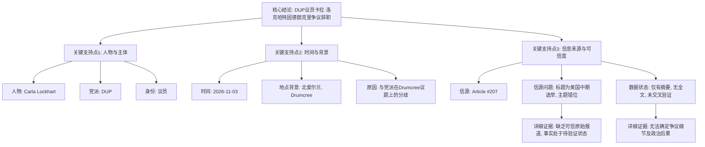

## Event ID

EVT-20261103-000404

## Selected Skills

- 总结文章.md

- 金字塔原理.md

## Event Analysis

### 标题：北爱尔兰民主统一党（DUP）议员卡拉·洛克哈特因德朗克里争议辞职事件分析

### 作者：748686 自生长知识系统

### 标签
`#政治` `#北爱尔兰` `#民主统一党` `#DUP` `#Carla Lockhart` `#Drumcree` `#国际新闻`

### 一句话总结
2026年11月3日，北爱尔兰民主统一党（DUP）议员卡拉·洛克哈特（Carla Lockhart）宣布辞职，直接诱因是与党派在“德朗克里”（Drumcree）相关议题上存在分歧。

### 文章内容摘要

#### 1. 核心结论（顶层）
**事件定性**：北爱尔兰地方政治人物辞职事件。
**核心事实**：DUP议员卡拉·洛克哈特因德朗克里（Drumcree）争议而辞去议员职务。这一结论基于事件合并理由（Event Merge Reason）生成，但缺乏原始报道全文及多重独立信源支撑，属于待验证的初步记录。

#### 2. 关键支持点（中层）
为了支撑上述核心结论，将现有信息分解为以下三个关键维度：

*   **人物与主体**：
    *   **人物**：卡拉·洛克哈特（Carla Lockhart）。
    *   **党派**：民主统一党（Democratic Unionist Party, DUP），北爱尔兰主要政党之一。
    *   **身份**：DUP议员。

*   **时间与背景**：
    *   **时间**：2026年11月3日。
    *   **地域背景**：涉及北爱尔兰地区性争议地点“德朗克里”（Drumcree）。该地点通常与游行、宗教或社区冲突议题相关。
    *   **起因**：与党派在Drumcree相关议题上的立场分歧。

*   **信息来源与可信度评估**：
    *   **主要信源**：Article #207《The US Midterms Unpacked In 39 Minutes》。
    *   **信源状态**：**严重不匹配**。该文章标题聚焦于“美国中期选举”，与北爱尔兰政治人物辞职无直接主题关联。
    *   **数据完整性**：仅拥有“地平线摘要”（Horizon Summary），无完整原文。
    *   **交叉验证**：缺乏其他独立信源，无法进行多重验证。

#### 3. 详细证据与分析（底层）

*   **关于信息来源的错位分析**：
    *   系统记录显示，Article #207的标题为《The US Midterms Unpacked In 39 Minutes》，其主题明确指向美国政治。
    *   然而，事件的核心事实（Lockhart辞职）被索引在该Article #207下，或源自未列出的系统合并理由字段。
    *   这种**主题错位**表明：要么Article #207的内容与摘要不符，要么事件信息的提取路径存在异常。目前无法确认该文章是否实际报道了此事件。

*   **关于“德朗克里争议”的缺失细节**：
    *   现有信息仅指出辞职源于“Drumcree row”（德朗克里争议/纠纷）。
    *   由于缺乏原始报道和详细信源，无法确定：
        *   争议的具体性质（如游行许可、社区边界、宗教象征等）。
        *   洛克哈特与DUP党内的具体分歧点。
        *   争议爆发的具体时间线和经过。

*   **关于后续影响的未知领域**：
    *   无法确定Lockhart辞职后的接任者。
    *   无法评估该辞职对DUP在北爱尔兰议会中的席位影响力。
    *   无法判断此事对北爱尔兰政治稳定性的宏观影响。

### 金字塔结构图示

### 行动建议与后续步骤

1.  **信源核查**：优先获取Article #207的完整原文，或寻找专门报道北爱尔兰政治的新闻源（如BBC Northern Ireland, Belfast Telegraph等），以验证Lockhart辞职的真实性和具体原因。
2.  **补充细节**：一旦找到可信信源，需补充“德朗克里争议”的具体内容，以及Lockhart辞职声明的关键引述。
3.  **影响评估**：跟踪DUP党内的反应，以及该事件对北爱尔兰权力分享政府可能的影响。
4.  **数据修正**：若确认Article #207与该事件无关，需在系统中修正来源映射，避免错误归因。
