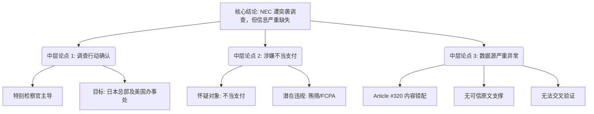

## Event ID

EVT-20261103-000485

## Selected Skills

- 总结文章.md
- 金字塔原理.md

## Event Analysis

### 标题
特别检察官突袭日本电气（NEC）：涉嫌不当支付调查

### 作者
748686 自生长知识系统 Event Analysis Engine

### 标签
#法律 #企业合规 #NEC #美国司法部 #特别检察官 #数据缺失 #信任危机

### 一句话总结
特别检察官因涉嫌不当支付对日本电气（NEC）总部及办事处发起突袭搜查，但由于关键原始信源缺失且关联数据存在严重错配，目前仅能确认调查行动本身，无法评估其具体范围、涉案金额及后续法律后果。

### 摘要

**核心结论（顶层）**
美国特别检察官于近期对日本科技企业 NEC（日本电气株式会社）发起了突袭搜查行动，调查焦点集中在公司涉嫌的不当支付行为。然而，鉴于当前可用信息的极端匮乏以及数据源匹配异常，该事件的详细指控、涉及金额及潜在影响目前处于高度不确定性状态。

**支持性论点（中层）**
1. **调查行动的确认**：特别检察官已采取实地突袭行动，目标为 NEC 位于日本的总部及其在美国的办事处。
2. **涉嫌罪名指向**：调查源于对“不当支付”（improper payments）的怀疑，这通常涉及贿赂、账外支出或违反《反海外腐败法》（FCPA）等合规问题。
3. **信息可信度危机**：当前分析依赖的唯一潜在来源（Article #320）存在严重的元数据错误，其内容关于韩国股市结算制度，与 NEC 突袭事件完全无关，导致无法进行多源交叉验证。
4. **背景缺失**：缺乏关于突袭具体日期、执行地点、扣押文件细节以及 NEC 官方回应等关键事实。

**详细证据与大纲（底层）**

*   **1. 事件基本情况**
    *   1.1 行动主体：美国特别检察官（Special counsel）。
    *   1.2 行动对象：NEC 日本总部及 NEC 美国办事处。
    *   1.3 行动性质：突袭搜查（Raid），通常意味着刑事调查而非普通民事问询。
    *   1.4 涉嫌原因：不当支付（suspected improper payments）。

*   **2. 数据质量与来源分析**
    *   2.1 来源状态：Article #320 被标记为 `unresolved` 和 `horizon_summary_only`，无可信原文。
    *   2.2 内容错配：唯一索引到的文章标题为《S. Korea Targets 1-Day Stock Settlement by 2028》，主题为韩国金融改革，与 NEC 法律调查毫无关联。
    *   2.3 推断：这表明数据管道存在匹配故障，导致本事件缺乏有效的原始新闻支撑。

*   **3. 无法确定的关键事项**
    *   3.1 时间维度：突袭发生的具体日期和时间。
    *   3.2 地理维度：除日本总部和美国办事处外，是否涉及其他地点。
    *   3.3 财务维度：涉及的具体金额及“不当支付”的性质（如回扣、贿赂中介等）。
    *   3.4 后果维度：是否已提出正式起诉，NEC 股价及业务运营受到的实际影响。

*   **4. 影响评估结论**
    *   4.1 当前状态：事件处于“黑箱”阶段，仅有行动发生的信号，无实质内容。
    *   4.2 建议行动：标记为**待更新**，等待可信原始报道介入，暂时不做投资损失或法律责任的量化预测。

### 金字塔结构图解

