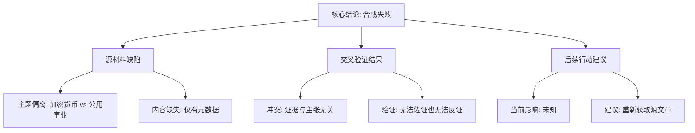

## Event ID

EVT-20261107-000155

## Selected Skills

- 总结文章.md

- 金字塔原理.md

---

## 标题
中部电力数据丑闻处罚分析：源材料不匹配与合成失败报告

## 作者
748686 自生长知识系统 Event Analysis Engine

## 标签
#事件分析 #来源验证 #中部电力 #Chainalysis #数据不匹配 #合成失败 #合规性审查

## 一句话总结这篇文章
本次事件分析揭示了事件标题“中部电力数据丑闻处罚”与实际提供的源文章（关于币安黑客资金流向中国洗钱者）之间存在完全的主题错位，导致无法基于现有材料对中部电力进行任何事实综合或影响评估。

## 总结文章内容并写成摘要

本报告针对事件 ID EVT-20261107-000155（中部电力数据丑闻处罚）进行了多源综合分析与交叉验证，核心结论如下：

### 1. 事件定义与预期
事件标题明确指向日本公用事业公司中部电力（Chubu Electric）因数据不当行为收到业务改善命令。这是事件单元（EventUnit）中“第一层 Global Merge”设定的核心叙事框架。

### 2. 源材料审核
系统中唯一提供的源文章为 Article #249，标题为《Binance hack funds flow to Chinese launderers, Chainalysis says》（币安黑客资金流向中国洗钱者，Chainalysis 称）。
*   **相关性评估**：该文章属于加密货币监控领域，与公用事业监管、数据隐私或日本电力公司完全无关。
*   **内容完整性**：文章状态标记为 `partial`（部分），实际内容仅为 Google News RSS 聚合元数据，缺乏实质性的新闻报道正文。

### 3. 冲突识别
存在严重的**主题不匹配（Topic Mismatch）**：
*   **事件头信息**要求分析：公用事业监管、数据丑闻、业务改善命令。
*   **源文章内容**实际提供：加密货币洗钱、区块链分析、币安安全事件。
*   **结果**：没有任何证据支持事件标题所述的事实，也没有任何证据反驳该事实（因为源材料未涵盖该主题）。

### 4. 结论与建议
由于源材料与事件主题完全脱节，**合成失败（Synthesis Failed）**。无法得出关于中部电力是否收到处罚、数据不当行为细节或当前影响的任何结论。建议重新评估该事件单元，检索并补充专门针对中部电力数据实践及监管行动的相关源文章。

## 越详细地列举文章的大纲

根据金字塔原理，将分析逻辑结构化如下：

### 顶层：核心结论
**事件合成失败**：由于源材料与事件主题不匹配，无法对“中部电力数据丑闻处罚”进行事实陈述或影响评估。

### 中层一：源材料缺陷分析（事实层面）
1.  **主题偏离**
    *   提供源（Article #249）主题为加密货币洗钱监控。
    *   目标事件主题为公用事业数据合规与监管处罚。
    *   两者无任何语义或实体重叠。
2.  **内容缺失**
    *   源文章状态为 `partial`。
    *   仅包含元数据，无实质新闻正文。
    *   即使主题相关，也无法提取有效信息。

### 中层二：交叉验证结果（逻辑层面）
1.  **冲突识别**
    *   事件标题声称：“Utility receives business improvement order over data misconduct”。
    *   源证据支持：“Binance hack funds... Chinese launderers”。
    *   判定：证据与主张无关（Irrelevant Evidence）。
2.  **验证状态**
    *    corroborating evidence（佐证证据）：无。
    *   contradicting evidence（反证证据）：无（因源材料未涉及中部电力）。
    *   最终判定：Unknown/Unverifiable（未知/无法验证）。

### 中层三：影响与后续行动（建议层面）
1.  **当前影响**
    *   无法确定中部电力是否收到业务改善命令。
    *   无法确定数据不当行为的具体细节。
    *   无法确定任何市场或监管影响。
2.  **后续建议**
    *   触发重新评估机制。
    *   需获取专门针对 Chubu Electric 的源文章。
    *   检查事件索引逻辑，防止无关源文章被错误关联至本事件。

---

### 附：金字塔结构可视化（文本形式）

