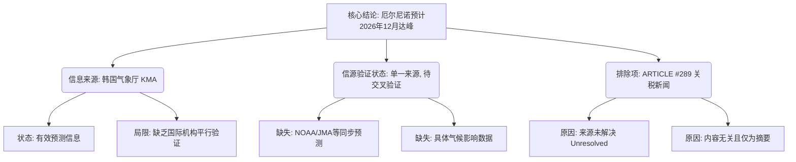

## Event ID

EVT-20261107-000405

## Selected Skills

- 总结文章.md

- 金字塔原理.md

---

## 事件分析报告：厄尔尼诺峰值预测

**标题：** 厄尔尼诺现象预计将于2026年12月达到峰值

**作者：** 748686自生长知识系统（基于韩国气象厅KMA预报合成）

**标签：** 气象学, 厄尔尼诺, 气候预测, 韩国气象厅, EVT-20261107-000405

**一句话总结：** 依据韩国气象厅（KMA）的独立气象预报，厄尔尼诺现象预计将在2026年12月达到其强度峰值，目前缺乏其他主要气象机构的交叉验证及具体影响数据。

---

### 摘要

本次事件记录了一项关于全球气候现象的气象预测信息。核心结论为厄尔尼诺现象（El Niño）预计于2026年12月迎来强度峰值。该信息源自韩国气象厅（KMA）的独立预报。

在信息综合过程中，发现源材料中存在一则关于特朗普关税政策的新闻（ARTICLE #289），但该文章存在`source_status: unresolved`（来源未解决）及`content_status: horizon_summary_only`（仅为摘要）的状态，且其政治经济主题与气象事件无事实关联，因此被明确排除在核心事实认定之外。

目前，关于此次厄尔尼诺峰值对全球或特定区域（如东亚）的具体气候影响（如降雨、温度异常等）尚无详细数据，且缺乏NOAA、JMA等国际机构的平行验证，信源单一。

---

### 内容大纲

根据金字塔原理，将事件信息结构化如下：

**1. 顶层结论：核心预测事实**
*   **事件预测**：厄尔尼诺现象预计将于2026年12月达到强度峰值。
*   **信息来源**：韩国气象厅（Korea Meteorological Administration, KMA）。
*   **信源性质**：独立气象预报，目前为单一有效信源。

**2. 中层支持：信息来源验证与排除**
*   **有效信源分析**：
    *   **韩国气象厅 (KMA)**：提供了关键的峰值时间预测，状态为有效预测信息。
    *   **局限性**：仅有一个来源，缺乏多重来源支持（Multi-source support），无法进行交叉比对。
*   **无效/无关信源排除**：
    *   **ARTICLE #289**：标题涉及“特朗普称外国公司若无关税保护将不在美国建厂”。
    *   **排除理由**：
        1.  **状态异常**：`source_status`为unresolved，`content_status`为horizon_summary_only，原文不可查。
        2.  **主题无关**：属于政治经济新闻，与气象事件无直接事实关联。
        3.  **结果**：该条目已明确排除出事实认定范围，不构成信息干扰。

**3. 底层细节：背景、视角与不确定性**
*   **地区视角（东亚/韩国）**：
    *   关注点在于12月达峰预示着后续冬季气候模式的潜在变化。
    *   具体影响细节（如气温异常幅度、降水模式改变）在本材料中未详述。
*   **已知当前影响**：
    *   目前信息停留在“预测”阶段。
    *   尚未描述已发生的物理影响或后果。
*   **目前无法确定的事项（不确定性列表）**：
    1.  **全球共识缺失**：无法确定NOAA（美国国家海洋和大气管理局）、JMA（日本气象厅）等机构是否得出相同的12月达峰预测。
    2.  **具体影响不明**：无法确定此次峰值对全球或特定区域（包括韩国及中国）的具体气候影响程度和类型。
    3.  **时间点模糊**：“12月”为月份范围，无法确定具体的峰值日期或周期。
    4.  **无关源关联**：无法确定ARTICLE #289中的关税言论与本次气象事件是否存在间接政策或供应链联系（因源内容不相关且未验证，此项可能性极低但 technically unresolved）。

---

### 金字塔结构图示

