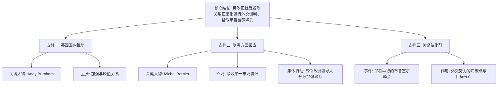

## Event ID

EVT-20261108-000084

## Selected Skills

- 总结文章.md
- 金字塔原理.md

---

## 标题：英欧关系正常化谈判：布鲁塞尔峰会前的外交推进

## 作者：748686 自生长知识系统 Event Analysis Engine

## 标签
政治外交、英欧关系、后脱欧谈判、布鲁塞尔峰会、单一市场协议、麦肯锡金字塔原理

## 一句话总结这篇文文章
在英国与欧盟后脱欧关系定位的关键窗口期，以安迪·伯纳姆为代表的英国国内力量与以巴尼耶及五位欧洲领导人为代表的欧盟方面，正围绕单一市场协议等核心议题进行外交接触，旨在为即将到来的布鲁塞尔峰会确立谈判基础。

## 总结文章内容

本事件报道聚焦于英国与欧盟之间旨在正常化及加强后脱欧关系的近期外交活动。事件的核心背景是即将在布鲁塞尔举行的高层峰会，各方正抓紧时间进行政治铺垫与立场沟通。

从报道内容来看，这一政治进程呈现出双向互动的特征：一方面，英国国内出现了要求加强与欧盟关系的声音，以安迪·伯纳姆（Andy Burnham）为代表的政治人物公开倡导更紧密的联系；另一方面，欧盟层面也作出了积极回应，米歇尔·巴尼耶（Michel Barnier）就单一市场协议表达了明确立场，且有五位欧洲领导人联名呼吁加强英欧联系。

尽管源文件中存在部分与主题无关的技术性或娱乐性文章（如关于微短剧、F1赛车条件及播客的内容），但通过第一层全局合并的事件判断，可以确认核心事实来源于两个相关集群的交叉印证。这两个集群分别从具体行动者/政策立场和宏观外交背景两个角度，描绘了同一正在发展的政治进程。

值得注意的是，目前公开信息中尚未明确峰会的具体日期、五位欧洲领导人的具体身份名单，以及单一市场协议的具体条款细节。此外，由于部分关联文章缺乏原文文本，无法完全验证是否存在其他隐性信息，但基于现有合并理由，事件的主旋律清晰指向“接触”与“定位”。

## 大纲

### 一、 事件核心结论：英欧关系进入关键谈判窗口期
1. **核心论点**：英欧双方正通过多层面外交努力，推动后脱欧关系的正常化与深化，以准备即将到来的布鲁塞尔峰会。
2. **逻辑支撑**：
   - 英国国内政治人物主动释放亲近信号。
   - 欧盟高层官员及多位领导人回应并设定框架。
   - 时间紧迫性由“峰会前”这一节点体现。

### 二、 英国视角：内部推动力与接触意愿
1. **关键人物行动**：安迪·伯纳姆（Andy Burnham）公开主张加强与欧盟的关系。
2. **政治意涵**：
   - 表明英国有内部政治力量希望调整脱欧后的疏离状态。
   - 为后续谈判提供国内政治背书或压力。

### 三、 欧盟视角：立场划定与集体呼声
1. **制度性立场**：米歇尔·巴尼耶（Michel Barnier）就“单一市场协议”表达立场。
   - 暗示欧盟可能在市场准入与政治一体化深度之间设定条件。
2. **集体外交姿态**：五位欧洲领导人联合呼吁加强英欧联系。
   - 显示欧盟层面对于维持与英国关系的整体积极性。
   - 为峰会营造正面的外交氛围。

### 四、 事件背景与催化剂：布鲁塞尔峰会
1. **事件载体**：即将举行的布鲁塞尔峰会。
2. **功能定位**：
   - 作为双方外交努力的最终汇聚点。
   - 确立峰会前的最后冲刺阶段特征。

### 五、 信息局限与待解问题
1. **时间维度缺失**：布鲁塞尔峰会的具体日期未披露。
2. **人物维度缺失**：“五位欧洲领导人”的具体身份不明。
3. **内容维度缺失**：“单一市场协议”的具体条款与边界未详述。
4. **结果维度待定**：谈判是否成功、峰会成果如何尚不可知。

### 六、 数据完整性说明
1. **有效来源**：基于集群 1 (EVT-20261108-000138/139) 和集群 29 (EVT-20261108-000084) 的合并理由。
2. **无效/噪声来源**：
   - 文章 #125（微短剧，无关）。
   - 文章 #136（F1赛车，无关）。
   - 文章 #171（政治播客，无关）。
   - 上述文章缺乏原文且主题不相关，判定为索引噪音，不参与核心事实构建。

## 金字塔结构图示（应用金字塔原理）

**层级说明：**
- **顶层（结论）**：明确事件本质——英欧正在进行面向峰会的正常化谈判。
- **中层（论点）**：从英国、欧盟、背景三个维度支撑结论，符合 MECE 原则（相互独立，完全穷尽主要方面）。
- **底层（证据）**：具体的人物姓名、主张内容、协议类型及峰会地点。
