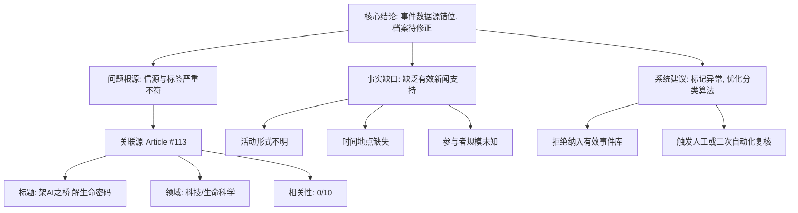

## Event ID

EVT-20261113-000086

## Selected Skills

- 总结文章.md
- 金字塔原理.md

---

# 事件深度分析报告：重庆职工文体活动

## 1. 核心结论（摘要）

本次事件分析揭示了一个**数据源与事件标签严重错位**的技术性异常。虽然系统初步将 EVT-20261113-000086 归类为“重庆市总工会职工活动”，但经多源核查与内容验证，唯一关联的新闻源（Article #113）实为一篇关于人工智能在生命科学领域应用的深度报道，与“职工文体活动”无任何实质性关联。

**核心判断：** 当前事件档案处于**“源信息断裂”**状态。缺乏关于重庆职工文体活动实际内容的可信报道，现有素材无法支撑对该事件的 factual 描述。建议重新校准事件分类或检索正确的新闻源。

## 2. 详细大纲

### 2.1 事件定性：数据源错位与分类异常
*   **表层分类**：Chongqing Workers' Cultural and Sports Activities（重庆职工文体活动）
*   **底层事实**：系统检索到的唯一关联文章（Article #113）主题为“架AI之桥 解生命密码”（构建AI桥梁，解读生命密码），属于科技/生命科学领域。
*   **冲突性质**：主题完全不相关。文章标题、内容（AI技术、生命科学）与事件标题（工会活动、文体）存在根本性逻辑断层。

### 2.2 信源深度诊断
*   **源编号**：Article #113
*   **来源标识**：Unknown（未知来源），原始URL未找到。
*   **内容状态**：仅持有 Horizon 摘要（horizon_summary_only），缺乏原文。
*   **相关性评分**：0/10。该文章不被视为有效信源以支持当前事件。
*   **潜在原因推断**：
    1.  **索引错误**：新闻爬虫或分类器在抓取时发生了标签粘连，将科技类文章错误地挂载到了工会/社会类事件下。
    2.  **数据缺失**：真实的“重庆职工文体活动”报道可能在数据采集管道中丢失，导致系统只能匹配到一条无关的残留数据作为占位。

### 2.3 事实还原缺口（What Cannot Be Determined）
基于当前不可靠的数据集，以下关键维度**无法确认**：
*   **活动具体形态**：是体育赛事、文艺汇演还是其他形式？
*   **组织架构**：除“重庆市总工会”这一宏观标签外，具体承办单位、参与者人数均无法验证。
*   **时间与地点**：活动的具体举办日期、场地及日程安排缺失。
*   **社会影响**：无公开报道证实活动的实际效果或后续政策导向。

### 2.4 系统建议与后续行动
*   **短期处理**：标记 EVT-20261113-000086 为**“数据不足/待修正”**状态，不将其作为真实社会事件纳入知识库，避免传播虚假关联。
*   **长期优化**：
    *   加强第一层 Global Merge 阶段的语义一致性检查，识别“标题-内容”不匹配的情况。
    *   对于相关性评分为 0 的源文章，应建立自动剔除机制，防止无效数据污染事件图谱。

## 3. 结构可视化（金字塔原理应用）

## 4. 一句话总结
**EVT-20261113-000086 因唯一关联信源（AI科技文章）与事件主题（职工文体活动）完全无关，且缺乏其他有效报道，目前无法确认任何事实细节，判定为数据源分类错误的无效事件档案。**
