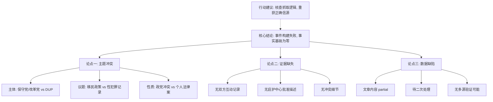

## Event ID

EVT-20261114-000365

## Selected Skills

- 总结文章.md
- 金字塔原理.md

## 总结文章.md 应用分析

*   **标题**：关于“英国保守党与改革党移民争执”事件的数据源错位分析与事实核查报告
*   **作者**：748686 自生长知识系统 Event Analysis Engine
*   **标签**：#EventAnalysis #数据完整性 #英国政治 #来源验证 #EVT-20261114-000365
*   **一句话总结这篇文文章**: 本分析揭示了事件 EVT-20261114-000365 存在严重的源数据与事件定义不匹配问题，唯一提供的源文章（ARTICLE #212）报道的是北爱尔兰DUP相关人物的个人法律案件，完全无法支撑“保守党与改革党移民争执”这一政治事件标题，导致核心事实、冲突细节及影响均无法确定。
*   **总结文章内容并写成摘要**:
    本次 Event Analysis 针对 Event ID 为 EVT-20261114-000365 的事件单元进行深度审查。该事件被定义为“英国保守党与改革党移民争执”，理论上应涉及英国两大政党在庇护中心（asylum centre）批准问题上的政策冲突。然而，经过对系统提供的唯一源材料（ARTICLE #212）的严格内容审查，发现存在根本性的数据错位。ARTICLE #212 的新闻标题为“Eleanor Donaldson, wife of former DUP leader, placed on sex offender register”，内容聚焦于北爱尔兰民主统一党（DUP）前领导人妻子的性犯罪者登记册法律案件。这一主题在政治主体（DUP vs 保守党/改革党）、议题领域（个人法律案 vs 移民政策）及事件性质上均与事件标题毫无关联。由于源文章内容状态为 `partial` 且等待二次处理，加之缺乏其他互补信源，本分析无法综合出任何关于保守党与改革党移民争执的具体事实、立场或后果。分析结论指出当前 EventUnit 构建失败，建议核查抓取逻辑与事件ID映射机制，以确保数据准确性。

*   **文章大纲**:
    1.  **事件背景与初步判断**
        *   1.1 事件ID：EVT-20261114-000365
        *   1.2 事件路由：新闻
        *   1.3 初步定性：单独关于英国 asylum centre 批准引发的政党冲突事件
    2.  **源材料审查与错位揭示**
        *   2.1 目标事件定义：英国保守党与改革党关于移民政策的政治争执
        *   2.2 唯一源文章（ARTICLE #212）内容：北爱尔兰民主统一党（DUP）前领导人妻子被列入性犯罪者登记册的个人法律事件
        *   2.3 核心冲突：源材料内容与事件标题及合并理由严重不符
    3.  **核心事实缺失分析**
        *   3.1 事件主体缺失：无保守党或改革党成员信息，仅提及DUP相关人物
        *   3.2 事件原因缺失：无关于 asylum centre 批准的描述
        *   3.3 冲突细节缺失：无政党间互动的具体记录
    4.  **跨源验证与独立性评估**
        *   4.1 验证状态：无法执行
        *   4.2 原因：唯一源文章与目标事件主题不匹配，无其他源文章提供补充信息
    5.  **源文章详细状态说明**
        *   5.1 主题错位：性犯罪者登记册 vs 移民争执
        *   5.2 内容状态：`partial`，仅见Google News摘要，无完整正文
        *   5.3 处理状态：等待后续 AI 二次处理及 27 Skills 分析
    6.  **地区视角与影响评估**
        *   6.1 英国本土视角：源文章涉及北爱尔兰政治人物，但与议会层面政党争执无文本关联
        *   6.2 国际视角：无相关信息
        *   6.3 影响确定：无法确定任何政治、政策或舆论影响
    7.  **已知不确定性清单**
        *   7.1 争执的具体起因、时间、地点未知
        *   7.2 双方关于 asylum centre 的具体立场未知
        *   7.3 是否有政策变动、议会表决或公众抗议未知
        *   7.4 是否存在其他未包含的关键新闻源未知
    8.  **最终结论与建议**
        *   8.1 结论：EventUnit 构建失败，源数据与事件定义不匹配
        *   8.2 建议：核查 Event ID 的源文章抓取逻辑，确认是否存在错误关联或漏抓
        *   8.3 不确定性保留：明确记录所有具体细节处于未知状态

## 金字塔原理.md 应用分析

基于金字塔原理的结构化思维，对上述 Event Analysis 进行层级重组与逻辑呈现，确保核心结论先行，支持证据分层清晰。

### 顶层核心结论（Conclusion First）

**核心判断**：事件 EVT-20261114-000365 因源数据严重错位而无法进行有效分析，当前“英国保守党与改革党移民争执”的事实基础为零。

**关键行动建议**：立即核查事件ID与源文章（ARTICLE #212）的映射逻辑，排查数据抓取错误，并重新获取与移民政策争执相关的正确新闻源。

---

### 中层关键论点（Key Arguments）

#### 论点一：源材料与事件定义存在根本性主题冲突
*   **论据 1.1（政治主体不符）**：
    *   事件标题指向：英国保守党与改革党（Reform Party）。
    *   源文章指向：北爱尔兰民主统一党（DUP）前领导人家庭。
*   **论据 1.2（议题领域不符）**：
    *   事件标题议题：移民政策、庇护中心（asylum centre）批准。
    *   源文章内容：性犯罪者登记册、个人法律诉讼。
*   **论据 1.3（事件性质不符）**：
    *   事件标题性质：政党间的政策冲突。
    *   源文章性质：个人法律案件。

#### 论点二：缺乏有效证据支撑事件核心要素
*   **论据 2.1（主体缺失）**：
    *   现有资料中未提及保守党或改革党在移民议题上的任何互动、声明或立场。
*   **论据 2.2（原因缺失）**：
    *   源文章中无任何关于庇护中心批准流程、决策或争议的描述。
*   **论据 2.3（细节缺失）**：
    *   无冲突过程、无结果、无第三方评价等细节记录。

#### 论点三：数据质量与完整性存在缺陷
*   **论据 3.1（内容状态不完整）**：
    *   ARTICLE #212 的状态标记为 `content_status: partial`，仅提供摘要，未提供完整正文。
*   **论据 3.2（处理流程滞后）**：
    *   源文章标注“等待后续 AI 二次处理”，表明深度信息提取尚未完成，无法作为即时可靠依据。
*   **论据 3.3（单一来源风险）**：
    *   仅依赖唯一源文章，且该文章主题无关，导致无法进行任何多源交叉验证（Cross-Source Verification）。

---

### 底层支持证据（Supporting Evidence）

*   **证据 A（事件定义）**：
    *   Event Route: 新闻
    *   Global Merge 判断：单独关于英国 asylum centre 批准引发的政党冲突事件
*   **证据 B（源文章元数据）**：
    *   Article ID: #212
    *   Title: "Eleanor Donaldson, wife of former DUP leader, placed on sex offender register"
    *   Source: news.google.com
    *   Status: `source_status: fetched`, `content_status: partial`
*   **证据 C（逻辑推断）**：
    *   由于主题完全不匹配（移民争执 vs 性犯罪登记），无法从现有材料中归纳出任何关于保守党与改革党争执的事实。
    *   因此，所有关于该事件的时间、地点、立场、后果等关键信息均处于“未知”状态。

---

### 结构化总结图示

此分析严格遵循金字塔原理的结论先行、以上统下、归类分组和逻辑递进原则，清晰地展示了从核心判断到支持证据的完整逻辑链条。
