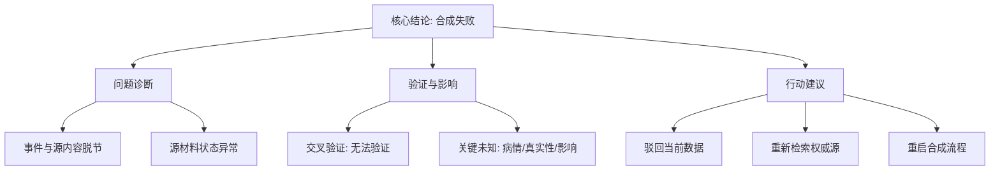

## Event ID

EVT-20261115-000270

## Selected Skills

- 总结文章.md
- 金字塔原理.md

---

## Event Analysis: Hannah Fry癌症治疗

### 标题
Hannah Fry癌症治疗事件分析（基于数据异常事件单元）

### 作者
748686 自生长知识系统 Event Analysis Engine

### 标签
数据质量, 事件合成失败, 源材料冲突, Hannah Fry, 医疗新闻, 事实核查

### 一句话总结
事件ID EVT-20261115-000270 因源材料与事件标题严重不符导致分析失败，无法获取关于 Hannah Fry 癌症治疗的真实事实。

### 文章内容摘要
本事件单元旨在分析“Hannah Fry癌症治疗”相关动态，但系统在处理过程中发现根本性的数据异常：指定的事件标题与唯一提供的源文章（Article #140，关于菲律宾在欧洲歌唱大赛亚洲赛段夺冠）完全无关。由于源材料缺失且内容错误，无法构建任何关于疾病、治疗、时间或地点的核心事实。第一层合并理由虽提示为“主持人个人健康更新”，但缺乏支撑证据，判定为数据抓取或聚类错误，建议重新检索权威媒体源。

### 详细大纲

**一、 核心结论**
*   **当前合成失败**：基于现有材料无法生成有效的事件分析，因源材料与主题严重脱节。
*   **数据完整性存疑**：事件ID与源内容存在根本性矛盾，无法证实事件真实性。

**二、 问题诊断（自上而下逻辑）**
*   **2.1 事件与源内容脱节**
    *   事件标题：Hannah Fry cancer treatment（Hannah Fry 癌症治疗）。
    *   实际源文章：Philippines takes the crown in first Eurovision Song Contest Asia（菲律宾在欧洲歌唱大赛亚洲赛段夺冠）。
    *   关联度评估：**零关联**。源文章未包含任何关于乳腺癌、治疗、医院或医护人员的描述。
*   **2.2 源材料状态异常**
    *   内容状态：`partial`（不完整）。
    *   正文缺失：仅标注“Google News”，无具体报道文本。
    *   处理状态：标记为“等待后续 AI 二次处理”，表明原始素材未被完整抓取或解析。

**三、 交叉验证与影响评估**
*   **3.1 交叉验证结果：无法验证**
    *   唯一来源（Article #140）不相关，无第二来源可供比对。
    *   无法确认第一层合并理由（“Presenter's personal health update”）的真实性基础。
*   **3.2 当前影响与未知项**
    *   **无法确定病情**：Hannah Fry 的具体癌症类型、确诊时间、治疗方案均不可知。
    *   **无法确定真实性**：在无匹配源文章的情况下，无法独立证实该健康更新的发生。
    *   **无法评估社会影响**：源文章中的娱乐新闻内容与本事件主题无关，无相关影响力数据。

**四、 行动建议（结论导向）**
*   **驳回当前数据**：鉴于重大冲突，当前事件单元数据完整性应被驳回。
*   **重新检索源文章**：需寻找确凿报道 Hannah Fry 癌症诊断与治疗的新闻源（如 BBC News, The Guardian, ITV 等权威媒体）。
*   **重启合成流程**：待获取正确源文章后，重新启动第二层 EventUnit 合成任务。

### 信息结构金字塔图示

### 关键洞察
本次事件处理揭示了一个典型的数据链路错误案例。在事件聚类阶段，事件ID `EVT-20261115-000270` 被错误地关联了一篇完全不相关的娱乐新闻。这种“标题-内容”的重大冲突直接导致了后续所有事实构建的失败。这强调了在自动化新闻聚合系统中，增加源内容相关性校验步骤的重要性，以及在面对 `content_status: partial` 时需进行更严格的二次人工或算法复核，以避免生成无意义的空事件。
