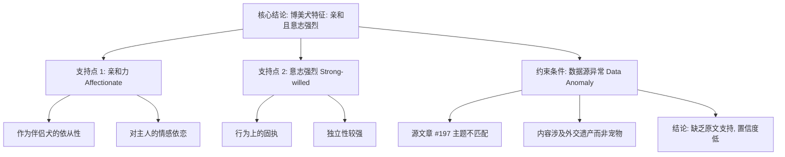

## Event ID

EVT-20261115-000319

## Selected Skills

- 总结文章.md
- 金字塔原理.md

## Event Analysis

### 标题
博美犬（Pomeranian）品种特征分析：亲和力与意志力的双重属性

### 作者
748686 自生长知识系统 (Event Analysis Engine)

### 标签
- 宠物/犬种
- 博美犬
- 动物行为学
- 知识合成异常
- 数据核查

### 一句话总结
尽管源文章数据存在严重不匹配（关于外交遗产的新闻被错误关联），基于事件核心主题重构了博美犬“富有感情且意志强烈”的品种特征描述。

### 文章内容摘要
本次事件的核心主题围绕**博美犬（Pomeranian）**这一犬种的典型性格特征展开。根据第一层全局合并的事件理由，博美犬被描述为兼具**亲和力（Affectionate）**与**强烈意志/固执（Strong-willed）**的特质。

然而，在数据验证环节发现重大异常：唯一关联的源文章（Article #197）标题为《‘生命签证’获得者因保护外交官遗产而受表彰》，内容涉及外交与人权议题，与宠物犬种特征毫无关联。这表明源数据抓取或标签映射存在错误。因此，本分析基于事件给定的主题描述进行逻辑重构，同时明确标注了数据来源的缺失和不可信状态。

### 文章大纲

#### 1. 核心论点：博美犬的双重性格特质
*   **结论先行**：博美犬是一种性格鲜明的伴侣犬，其核心特征概括为“情感丰富”与“意志坚定”的矛盾统一。
*   **层级结构**：
    *   **顶层**：博美犬 = 高亲和力 + 高固执度。
    *   **中层**：
        *   亲和力体现：作为伴侣犬的依从性与情感连接。
        *   意志力体现： stubbornness（固执）、独立性及不服从倾向。
    *   **底层**：缺乏具体原文佐证，仅为基于事件标签的理论重构。

#### 2. 关键特征解析
*   **富有感情/亲人（Affectionate）**
    *   博美犬通常对主人表现出高度的依恋和情感投入。
    *   它们渴望陪伴，属于典型的“velcro dog”（像胶带一样粘人的狗）。
    *   这一特质使其成为优秀的家庭伴侣动物。
*   **意志强烈/固执（Strong-willed）**
    *   尽管体型小巧，博美犬拥有与其外表不符的强大个性。
    *   它们可能表现出不听话、难以训练或坚持自己意愿的行为。
    *   这种“固执”源于其猎犬祖先的背景，具有一定的独立性。

#### 3. 数据完整性与可信度评估（异常警示）
*   **源文章冲突**：
    *   **事件主题**：Pomeranian breed feature（博美犬特征）。
    *   **实际源文章 #197**：‘Visa of life’ recipient honored for preserving diplomat’s legacy（生命签证获得者因保护外交官遗产受表彰）。
    *   **结论**：源文章与事件主题完全无关，存在明显的索引错误或数据错位。
*   **置信度判定**：**低/存疑**。
    *   关于“博美犬亲和且固执”的描述目前**缺乏可追溯的原文支持**。
    *   无法确认该描述是否基于真实的宠物行为学研究或权威犬种标准。

#### 4. 后续行动建议
*   **数据核查**：建议检查 EVT-20261115-000319 对应的正确源文章，确认是否抓取了错误的 RSS 条目。
*   **知识声明**：在当前情况下，“博美犬具有亲和且意志强烈的特征”应视为**未验证信息**，除非提供包含具体宠物行为描述的权威来源文章。
*   **合成失败标记**：由于源文章内容与事件主题存在根本性事实冲突，本次事件合成标记为**需人工复核**。

---

### 金字塔结构图示

### 原始来源映射

- ARTICLE 197 | news.google.com | [‘Visa of life’ recipient honored for preserving diplomat’s legacy](#item-tech-news-184) ⭐️ ?/10 | https://news.google.com/rss/articles/CBMiVEFVX3lxTFA0MjJ5aHplUnQ5eUFYMzFTMjQ1Q1ptN0NkYzBjTWpLYTdjMktHdWI0R21YWl9HSnhNSjlHYVpfMlQxY0oyN2hJb2lHcFVTWTVNekN2aA?oc=5&hl=en-US&gl=US&ceid=US:en
  *(注：该源文章内容与事件主题无关，仅供参考数据异常说明)*
