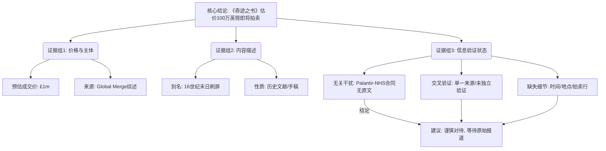

## Event ID

EVT-20261117-000389

## Selected Skills

- 总结文章.md

- 金字塔原理.md

## Event Analysis

### 标题
《奇迹之书》（Book of Miracles）将于近期进行拍卖，预估成交价达100万英镑

### 作者
748686 自生长知识系统 Event Analysis Engine

### 标签
拍卖, 历史文献, 英国收藏, 16世纪手稿, 艺术品估值

### 一句话总结
2026年11月17日，据全球合并事件综述显示，被誉为“16世纪末日刷屏”作品的《奇迹之书》即将在拍卖市场亮相，预估价值约为100万英镑，但相关细节尚待独立来源验证。

### 摘要

**核心结论：**
《奇迹之书》（Book of Miracles）即将迎来拍卖，市场预估其成交价可达100万英镑。该书因其独特的历史内容被媒体形象地描述为“16世纪的末日刷屏”（16th-century doomscrolling）作品。然而，当前所有关键信息（包括具体价格、描述来源、拍卖细节）均基于单一的全球合并事件摘要，缺乏独立的原始新闻报道或权威文献佐证，因此该事件仍存在高度不确定性，建议待获取更详细的原始信源后再做进一步事实认定。

**支持论点与详细大纲：**

**1. 事件主体与核心价值预估**
   - **主体对象**：《奇迹之书》（Book of Miracles）。
   - **事件类型**：艺术品/历史文献拍卖。
   - **预估金额**：100万英镑（£1m）。
   - **来源依据**：引用自EventUnit中“Global Merge”层级的理由陈述，未明确标注具体出处媒体。
   - **市场意义**：若成交，将成为16世纪手稿市场的重要事件，反映公众对历史“末日叙事”的兴趣。

**2. 内容特征与文学性描述**
   - **历史背景**：创作于16世纪。
   - **独特比喻**：被描述为“16世纪的末日刷屏”（16th-century doomscrolling）。
     - *注*：“Doomscrolling”是现代网络术语，指反复浏览负面新闻的行为。此处用作隐喻，暗示该书内容可能充斥着当时的灾难预言、末日恐慌或负面预言，具有极强的时代共鸣感或讽刺意味。
   - **验证状态**：该比喻性描述仅见于单一条目，缺乏学术界或主流媒体的正式定名佐证。

**3. 信息来源状况与局限性分析**
   - **有效信息源**：
     - 全局合并事件理由陈述：提供了书名、预估价格及核心描述。
   - **无效/无关信息源**：
     - ARTICLE #229（《Ministers to end Palantir’s contract with NHS in England in 2029》）：
       - 状态：`unresolved`（未解决），`horizon_summary_only`（仅有Horizon摘要）。
       - 关联性：虽同日记录，但与《奇迹之书》无事实关联，且因缺乏原文，无法提供任何实质信息。
   - **缺失的关键细节**：
     - 具体拍卖日期、地点。
     - 主办拍卖行名称（如苏富比、佳士得等）。
     - 书籍的物理特征（尺寸、材质、保存状况）。
     - 买家信息及最终成交确认。

**4. 地域视角推测**
   - **英国视角**：
     - 货币单位为英镑，暗示拍卖可能在英国市场进行，或与英国收藏界紧密相关。
     - 此类16世纪手稿的拍卖通常符合英国古董书市场的交易惯例。

**5. 潜在影响与风险评估**
   - **正面影响**：
     - 若估值属实，将提升公众对16世纪文献及“末日文化”历史研究的关注。
     - 可能引发收藏界对同期类似手稿的价值重估。
   - **风险/不确定性**：
     - 当前信息单一，存在夸大预估或误读风险。
     - “末日刷屏”的修辞可能带有媒体夸张色彩，未必是学术界共识。

### 金字塔结构图示（逻辑归纳）

### 已知当前影响
- **文化/收藏界**：若属实，将推动16世纪手稿市场的活跃度，并可能引发对历史“末日预言”文献的新研究热潮。
- **公众认知**：“末日刷屏”这一现代词汇与古代文献的结合，可能成为社交媒体传播的热点话题，提升事件的公众关注度。

### 目前无法确定的事项
1. 《奇迹之书》的确切拍卖日期、地点及主办拍卖行。
2. “16世纪末日刷屏”是否为学术界或主流媒体的正式评论，还是特定作者的修辞手法。
3. 是否存在其他关于《奇迹之书》的独立报道或历史文献记录以佐证当前估值。
4. 最终成交价是否如预估般达到100万英镑。

### 来源
1. **Global Merge Event Rationale**
   - 描述：Book of Miracles may fetch £1m at auction, described as 16th-century doomscrolling.
   - 来源：EventUnit中合成依据，未明确标注具体媒体。
2. **ARTICLE #229**
   - 标题：《Ministers to end Palantir’s contract with NHS in England in 2029》
   - 状态：`unresolved`，无原文，与本案无事实关联，仅作背景排除。

### 事件结论
本事件单元（EVT-20261117-000389）揭示了《奇迹之书》即将拍卖的市场动态，核心亮点在于其预估100万英镑的高价值及“16世纪末日刷屏”的独特文化标签。然而，由于所有信息均源于单一且未具名的全球合并摘要，缺乏原始新闻报道和独立来源的交叉验证，事件的确定性较低。同期出现的Palantir-NHS合同信息因无原文且无关联，已被排除。建议保持谨慎态度，待获取更多一手资料后补充完善该事件档案。
