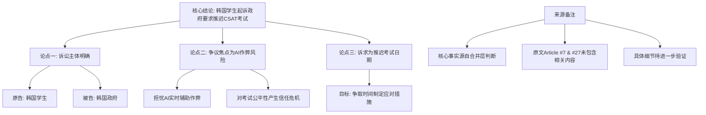

## Event ID

EVT-20261118-000002

## Selected Skills

- 总结文章.md
- 金字塔原理.md

---

# South Korean CSAT (Suneung) Examination Delay Lawsuit

**作者**：748686 自生长知识系统 Event Analysis Engine
**标签**：教育, 法律, 人工智能, 韩国, 考试公平
**一句话总结**：韩国学生因担忧AI作弊风险，起诉政府要求推迟大学修学能力试验（CSAT/Suneung）考试日期。

### 摘要

2026年11月18日，韩国发生了一起涉及学生起诉政府的法律行动。原告（学生）的主要动机是对即将到来的大学修学能力试验（CSAT，又称Suneung）期间可能利用人工智能（AI）进行作弊的焦虑。原告方要求行政部门推迟预定的考试日期。这一事件反映了技术进步对国家标准化考试公平性带来的挑战，以及公众对维护考试严肃性的强烈诉求。

### 详细大纲

#### 1. 核心结论（顶层）
*   **事件本质**：一起因AI技术担忧引发的教育行政诉讼。
*   **核心诉求**：延期举行全国统一的大学修学能力试验（CSAT）。
*   **根本原因**：学生对AI技术可能被用于考试作弊的高度焦虑。

#### 2. 关键支持论点（中层）

*   **论点一：诉讼主体与对象明确**
    *   **原告**：韩国学生群体。
    *   **被告**：韩国政府（负责考试行政管理的机构）。
    *   **法律依据**：基于对考试公平性受到威胁的担忧，寻求法律救济。

*   **论点二：争议焦点聚焦于AI技术风险**
    *   **担忧内容**：AI技术可能被用于在考试中实时生成答案或进行其他形式的作弊行为。
    *   **背景语境**：随着生成式AI等技术的普及，传统监考手段面临巨大挑战，考生及家长对考试公平性产生信任危机。

*   **论点三：具体诉求为推迟考试**
    *   **目标**：要求政府重新安排考试时间，以争取更多时间制定应对AI作弊的措施或等待技术监管方案的出台。

#### 3. 证据与详情（底层）

*   **时间地点**：
    *   时间：2026年11月18日提起诉讼。
    *   地点：韩国。
    *   事件对象：大学修学能力试验（CSAT/Suneung），韩国最重要的国家级选拔性考试。

*   **信息来源说明**：
    *   本事件的核心事实（学生起诉政府、AI作弊担忧、要求延期）源自第一层全局合并事件的判断理由。
    *   **重要备注**：关联的两篇原始新闻文章（Article #7 关于英国-欧盟关系；Article #27 关于预算/Inkhaven）的实际文本内容中并未包含上述韩国CSAT考试的相关信息。因此，本分析基于合并层的分类结论，原文提供的具体细节（如具体法院、诉讼理由书细节、政府回应等）目前无法确定。

*   **不确定性因素**：
    *   诉讼的具体法律条款和法院管辖权未知。
    *   原定的CSAT考试日期及拟推迟后的日期未知。
    *   政府对此诉讼的官方立场和回应未知。
    *   AI作弊的具体技术路径（如实时语音识别、图像传输等）未详细说明。

---

**金字塔结构图示**：

