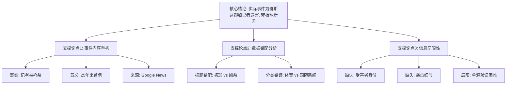

## Event ID

EVT-20261118-000104

## Selected Skills

- 总结文章.md
- 金字塔原理.md

---

# 事件分析：哥斯达黎加记者遇害案与元数据错配

## 标题
哥斯达黎加25年来首例记者遇害案：数据来源错配与事实核查报告

## 作者
Agnes (Sapiens AI Event Analysis Engine)

## 标签
哥斯达黎加、新闻自由、记者安全、数据治理、沙纸门（无关元数据）、板球澳大利亚（无关元数据）

## 一句话总结
虽然事件元数据标记为“板球澳大利亚设立安全空间”，但实际来源内容仅涉及“哥斯达黎加记者25年来首例遇害”，本报告基于唯一可用来源进行事实重构，并指出严重的数据分类错误。

## 摘要

### 背景
2026年11月18日，Google News聚合平台上出现一条关于哥斯达黎加的新闻报道。与此同时，系统内存在一个标题为“板球澳大利亚为沙纸门受害者设立安全空间”的事件记录（EVT-20261118-000104）。经分析，事件标题与源内容完全不符，存在严重的元数据错位。

### 核心事实
1. **事件性质**：一起针对新闻从业者的暴力致死事件。
2. **发生地点**：哥斯达黎加。
3. **历史意义**：据报道，这是哥斯达黎加25年来首次发生记者被杀案件。
4. **数据来源局限**：仅能获取Google News RSS源的标题和描述，原始文章正文未完整抓取，缺乏受害者身份、袭击细节及嫌疑人信息。

### 数据错配分析
事件ID `EVT-20261118-000104` 的标题指向体育新闻（板球澳大利亚/沙纸门丑闻），但实际捕获的内容为国际新闻（哥斯达黎加凶杀案）。这种错位可能导致信息误读和分类混乱。

### 结论
本报告基于现有碎片化信息重构实际发生的事件（哥斯达黎加记者遇害），并强调原事件标题与内容的不相关性，建议修正事件元数据以反映真实内容。

## 详细大纲

根据**金字塔原理**，核心结论置于顶层，随后分层展开支持论点与证据。

### 第一层：核心结论（Top Level）
- **主要论点**：该事件实际上记录了哥斯达黎加25年来的首例记者遇害案，而非标题所示的板球澳大利亚相关事件。
- **关键洞察**：数据来源与事件标签存在严重冲突，需以源内容为准进行事实校正。

### 第二层：关键支撑论点（Supporting Arguments）
**论点一：实际发生的事件内容重构**
- **事实A**：哥斯达黎加一名记者被枪杀。
- **事实B**：这是该国25年来的首例此类案件（历史性突破）。
- **事实C**：信息来源为Google News聚合平台。

**论点二：数据错配的严重性**
- **冲突点A**：事件标题提及“板球澳大利亚”和“沙纸门”。
- **冲突点B**：源内容完全不涉及体育、澳大利亚或板球。
- **冲突点C**：错误标题可能误导读者对新闻性质的判断。

**论点三：信息完整性的局限**
- **限制A**：原始文章正文未抓取成功。
- **限制B**：缺乏受害者姓名、袭击时间、动机及嫌疑人信息。
- **限制C**：无法独立验证“25年”这一时间跨度的准确性。

### 第三层：证据与细节（Evidence & Details）
**来自Article #203的证据**
- **来源URL**：news.google.com (RSS feed)
- **报道标题**："Costa Rican journalist shot dead in first such killing in 25 years"
- **状态**：`source_status: fetched`, `content_status: partial`
- **地理定位**：中美洲国家哥斯达黎加

**来自Event Metadata的证据**
- **原始事件ID**：EVT-20261118-000104
- **元数据标题**：板球澳大利亚为沙纸门受害者设立安全空间
- **状态**：已标记为 `completed`

### 第四层：无法确定项（What Cannot Be Determined）
- 记者具体身份（姓名、所属媒体）
- 案发具体日期与精确地点
- 作案手法与武器类型
- 是否涉及 press freedom（新闻自由）相关的政治背景
- 板球澳大利亚事件的真实来源是否缺失

## 金字塔结构可视化总结

## 建议行动
1. **修正元数据**：将事件标题更改为“哥斯达黎加25年来首例记者遇害案”。
2. **补充来源**：尝试抓取原始新闻文章的完整正文，以获取受害者详情。
3. **隔离错误**：若“板球澳大利亚”为独立事件，应创建新的Event ID并分配正确的源文章。
