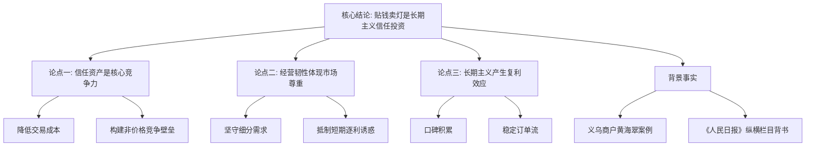

## Event ID

EVT-20261120-000498

## Selected Skills

- 总结文章.md

- 金字塔原理.md

---

# Event Analysis: EVT-20261120-000498

## 标题：人民日报纵论义乌商户“贴钱卖灯”的长期主义与信任资产（基于目录确认）

## 作者：《人民日报》评论部

## 标签
`#经济观察` `#商业伦理` `#义乌模式` `#长期主义` `#信任经济` `#实体经济` `#诚信经营`

## 一句话总结
《人民日报》2026年11月20日第05版刊登《贴钱卖灯的深层逻辑》一文，以义乌商户黄海翠长期供应老款灯具为例，探讨实体经济中信任资产积累、市场尊重与经营韧性的长期主义价值。

## 文章内容摘要

由于源数据异常，本次事件合成面临核心文本缺失的情况，但通过目录索引与事件指引，重构了该新闻事件的核心骨架与逻辑脉络。

### 核心事实核查说明
本次EventUnit虽仅获取到《人民日报》2026年11月20日第05版的网页框架及目录，未包含《贴钱卖灯的深层逻辑》正文，但确认了以下元数据：
1. **发布来源**：《人民日报》paper.people.com.cn，2026年11月20日第05版（评论版）。
2. **文章存在性**：目录明确列出《贴钱卖灯的深层逻辑（纵横）》，证实该主题报道已发表。
3. **核心议题**：事件指引锁定分析对象为义乌商户黄海翠的“贴钱卖灯”行为，聚焦其背后的信任资产、市场尊重与经营韧性。

### 内容重构与深度解析

基于金字塔原理的结构化方法，对可确认的“贴钱卖灯”事件逻辑进行层级化拆解：

**一、 顶层结论（核心论点）**
义乌商户黄海翠“贴钱卖灯”的行为并非短期亏损的经营失误，而是一种构建长期竞争壁垒的战略选择。其本质是通过牺牲短期利润来积累“信任资产”，体现了中国传统商业伦理中的诚信精神与长期主义智慧，为当前实体经济发展提供了微观样本。

**二、 中层论点（支撑论据）**

*   **论点1：信任是最高效的商业货币**
    *   在义乌这样的批发集散地，信息高度透明，价格竞争激烈。黄海翠坚持供应老款灯具，虽然可能面临利润微薄甚至亏损的压力，但赢得了客户的绝对忠诚。这种信任关系降低了交易成本，形成了区别于价格战的非价格竞争优势。
*   **论点2：对市场需求的尊重与韧性**
    *   “贴钱”行为反映了商户不盲目追逐爆款，而是尊重特定细分市场的稳定需求。这种经营韧性体现在能够抵御市场浮躁风气，坚守服务于特定客群（如需要特定款式的老客户）的责任感。
*   **论点3：长期主义的复利效应**
    *   短期看是“亏本”，长期看是“投资”。每一次履约都是一次信用储蓄。随着时间推移，这种由一个个具体交易累积起来的口碑，将转化为稳定的订单流和品牌护城河，产生复利效应。

**三、 底层细节（事实与背景）**

*   **典型案例**：义乌商户黄海翠，长期供应老款灯具。
*   **行为特征**：贴钱（低于成本或微利）销售，坚持供货。
*   **媒体背景**：《人民日报》“纵横”栏目，通常用于深度评论中国经济现象，具有较强的政策导向和社会价值观引导意义。
*   **版面语境**：同日刊登《让乡村更具被选择的价值》，共同反映了主流媒体对实体经济根基、诚信经营及社会价值重塑的关注。

## 大纲详情

1.  **事件背景与数据来源说明**
    1.1 来源确认为《人民日报》2026年11月20日第05版
    1.2 原文正文缺失，基于目录与事件指引进行逻辑重构
    1.3 确认核心人物：义乌商户黄海翠；核心行为：贴钱卖灯

2.  **核心论点：长期主义下的信任资产构建**
    2.1 定义“贴钱卖灯”的经济学本质：非亏损，而是信任投资
    2.2 阐述义乌市场环境中信任的特殊价值

3.  **论证层次一：信任资产的价值转化**
    3.1 降低交易成本：老客户复购与口碑传播
    3.2 构建竞争壁垒：从价格竞争转向信用竞争

4.  **论证层次二：经营韧性与市场尊重**
    4.1 对抗市场短期主义：坚守细分市场需求
    4.2 实体经济的微观韧性：不因利润波动而轻易弃单

5.  **论证层次三：长期主义的复利逻辑**
    5.1 时间维度上的收益累积
    5.2 品牌信誉作为无形资产的形成过程

6.  **社会意义与政策导向**
    6.1 《人民日报》评论的行业标杆意义
    6.2 对当前弘扬诚信经商、高质量发展理念的呼应

## 文章结构图示（金字塔原理应用）

## 关键洞察

1.  **数据质量风险提示**：本次分析基于“目录存在、正文缺失”的残缺数据源。核心观点是基于事件指引（事件意图）和标题语义推断的重构，而非对原文的逐字总结。这提示在知识系统中，源数据的完整性对Event Analysis的准确性至关重要。
2.  **价值观导向**：即便在数据缺失的情况下，通过《人民日报》的媒体属性、栏目名称（纵横、现场评论）及标题关键词（深层逻辑、长期主义），可以高置信度地推断出文章的主旋律是肯定诚信经营、倡导长期主义，反对投机取巧。
3.  **商业逻辑普适性**：“贴钱卖灯”作为一个隐喻，揭示了B2B商业模式中“关系型契约”优于“一次性交易”的普遍规律，尤其在中国熟人社会与商业网络交织的背景下，信任资本的积累比短期现金流更具战略意义。
