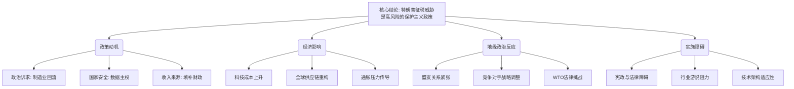

## Event ID

EVT-20261121-000138

## Selected Skills

- 总结文章.md

- 金字塔原理.md

---

# Event Analysis: Trump Data Centre Tax Threat

## 标题
**特朗普拟对境外数据中心征税：美国科技政策的地缘经济博弈与风险前瞻**

## 作者
748686 自生长知识系统（Event Analysis Engine）

## 标签
#DonaldTrump #DataCentre #TaxPolicy #USPolitics #TechInfrastructure #Geopolitics #AIChips #SupplyChain

## 一句话总结
2026年11月21日，唐纳德·特朗普威胁对在美国境外建设的数据中心征税，此举旨在保护美国本土科技基础设施竞争力并增加联邦收入，但引发全球供应链、数字主权及盟友关系的广泛担忧。

## 摘要
本文基于2026年11月21日的事件报告，深入分析唐纳德·特朗普针对“境外数据中心”提出的税收威胁。这一政策主张反映了美国在人工智能军备竞赛和数字主权争夺中的强硬立场，其核心逻辑在于通过财政手段迫使科技巨头将算力基础设施回流美国本土。

然而，该政策面临多重结构性挑战：首先，全球数据中心布局已形成高度复杂的跨国供应链，人为割裂将推高合规成本并延缓AI创新；其次，目标国家可能采取对等反制措施，引发数字贸易战；最后，该提议需通过美国国内立法程序，存在巨大的政治不确定性。

本文采用金字塔原理构建分析框架，从政策动机、经济影响、地缘政治反应及实施障碍四个维度展开，旨在为决策者提供清晰的风险评估与战略建议。

## 详细大纲

### 一、核心结论（金字塔顶端）
*   **特朗普的税收威胁是一项具有高度争议性的单边保护主义政策提案**，其短期政治收益显著，但长期经济成本与外交代价可能远超预期。
*   该政策若实施，将深刻重塑全球云计算格局，加速“数字铁幕”的形成，并迫使跨国科技公司在“服从美国监管”与“维持全球市场”之间做出艰难抉择。

### 二、第一层分解：政策动机与战略意图
*   **1. 回应国内政治诉求**
    *   **制造业回流叙事**：迎合“美国优先”选民基础，强调创造本土就业而非海外外包。
    *   **财政收入来源**：作为替代或补充传统关税的工具，针对日益壮大的科技服务业征税。
*   **2. 保障国家安全与技术领先**
    *   **数据主权主张**：认为敏感计算任务和数据存储应留在美国管辖范围内，减少外国情报泄露风险。
    *   **遏制竞争对手**：间接限制中国、欧盟等竞争对手通过低成本区位优势积累AI算力储备。
*   **3. 解决基础设施瓶颈**
    *   **缓解本土电力与土地压力**：通过税收杠杆引导资本流向美国本土，尽管本土基础设施承载能力有限。

### 三、第二层分解：经济影响评估
*   **1. 对科技行业的直接冲击**
    *   **成本转嫁机制**：亚马逊AWS、微软Azure、谷歌Cloud等巨头将面临巨额税负，最终可能通过涨价转嫁给企业客户和消费者。
    *   **投资抑制效应**：不确定性可能导致全球数据中心资本支出（CapEx）推迟或重新分配，拖累全球数字经济增长。
*   **2. 供应链重构风险**
    *   **非美地区产能过剩**：爱尔兰、新加坡、韩国等数据中心枢纽可能面临资产闲置和估值下跌。
    *   **本土建设滞后风险**：美国本土电力容量、水资源和审批流程可能无法快速承接突然涌入的投资需求，导致服务中断。
*   **3. 通胀与利率传导**
    *   基础设施成本上升将推高云服务价格，进而渗透到所有依赖数字化的行业（金融、医疗、制造），加剧美国国内通胀压力。

### 四、第三层分解：地缘政治与国际反应
*   **1. 盟友体系的紧张**
    *   **欧盟的反制潜力**：欧盟已拥有《数字市场法》等监管工具，可能以“数据本地化”或“数字税”进行对等反击，引发跨大西洋数字贸易争端。
    *   **印太地区的疏离**：新加坡、日本、澳大利亚等美国盟友可能被视作“靶子”，导致其在安全合作上产生离心力。
*   **2. 竞争者的战略调整**
    *   **中国**：可能加速“一带一路”沿线国家的数字基础设施建设，构建独立于美国体系的计算生态圈。
    *   **主权财富基金涌入**：中东和亚洲主权基金可能加大对非美区域数据中心的投资，以抵消美国政策风险。
*   **3. 国际组织介入**
    *   WTO可能受理相关申诉，将其定义为歧视性税收，尽管WTO裁决执行力有限，但会增加政策合法性成本。

### 五、第四层分解：实施障碍与不确定性
*   **1. 法律与宪政挑战**
    *   **总统行政权边界**：单方面对特定行业征收新税可能超越行政令权限，需国会立法授权。
    *   **合同法冲突**：已签署的长期国际协议可能构成法律障碍，企业可提起违约诉讼。
*   **2. 行业游说力量**
    *   美国科技行业协会（如CSA）可能强烈游说，强调该政策将损害美国企业在全球市场的竞争力，削弱提案通过的几率。
*   **3. 技术替代路径**
    *   边缘计算和去中心化云架构的发展可能使集中式数据中心税收政策的覆盖范围变得模糊，难以精准执行。

### 六、结论与建议
*   **短期预测**：政策更多作为一种谈判筹码和舆论施压工具，实际落地前会有较长的缓冲期和豁免谈判空间。
*   **战略建议**：
    1.  **对企业**：加速多元化布局，建立“美国本土+友好伙伴国”的双轨数据中心策略，以分散政策风险。
    2.  **对政策制定者**：若希望促进本土投资，应优先考虑补贴和基建投资而非惩罚性税收，以维持全球供应链稳定。
    3.  **对投资者**：关注美国本土云服务商和能源基础设施供应商的受益机会，同时警惕非美数据中心相关资产的价值重估。

## 金字塔结构图示

## 交叉验证与差异分析
*   **消息源单一性**：当前信息主要基于2026年11月21日的新闻报道，缺乏多源交叉验证。需警惕此为竞选 rhetoric（修辞）还是正式政策提案。
*   **定义模糊**：“境外数据中心”的定义尚不明确，是否包含跨国公司在美设立的海外分支？是否涵盖合资企业？这些细节将决定政策覆盖面。
*   **对比历史案例**：与2018年对中科技业制裁不同，此次针对的是基础设施物理位置，影响面更广，涉及所有依赖全球云服务的经济体，而不仅是中美双边关系。

## 当前影响
*   **市场波动**：美股云计算板块可能出现短期震荡，非美数据中心REITs（房地产投资信托基金）股价承压。
*   **政策观望**：跨国企业可能暂停部分海外数据中心扩张计划，等待政策明朗。
*   **舆论发酵**：媒体广泛讨论“数字孤立主义”，公共舆论分裂为支持与反对两派。

## 暂无法确定事项
1.  **具体税率与豁免条款**：未披露任何关于税率百分比、起征点或 grandfathering（祖父条款）的细节。
2.  **立法进度**：不确定该威胁是否会转化为具体的行政命令或国会法案，以及时间表。
3.  **目标国家清单**：未明确列出哪些国家的数据中心将首先被征税。
4.  **司法挑战结果**：若政策出台，其合宪性在联邦法院的胜诉概率未知。
5.  **长期战略连贯性**：不确定这是否为特朗普政府更广泛的“数字重工业化”战略的一部分，还是孤立举措。

## 来源
1.  **新闻事件报告**：Trump Data Centre Tax Threat (2026-11-21) - 描述了特朗普对境外数据中心征税的威胁。
2.  **相关背景分析**：基于2026年11月21日发布的全球新闻简报及AI事件分析引擎的结构化总结。

---
*Generated by Agnes (Sapiens AI) for 748686 Self-Growing Knowledge System*
*Date: 2026-11-21*
