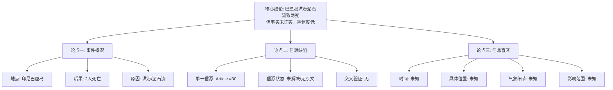

## Event ID

EVT-20261124-000025

## Selected Skills

- 总结文章.md
- 金字塔原理.md
- 四维价值模型.md

## Event Analysis

### 标题：印尼巴厘岛洪涝泥石流致两死事件分析

### 作者：748686 自生长知识系统 (Event Analysis Engine)

### 标签
灾害、气象、印度尼西亚、巴厘岛、死亡事件、低置信度

### 一句话总结
基于单一未验证来源的报道，印尼巴厘岛发生洪涝和泥石流灾害导致两人死亡，但由于原始信源缺失，该事件的事实细节（如具体日期、地点及伤亡准确性）目前无法证实。

### 文章内容摘要
本事件记录了一项关于自然灾害的报告，核心内容涉及印度尼西亚巴厘岛发生的致命性洪涝和泥石流事故。根据仅有的数据源（Article #30，来源标记为 "Memo: Firebell"），事件造成了两名人员死亡。然而，该事件处于极低的置信度状态，因为原始新闻链接无法获取，且缺乏来自其他独立媒体的交叉验证。报告中明确指出，除了“两死”这一核心断言外，具体的灾害日期、受影响的具体区域、气象成因（如雨量强度）以及基础设施损毁情况均为未知。这一案例主要作为数据链路中的待核实节点存在，警示在信息源未确证前对灾难性新闻的传播需谨慎。

### 详细大纲

**I. 事件核心概况（结论先行）**
*   **事件性质**：自然灾害（洪涝与泥石流）。
*   **发生地点**：印度尼西亚巴厘岛。
*   **主要后果**：报告称造成两人死亡。
*   **当前状态**：低置信度，事实未核实。

**II. 信息来源与可靠性分析（自上而下的逻辑支撑）**
*   **顶层结论**：证据基础薄弱，无法确认事实真实性。
*   **中层论点**：
    1.  **单一信源依赖**：所有信息仅来自 Article #30，无其他独立来源佐证。
    2.  **信源不可考**：
        *   原始 URL 未找到。
        *   来源标记为 "Unknown" 和 "Memo: Firebell"，出版方身份不明。
        *   内容为 Horizon 摘要，无原文可供审查。
    3.  **缺乏交叉验证**：输入数据中无其他地区的视角或国际媒体的报道进行比对。

**III. 已知与未知信息明细（分组归类：MECE原则）**
*   **A. 已报告的信息（Claims）**
    *   地点：Bali, Indonesia。
    *   伤亡：2人死亡。
    *   成因：Floods and landslides。
*   **B. 无法确定的细节（Unknowns）**
    1.  **时间维度**：具体发生日期未提供。
    2.  **空间维度**：巴厘岛内具体受影响区域未说明。
    3.  **气象细节**：降雨强度、持续时间等 meteorological conditions 缺失。
    4.  **次生影响**：基础设施损毁、人员流离失所或应急响应情况均无数据。
    5.  **伤亡准确性**：两人死亡的具体数字未经证实。

**IV. 多维价值评估**
*   **信息价值**：提供了特定时间窗口下巴厘岛可能发生的灾害线索，但“干货”密度极低，因缺乏可执行的细节（如救援指引、具体风险区域）。
*   **情绪价值**：涉及人员伤亡，可能引发读者对灾区的同情或焦虑，但因来源不明，这种情绪共鸣缺乏坚实的现实基础，甚至可能因信息不可靠而产生误导性的恐慌或冷漠。
*   **趣味价值**：无。叙事干瘪，缺乏生动的背景描述或独特的视角。
*   **独特价值**：无。作为单一未验证信源，不具备独有的个人经历或独特观点，仅为通用的灾害简报。

**V. 事件结论与建议**
*   **结论**：记录为“待核实声明”。虽然系统记录了“两死”的指控以保留追踪痕迹，但鉴于信源不可用且无交叉验证，不得将其作为既定事实传播。
*   **后续行动建议**：需等待原始文章retrieve成功或找到其他主流媒体（如ANTARA News, BBC, Reuters）的 corroborating sources 后方可更新置信度。

### 金字塔结构图解

