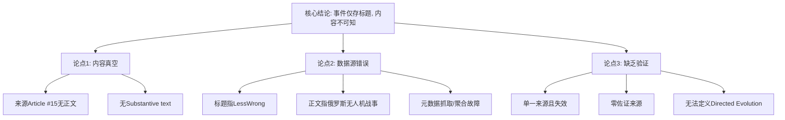

## Event ID

EVT-20261125-000014

## Selected Skills

- 总结文章.md
- 金字塔原理.md

---

## 文章摘要

**标题：** LessWrong致DirectedEvolution公开信 (LessWrong Issues Open Letter to Directed Evolution)

**作者：** 748686自生长知识系统（基于新闻源自动化生成）

**标签：** #AI治理 #理性主义社区 #公开信 #DirectedEvolution #LessWrong #信息缺失 #元数据错误

**一句话总结：**
2026年11月25日，理性主义社区平台LessWrong向Directed Evolution发出了一封公开信，但由于原始新闻源存在严重的元数据错配和内容缺失，目前无法获取该公开信的具体内容、背景及影响。

**文章内容摘要：**
本事件记录了一起发生于2026年11月25日的新闻事件，涉及在线理性主义社区LessWrong与实体Directed Evolution之间的公开通信。然而，现有的唯一新闻来源（Article #15，来自Google News）存在显著的数据质量问题。虽然事件标题明确指出了“LessWrong致DirectedEvolution公开信”，但新闻源的实际正文内容仅包含关于俄罗斯萨马拉州上空击落无人机事件的俄语元数据，完全缺乏关于LessWrong公开信的实质文本。经交叉验证，目前没有任何 corroborating sources（佐证来源）可以提供该公开信的具体论点、动机或后续影响。因此，该事件目前仅处于“标题级”知识状态，核心事实处于不可知状态。

**文章大纲：**

1.  **事件基本信息确认**
    *   事件ID：EVT-20261125-000014
    *   发生时间：2026年11月25日
    *   核心行动：LessWrong向Directed Evolution发布公开信
    *   事件性质：社区/组织间的公开声明或争议

2.  **信息来源状况分析**
    *   来源数量：单一来源（Article #15）
    *   来源平台：Google News
    *   内容状态：`partial`（部分/缺失）
    *   有效性评估：失效。正文内容与标题严重不符，属于元数据抓取错误或RSS聚合错位。

3.  **数据异常诊断**
    *   **标题-内容不匹配**：标题指向AI/理性主义社区争议，正文指向俄乌冲突相关的无人机军事新闻（俄语：`Над Самарской областью ночью сбито более 145 БПЛА...`）。
    *   **信息断层**：Horizon Summary明确指出未提供该条目的完整正文。
    *   **无关信息排除**：俄罗斯无人机新闻与LessWrong事件无逻辑关联，予以剔除。

4.  **未知领域界定（What Cannot Be Determined）**
    *   **信件内容**：缺乏具体论点、指控或要求。
    *   **事件起因**：不明，无法确定引发公开信的具体争议或incident。
    *   **主体定义**：Directed Evolution的具体身份（公司、研究组、个人还是概念）尚不明确。
    *   **后续影响**：无公开反应或政策变更的记录。
    *   **链接真实性**：无法从现有文本确定俄语新闻是否为错误的RSS链接映射，或是否为独立的不相关新闻混杂。

5.  **结论与状态**
    *   事件存在性：已确认（基于元数据标题）。
    *   知识深度：表层（Title-only）。
    *   分析可行性：当前阶段无法进行实质性分析，需等待更多高质量来源补充。

---

## 金字塔原理分析

根据金字塔原理，将上述事件信息按照**结论先行、自上而下、逻辑分组**的原则进行结构化重组：

### **顶层核心结论（Top-Level Conclusion）**

**核心观点：**
2026年11月25日LessWrong对Directed Evolution的公开信事件，因**源头数据严重缺失及元数据错配**，目前仅保留事件标题层面的元信息，无法对其内容、动机及影响进行实质性分析。

### **中层关键论点（Key Arguments）**

**论点一：事件核心事实已确认，但实质内容真空**
*   LessWrong与Directed Evolution之间存在公开信往来（事实确认）。
*   然而，支撑该事件的唯一新闻源（Article #15）未包含任何关于信件内容的文本（实质空白）。

**论点二：数据来源存在严重的“标题-内容”错配错误**
*   来源Article #15的正文内容是关于俄罗斯萨马拉州无人机袭击的军事新闻（俄语），与“理性主义社区争议”毫无关联。
*   这种错配表明数据抓取或聚合环节存在故障，导致有效信息被噪音覆盖。

**论点三：缺乏多源验证，无法构建因果链条**
*   由于单一来源失效且无其他佐证来源，无法验证Directed Evolution的定义及其与LessWrong冲突的根源。
*   无法判断该事件是否具有更广泛的社区影响或政策后果。

### **底层支持证据（Supporting Evidence）**

*   **证据1（时间/主体确认）：** 事件日志明确记录Date: 2026-11-25，Sender: LessWrong，Recipient: Directed Evolution。
*   **证据2（内容缺失证明）：** Horizon Summary明确指出 "did not provide a full body for this item"，且Article #15的状态标记为 `content_status: partial`。
*   **证据3（无关内容佐证）：** Article #15实际文本包含俄语关于无人机击落的报道（`Над Самарской областью ночью сбито более 145 БПЛА...`），证实了内容不匹配的存在。
*   **证据4（验证失败）：** Cross-Source Verification显示 "Verification Status: Failed"， corroborating sources数量为0。

### **逻辑结构图示**

