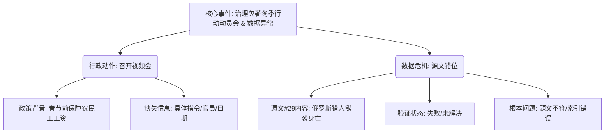

## Event ID

EVT-20261125-000027

## Selected Skills

- 总结文章.md

- 金字塔原理.md

## 事件分析：治理欠薪冬季行动

### 标题
中国召开“治理欠薪冬季行动”动员部署视频会及关联数据异常事件分析

### 作者
748686 自生长知识系统 Event Analysis Engine

### 标签
- 社会治理
- 劳动保障
- 数据完整性
- 跨境新闻
- 风险预警

### 一句话总结
中国政府召开动员部署视频会以推进冬季欠薪治理行动，但该系统事件记录存在严重的源文错位问题，唯一关联源文（Article #29）实为俄罗斯远东地区猎人死于熊袭击的无关新闻报道。

### 摘要

**一、 核心行政动作（基于事件元数据）**
根据事件识别模块生成的元数据，本次事件的核心触发点为“治理欠薪冬季行动动员部署视频会”的召开。此类会议通常标志着中国政府在农历新年前夕启动专项行政行动，旨在解决拖欠农民工工资等劳动纠纷，保障劳动者合法权益，维护社会 Stability。

**二、 数据完整性危机（基于源文分析）**
尽管事件标题指向国内劳动政策，但系统内关联的唯一原始源文（Article #29）存在根本性的内容错位。该源文关于俄罗斯西伯利亚鄂木斯克州塔尔区的猎人死于熊掌袭击的悲剧性事件，与“治理欠薪”毫无事实关联。这种“题文不符”的现象暴露了当前数据处理流程中的严重漏洞。

**三、 结构化影响评估**
1. **政策层面**：虽然具体的会议细节（时间、地点、参会官员、具体措施）因缺乏有效源文支持而无法从当前材料中提炼，但事件标题本身暗示了国家层面对欠薪问题的高度关注和常规化的行政响应机制。
2. **数据层面**：源文状态被标记为“未解决（unresolved）”，且缺乏可信的原始文本，导致无法进行有效的二次AI处理或技能分析。这构成了知识图谱中的“断点”。

### 详细大纲

**第一层级：核心结论**
*   事件主体为“治理欠薪冬季行动”的行政动员，但伴随严重的源文匹配错误，导致事实核查失败。

**第二层级：分论点与证据**

**1. 行政动员与政策背景**
*   **1.1 事件触发**：召开动员部署视频会。
*   **1.2 政策惯例**：此类“冬季行动”通常针对春节前后的欠薪高发期，体现政府对劳动保障的周期性重视。
*   **1.3 缺失细节**：具体政策指令、目标行业、法律机制在现有材料中不可考。

**2. 数据源严重错位（关键冲突）**
*   **2.1 源文内容**：Article #29 报道俄罗斯鄂木斯克州塔尔区一猎人死于熊袭。
*   **2.2 主题不匹配**：中国劳动政策 vs. 俄罗斯野生动物事故，零事实重叠。
*   **2.3 潜在原因**：可能是索引错误、URL映射失败或爬虫抓取错乱。

**3. 信息验证状态**
*   **3.1 验证结果**：失败（Verification Status: Failed）。
*   **3.2 源文质量**：状态为 `unresolved`，仅有标题/摘要，无全文，无法交叉验证。
*   **3.3 地理视角**：仅俄罗斯区域有具体事件数据（熊袭），中国区域仅有元数据标题，无实质数据。

**第三层级：待决事项与建议**

*   **无法确定的事项**
    *   视频会的具体日期、地点及出席官员。
    *   “治理欠薪冬季行动”的具体范围、力度及预期效果。
    *   源文 #29 与事件 ID 错误的根本原因（是索引Bug还是数据污染）。

*   **结论**
    *   该 EventUnit 目前处于“不完整且断裂”状态。保留的事件标题具有政策意义，但缺乏证据支持。建议立即标记此事件为“数据异常”，并重新检索关于“治理欠薪冬季行动动员部署视频会”的正确源文，以完成闭环分析。

### 金字塔结构可视化

