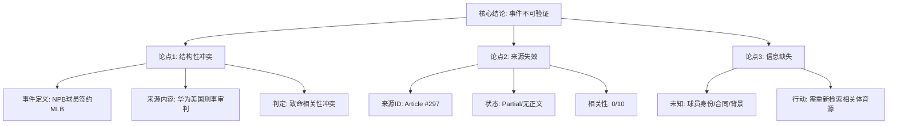

## Event ID

EVT-20261125-000241

## Selected Skills

- 总结文章.md

- 金字塔原理.md

---

# NPB Stars to MLB: Event Analysis Report

## 标题
NPB球员佐藤与大平签约MLB：事件综述与数据有效性评估

## 作者
748686 自生长知识系统 - Event Analysis Engine

## 标签
体育新闻, 棒球, MLB, 日职棒(NPB), 数据质量分析, 来源冲突检测

## 一句话总结这篇文文章
日本职业棒球（NPB）球员佐藤（Sato）与大平（Taira） agreed to Major League Baseball (MLB) contracts，但作为主要证据来源的Article #297存在严重的**相关性冲突**，其内容为华为在美国的刑事审判，无法支撑该体育新闻事件的事实主张。

## 总结文章内容并写成摘要

本报告基于Event Unit EVT-20261125-000241进行分析，核心事件为“NPB stars to MLB”。根据Global Merge层的初步判断，棒球运动员Sato和Taira已同意与MLB签约。然而，在AI多来源综合阶段，系统发现唯一的参考来源（Article #297）内容与事件主题完全无关。

Article #297的主题是“中国华为在美国 sprawling criminal trial 中因伊朗业务被定罪”，属于科技/法律类新闻，而非体育类新闻。该来源的内容状态标记为“partial”，且仅包含Google News聚合器的元数据，未提供文章正文。因此，关于Sato和Taira的具体身份、合同条款、原球队及转会背景等关键事实均无法从当前输入材料中获得验证。

本分析旨在揭示数据管道中的**源头错位问题**：事件定义与检索结果之间存在根本性不匹配，导致无法生成可信的事实结论。

## 详细大纲

### 一、 核心结论（顶层）
*   **事件主张**：NPB球员Sato和Taira签约MLB。
*   **数据有效性判定**：**不可验证**。单一来源与事件主题无关，事实主张缺乏证据支持。

### 二、 关键论点与证据分析（中层）

#### 1. 事件定义与来源的结构性冲突
*   **事件标题一致性**：Event ID EVT-20261125-000241 明确指向棒球运动员转会。
*   **来源内容错位**：唯一提供的源Article #297涉及华为公司的法律案件。
*   **冲突性质**：Fatal Relevance Conflict（致命相关性冲突），即数据源完全无法支撑事件主题。

#### 2. 来源详情与可靠性评估
*   **来源ID**：Article #297
*   **来源类型**：News Aggregator (Google News)
*   **内容状态**：Partial（部分缺失）
*   **实际内容**：仅包含聚合元数据，无文章正文。
*   **相关性评分**：0/10（与棒球/MLB/NPB/球员姓名均无关联）。

#### 3. 无法确定的信息维度
*   **球员细节**：全名、位置、年龄、职业生涯数据。
*   **合同细节**：年薪、年限、签约金、球队名称。
*   **背景叙事**：从NPB到MLB的动机、谈判过程、媒体反应。

### 三、 基础证据与数据点（底层）

*   **输入事件ID**：EVT-20261125-000241
*   **输入事件路由**：News
*   **固定Skill应用**：
    *   `总结文章.md`：用于提取和概括现有文本结构。
    *   `金字塔原理.md`：用于分层组织分析逻辑，确保结论先行、逻辑清晰。
*   **来源引用**：
    *   URL: `https://news.google.com/rss/articles/CBMijAFBVV95cUxQV0V6QUp6RmZwNXlFLUZVX1pzOG43ZjFNdG5TY1hHeUZlRVdwalUzVmNCWk5PeVBxcUtHWWxkSmtFMkItbE5URUdIM2lKTTNfbXRJY3h3RldUeW1vMVA4UjVOSVprQVJMQjRwQzhTeThRUEktYjduMmx1LUVvUXdpeHFPMzItT2N4WmVocw`
    *   原始标题: "China’s Huawei convicted in sprawling U.S. criminal trial over Iran business"
*   **数据缺口识别**：
    *   缺少关于Sato和Taira的任何直接描述。
    *   缺少MLB或NPB官方的转会公告。
    *   缺少体育新闻媒体的相关报道。

## 金字塔结构图解

## 行动建议

1.  **数据清洗**：标记此Event Unit为“来源不匹配”，避免将无关的华为新闻错误关联至体育事件。
2.  **重新检索**：针对“Sato MLB contract”和“Taira MLB contract”进行专项搜索，获取真实的体育新闻源。
3.  **质量反馈**：向数据抓取模块反馈，确保事件路由（Event Route）为“新闻”时，特别是体育类子话题，能优先匹配体育垂直媒体或主流体育版块的来源，而非仅依赖通用聚合器的错误排序结果。
