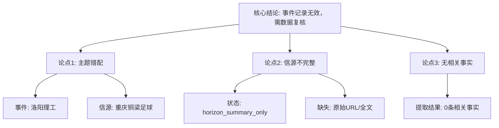

## Event ID

EVT-20261126-000098

## Selected Skills

- 总结文章.md
- 金字塔原理.md
- 四维价值模型.md

## Event Analysis

### 1. 内容总结 (Summary)

**标题**：洛阳理工学院建设 (Construction and Development of Luoyang Institute of Technology)
**作者**：未知 (来源数据缺失/错配)
**标签**：#高等教育 #洛阳理工学院 #数据完整性 #异常检测 #来源错配 #重庆铜梁 #足球战略

**一句话总结**：
由于唯一提供的新闻源 (Article #105) 主题（重庆铜梁“西部足球城”建设）与事件标题（洛阳理工学院建设）完全无关，且源数据仅为摘要缺乏正文，无法对洛阳理工学院的发展举措进行实质性分析，该事件记录存在严重的数据错配，需标记为数据完整性异常。

**摘要**：
本次事件分析旨在梳理“洛阳理工学院建设”的相关举措，但基于提供的 EventUnit 数据，发现唯一的信源 Article #105 实际上报道的是“重庆铜梁聚力打造‘西部足球城’”的相关新闻。由于信源内容与事件主题零重叠，且该信源本身缺乏原始链接及完整正文（仅为 Horizon digest 摘要），导致无法提取任何关于洛阳理工学院的实质性事实。根据数据完整性原则，本次分析判定该事件处于“Insufficient Data（数据不足）”状态，核心结论是信源错配，建议立即触发数据审核流程。

**文章大纲**：
1.  **事件背景与初始判断**
    *   事件标识：EVT-20261126-000098。
    *   初始意图：报道洛阳理工学院建设高水平应用型大学的举措。
2.  **信源核对与异常发现**
    *   信源识别：Article #105。
    *   信源内容：重庆铜梁足球发展战略（“守住山城足球火种，铺就以球兴城之路”）。
    *   异常判定：信源主题与事件标题（洛阳理工学院）完全脱节，出现地域（重庆 vs 洛阳）与领域（体育/城市复兴 vs 高等教育）的双重错配。
3.  **数据完整性评估**
    *   状态标记：Source Status 为 `unresolved`，Content Status 为 `horizon_summary_only`。
    *   限制因素：缺乏原始 URL，缺乏全文支撑，仅有摘要信息。
4.  **结论与建议**
    *   无法生成关于洛阳理工学院的有效事实陈述。
    *   建议：标记为数据完整性审查对象，重新获取正确信源。

### 2. 金字塔结构分析 (Pyramid Principle)

**结论先行 (Conclusion First)**：
**当前事件记录无效，原因为信源与主题严重错配（Source-Topic Mismatch）且数据不完整。** 在缺乏匹配信源的情况下，不能基于现有数据推断洛阳理工学院的建设现状。

**支撑论点 (Key Supporting Points)**：

1.  **论点一：数据源主题不一致 (Topical Inconsistency)**
    *   *逻辑关系：归纳 (Inductive)*
    *   **证据/事实**：
        *   事件定义指向“洛阳理工学院”。
        *   实际信源 (Article #105) 指向“重庆铜梁”及“足球城市发展”。
        *   **推论**：两者在地理区域（洛阳 vs 重庆）和核心议题（高校建设 vs 城市体育战略）上均无交集，逻辑链条断裂。

2.  **论点二：信源可信度与完整性不足 (Source Limitations)**
    *   *逻辑关系：演绎 (Deductive - If source is incomplete/mismatched, then analysis is invalid)*
    *   **证据/事实**：
        *   信源状态标记为 `unresolved` 和 `horizon_summary_only`。
        *   原始 URL 缺失，仅有摘要。
        *   **推论**：即使存在部分相关性，摘要信息也不足以支撑对“建设举措”的详细事实提取。

3.  **论点三：缺乏可提取的核心事实 (Absence of Core Facts)**
    *   *逻辑关系：归纳 (Inductive)*
    *   **证据/事实**：
        *   关于洛阳理工学院的具体措施、政策、时间表、关键人物等信息在提供的文本中数量为 0。
        *   文本中仅存在与事件无关的铜梁足球事实。
        *   **推论**：无法构建基于事实的金字塔底层证据层，导致顶层结论无法成立。

**层级结构图示 (Logical Hierarchy)**：

### 3. 四维价值评估 (Four-Dimensional Value Model)

基于本次“异常数据”的特性，对该内容/事件记录的价值进行四维评估：

*   **信息价值 (Information Value): 极低 (Low)**
    *   *分析*：对于希望获取“洛阳理工学院建设”信息的目标受众而言，本内容未提供新数据、新视角或有效事实。相反，它提供的是一个“数据异常”的信号。
    *   *用户感受*：“无效信息”、“数据错误”、“未获得预期干货”。

*   **情绪价值 (Emotional Value): 负面/警示 (Negative/Cautionary)**
    *   *分析*：主要引发的是数据治理层面的焦虑或严肃感，而非内容本身的情感共鸣。对于知识系统维护者，具有“警示”作用（提醒数据清洗的重要性）。
    *   *用户感受*：“数据出了问题”、“需要注意信源质量”、“困惑”。

*   **趣味价值 (Entertainment Value): 低 (Low)**
    *   *分析*：由于内容是技术性的数据异常报告，缺乏叙事张力、生动比喻或幽默元素，不具备娱乐消遣属性。
    *   *用户感受*：“枯燥”、“无趣”、“纯技术记录”。

*   **独特价值 (Unique Value): 中 (Medium) - 仅限数据治理场景**
    *   *分析*：在通用的新闻消费场景中，无独特价值。但在“748686 自生长知识系统”的底层逻辑中，该事件作为一个典型的“Source Mismatch（信源错配）”案例，具有独特的**数据完整性检测**参考价值。它展示了系统在数据清洗环节如何识别并隔离错误关联。
    *   *用户感受*（针对系统工程师）：“这是一个典型的坏数据样本”、“有助于优化路由匹配算法”。

**综合判断**：
该事件记录在**内容层面**价值极低，但在**系统运维层面**具有作为“负面案例”的独特价值。最终分析应严格遵循“不编造事实”原则，输出“无法确定”的结果。
