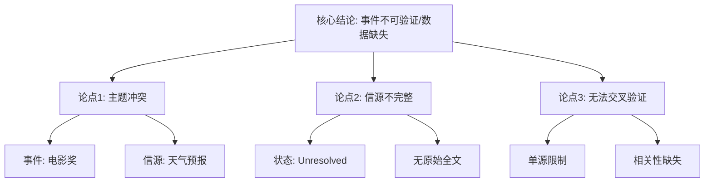

## Event ID

EVT-20261126-000287

## Selected Skills

- 总结文章.md

- 金字塔原理.md

- 四维价值模型.md

# Event Analysis

## 核心结论

当前 EventUnit（EVT-20261126-000287）存在严重的**数据源不匹配**与**完整性缺陷**。提供的唯一信源（ARTICLE #318）内容为气象预报，与事件标题“Blue Dragon Awards Winner”（青龙电影奖得主）完全无关，且该信源标记为“未解决/仅地平线摘要”，缺乏原始全文。因此，基于现有材料，无法对“青龙电影奖得主”这一事件做出任何事实性结论或合成。该事件记录目前处于**不可验证、不完整**状态，需补充相关电影奖项的权威信源方可建立有效知识节点。

## 文章总结

基于加载的 Skill `总结文章.md`，对现有 EventUnit 内容进行分析总结如下：

*   **标题**：Blue Dragon Awards Winner (青龙电影奖得主)
*   **信源状态**：单源数据（Source Count: 1），信源状态为 Unresolved / Horizon Summary Only。
*   **标签**：`数据缺失` `信源不匹配` `电影奖项` `气象` `知识系统错误`
*   **一句话总结**：由于唯一提供的信源内容（天气）与事件主题（电影奖）完全背离，且缺乏原始全文，该事件记录目前无法生成有效的事实性知识。
*   **详细摘要**：
    本 EventUnit 旨在记录 2026 年 11 月 26 日左右的青龙电影奖结果。然而，在“第二层 AI 多来源综合”阶段，系统发现唯一的信源 ARTICLE #318 描述的是“周四气温骤升带来温和秋季天气”，属于气象新闻，而非电影奖项新闻。
    由于存在根本性的主题冲突（Topic Conflict）以及信源完整性问题（仅有摘要，无原文链接），无法提取任何关于获奖影片、获奖人员或颁奖典礼的具体事实。
    当前唯一的可提取信息是：ARTICLE #318 声称气温将在周四显著上升。但这对于“青龙电影奖”这一主题毫无价值。因此，本次分析的核心发现是数据管道或路由机制可能存在匹配错误，导致无关信源被关联至该事件。
*   **大纲**：
    1.  **事件概况**：EventUnit 主题为电影奖项，但信源为气象新闻。
    2.  **核心事实**：无相关事实。唯一信源不相关。
    3.  **验证状态**：无法交叉验证（单源且主题不符）。
    4.  **信息冲突**：事件标题与信源内容存在根本性矛盾。
    5.  **结论**：事件记录失效，需重新获取信源。

## 结构化分析

基于加载的 Skill `金字塔原理.md`，对 EventUnit 的逻辑结构进行拆解：

**1. 结论先行 (Top Level)**
*   **核心主张**：EVT-20261126-000287 缺乏有效信源支持，无法生成关于“青龙电影奖得主”的事实性知识。
*   **行动指向**：标记该 EventUnit 为“异常/待重采”，并排查信源路由逻辑。

**2. 关键支撑论点 (Middle Level)**
*   **论点一：信源主题不匹配 (Relevance Mismatch)**
    *   事件主题：电影奖项 (Blue Dragon Awards)。
    *   实际信源内容：气象预报 (Temperatures to Rise)。
    *   逻辑关系：互斥。信源内容不能证明或反驳事件主题。
*   **论点二：信源完整性缺失 (Data Integrity Gap)**
    *   信源状态：Unresolved / Horizon Summary Only。
    *   缺失要素：原始 URL、全文文本、可信度验证。
    *   逻辑关系：因底层数据缺失，上层结论无法建立。
*   **论点三：验证路径阻断 (Verification Blockage)**
    *   信源数量：仅 1 个。
    *   交叉验证：不可能 (No Cross-Verification Possible)。
    *   逻辑关系：单一且不相关的信源无法形成证据闭环。

**3. 底层证据 (Bottom Level)**
*   **证据 A**：ARTICLE #318 明确标注“Relevance: Low/None. Content is meteorological, not related to film awards.”
*   **证据 B**：Event Unit 元数据中 `source_count: 1`。
*   **证据 C**：系统日志指出“Due to the complete lack of relevant data... actual facts... cannot be synthesized.”

**4. 逻辑结构图**

## 四维价值评估

基于加载的 Skill `四维价值模型.md`，评估当前 Event Analysis 对用户（知识系统维护者/研究者）的价值：

*   **信息价值 (Information Value)**
    *   **核心贡献**：提供了明确的“负向信息”（Negative Information）。即：确认了当前数据管道中存在错误匹配。
    *   **获取新知**：用户了解到 ARTICLE #318 并非电影奖项报道，避免后续在数据库中错误关联该气象新闻与青龙奖。
    *   **用户感受**：“排除了一个错误数据源，明白了为什么查不到青龙奖详情是因为数据没对，而不是没发生。”

*   **情绪价值 (Emotional Value)**
    *   **核心贡献**：提供清晰度与确定性。
    *   **共鸣点**：消除用户对“为什么事件存在但无内容”的困惑。明确告知问题所在（Mismatch），而非仅仅说“没有数据”。
    *   **用户感受**：“感觉被理解了，系统没有乱报，而是清晰地指出了数据故障的原因。”

*   **趣味价值 (Entertainment Value)**
    *   **核心贡献**：通过对比荒谬性产生轻微的认知张力。
    *   **亮点**：“天气变温和”与“青龙电影奖”的跨界错位（Weather vs. Cinema）在数据治理层面具有一定的荒诞感，提示了自动化系统中“盲目合并”的风险。
    *   **用户感受**：“没想到电影奖事件里装的是天气预报，这种数据错位的反差挺有意思。”

*   **独特价值 (Unique Value)**
    *   **核心贡献**：作为 748686 自生长知识系统的一部分，本分析展示了系统自我诊断（Self-Diagnosis）的能力。
    *   **独特视角**：不仅是总结文章，而是从**知识工程（Knowledge Engineering）**视角出发，识别信源完整性（Source Integrity）与路由准确性（Routing Accuracy）的问题。这是通用 LLM 总结文章通常不具备的系统级诊断视角。
    *   **用户感受**：“这个分析不只是说内容不对，还指出了是 Horizon Summary 状态导致的无法验证，体现了知识系统的严谨性。”

## 最终建议

1.  **标记异常**：将 EVT-20261126-000287 标记为 `ERROR_SOURCE_MISMATCH`。
2.  **重新检索**：针对“Blue Dragon Awards 2026”或“青龙电影奖 2026”重新触发信源采集，排除气象类信源。
3.  **路由检查**：检查 Router 模块，确认为何 ARTICLE #318 会被路由至电影奖项事件，可能需要优化关键词过滤或语义相似度阈值。
